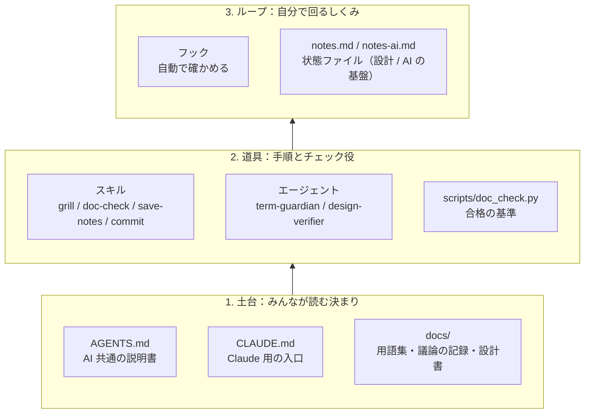
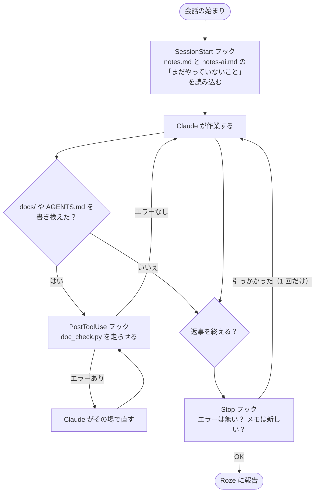

# AI と回すループの説明書（Roze 向け）

Foxonar で Claude Code などの AI と一緒に作業するための、しくみの説明です。
AI 向けの決まりは [AGENTS.md](../AGENTS.md) に書いてあります。

## ループエンジニアリングとは

- 毎回 AI に「確かめて」「メモして」と指示を打つ代わりに、**AI が自分で確かめ、直し、記録するしくみ**を作ること
- 2026 年 6 月ごろから広まった言葉。プロンプト（指示文）→ コンテキスト（渡す情報）→ ハーネス（道具立て）の次の段階
- 大事なのは「合格の基準を機械で判定できること」。判定できないことは、人（Roze）が決める

## 全体の形（3 段）



## 1 回の会話の中で、どう回るか



- **内側のループ**（書く → 確かめる → 直す）は、フックが自動で回す
- **Stop フック**は「終わる前の最後の確認」。同じ理由では 1 回しか止めないので、止まり続けることはない
- 用語集の中身に関わるものは、AI は直さずに Roze に報告する（決めるのは Roze）

## 部品の一覧

| 部品 | 場所 | 役割 |
|---|---|---|
| AGENTS.md | [../AGENTS.md](../AGENTS.md) | AI 共通の説明書。Copilot や Codex も読める |
| CLAUDE.md | [../CLAUDE.md](../CLAUDE.md) | `@AGENTS.md` で本体を読み込み、Claude だけのしくみを足す |
| 突き合わせスクリプト | [../scripts/doc_check.py](../scripts/doc_check.py) | 機械で分かるずれを見つける。**合格の基準** |
| スキル grill | [skills/grill/SKILL.md](skills/grill/SKILL.md) | 設計を詰める手順。宿題一覧を前提の「木」にし、今聞ける問いだけを具体例とおすすめつきで聞く。もとは mattpocock/skills の grilling |
| スキル doc-check | [skills/doc-check/SKILL.md](skills/doc-check/SKILL.md) | スクリプト＋エージェント 2 人で文書を突き合わせる手順。ふだんは前回からの差分だけを調べる。報告は `.claude/state/doc-check/` に残る |
| スキル save-notes | [skills/save-notes/SKILL.md](skills/save-notes/SKILL.md) | 作業メモの書き方 |
| スキル commit | [skills/commit/SKILL.md](skills/commit/SKILL.md) | Roze の形式でコミットする手順。形式は `check_msg.py` で確かめる |
| エージェント term-guardian | [agents/term-guardian.md](agents/term-guardian.md) | 用語の番人（読むだけ） |
| エージェント design-verifier | [agents/design-verifier.md](agents/design-verifier.md) | 設計の検証役（読むだけ）。書いた本人とは別の目 |
| フック | [settings.json](settings.json)、[hooks/](hooks/) | 上の図のとおり自動で動く |
| 作業メモ | [notes.md](notes.md) | 状態ファイル。会話が要約されても続きができる。設計の話だけ |
| 作業メモ（AI の基盤） | [notes-ai.md](notes-ai.md) | このしくみ自体の話 |

## 使い方

Claude Code の入力欄で、スラッシュに続けてスキルの名前を打つと呼べます。普通の言葉で頼んでも、Claude が合うスキルを選びます。

| 打つもの | 普通の言葉の例 | 何が起きるか |
|---|---|---|
| `/grill` | 「設計を詰めたい」「次を決めよう」 | 決めることの木を作り、聞ける問いから 4 問ずつ聞く → 決まったら設計書などへすぐ書く → 具体例で試す |
| `/doc-check` | 「矛盾はない？」 | スクリプト → エージェント 2 人 → 報告を保存 → 裏取り → 報告（判断が要るものは、具体例つきで 4 問ずつ聞く） |
| `/save-notes` | 「ここまでをメモして」 | notes.md に書き足し、「まだやっていないこと」を直す |
| `/commit` | 「コミットして」 | メッセージを作り、形式を確かめ、Roze の OK のあとでコミット |

ターミナルで直接確かめることもできます。

```bash
python scripts/doc_check.py --todo
```

## 外側のループ（これから足せるもの）

今あるのは「1 回の会話の中のループ」。次の段階は、会話をまたいで AI が自分で次の仕事を始めるループです。

| しくみ | 使い方の例 | 向いていること |
|---|---|---|
| `/goal` | `/goal doc_check.py がエラー 0 で終わる` | 条件を満たすまで、Claude が自分で続ける |
| `/loop` | `/loop 30m /doc-check` | 決まった間隔で同じことを繰り返す（PC を閉じると止まる） |
| `/schedule` | 「毎朝 9 時に突き合わせて」 | クラウドで定期的に動かす |

- **注意：トークン代**。回すたびに文書を読み直すので、使った量が増える。最初は短い回数で試す
- **合格の基準が機械で判定できない仕事**（論点を決める、など）は、ループに向かない。Roze が決める

## 新しい部品の足し方

- **スキル**：`.claude/skills/<名前>/SKILL.md` を作る。先頭の `description` に「いつ使うか」を具体的に書くと、Claude が自分で選ぶ
- **エージェント**：`.claude/agents/<名前>.md` を作る。`tools:` で使える道具を絞る（読むだけなら `Read, Grep, Glob`）
- **フック**：`.claude/hooks/` に Python のスクリプトを置き、`settings.json` に登録する。終了コード 2 で、標準エラーの文が Claude に届く
- **実装が始まったら**：Stop フックに `cargo fmt --check`・`cargo clippy`・`cargo test` を足すと、「テストが通るまで終われない」ループになる

## 注意

- フックは Python で書いている。Linux で `python` が無い（`python3` しか無い）ときは、`settings.json` の `python` を `python3` に変える
- フックを一時的に止めたいときは、`.claude/settings.local.json` に `{"disableAllHooks": true}` と書く（このファイルは git に入らない）
- フックの覚え書き（同じ注意を繰り返さないため）と、doc-check のエージェントの報告は `.claude/state/` にある。git には入らない
- `.claude/README.md`（このファイル）は、書き換えても PostToolUse フックの対象ではない（リンク切れは `doc_check.py` で分かる）
