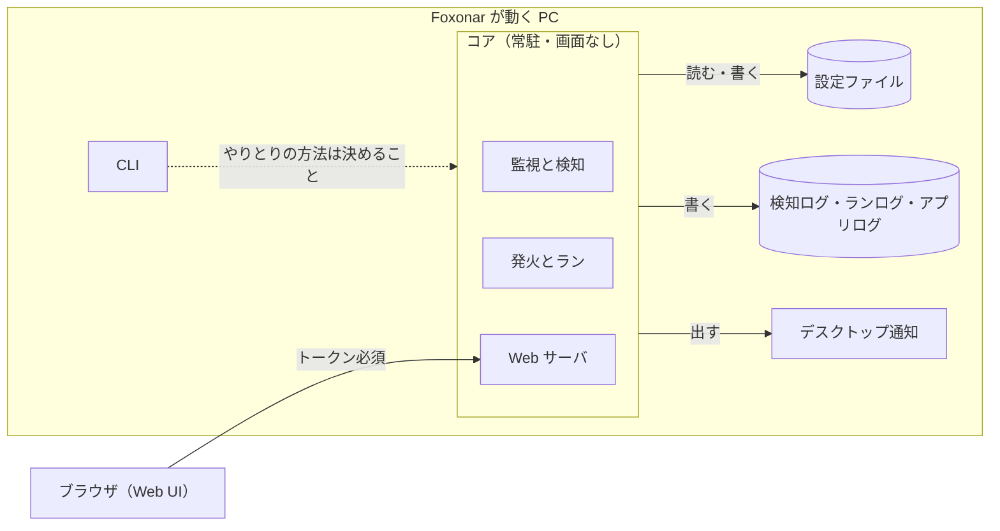
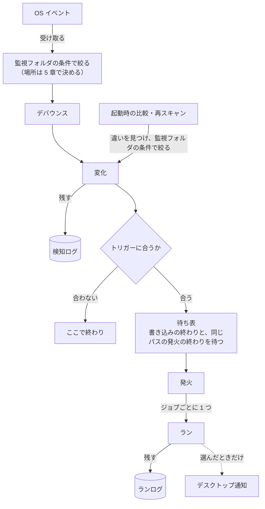
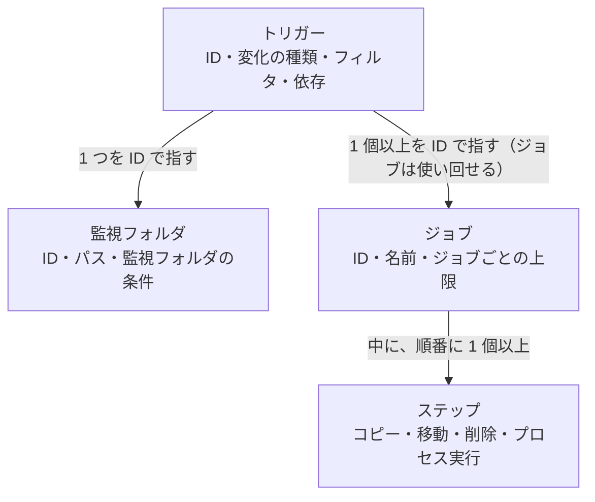
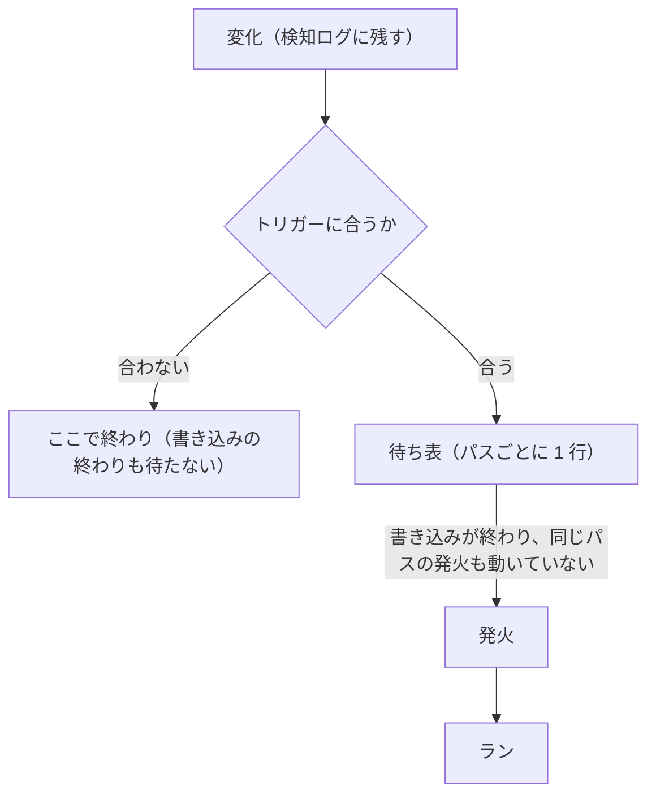

# 設計書

Foxonar の設計書です。決まった方針と、まだ決まっていない「どうやるか」をまとめています。

- 言葉は [用語集](glossary.ja.md) の意味で使う。用語集にまだ載っていない言葉（コア、Web UI、検知ログなど）は、[議論の記録](decisions.ja.md) の論点 O〜U で決めた意味で使う。
- 「論点 J」などは、議論の記録の見出しを指す。
- 章は外側から内側への順に並べる：目的と範囲 → 全体の構成 → Web UI → 設定ファイル → 監視と検知 → ランの実行 → ログ → デスクトップ通知。
- 各章は「決まったこと」と「決めること」に分ける。「決めること」に書いた案は、まだ決定ではない。
- 日本語のみ。英訳は、設計の方針が固まってから作る。

## 1. 目的と範囲

### 決まったこと

- Foxonar は、監視フォルダを見張り、変化を検知して、トリガーに合ったらジョブを走らせる常駐アプリ。利用者が設定したとおりに動く。
- ジョブが無くても、監視フォルダにどんなファイルが来たかを、検知ログで確かめられる（論点 Q、T）。
- 対応する OS は Windows と Linux。Linux は、画面のないサーバーも含む（論点 O）。
- 使い方は 2 つの形がある（論点 P）。

| 形 | 起動のしかた | Web UI の開き方 | デスクトップ通知 |
|---|---|---|---|
| デスクトップで使う | ログイン時に起動 | 同じ PC のブラウザ | 出せる |
| サーバーとして動かす | サービス | SSH のトンネルを使い、手元のブラウザ | 出せない |

### やらないこと

- シェルを通したコマンドの実行（論点 F）。外部のプログラムは、プロセス実行で動かす。
- ほかの PC やスマホからの接続は、最初は作らない。あとで足す（論点 O）。

### 決めること

| 項目 | 決めること |
|---|---|
| 対応する OS | Windows と Linux の、どの版から対応するか。macOS を対象にするか |

## 2. 全体の構成

### 2.1 部品

| 部品 | 役割 | 論点 |
|---|---|---|
| コア | 監視フォルダを見張り、変化を検知して、発火とランを行う常駐のプログラム。画面を持たない。Web UI を閉じていても動き続ける | O |
| Web UI | コアの中の Web サーバが出す画面。ブラウザで開き、設定とログを見たり変えたりする | O |
| CLI | ターミナルから操作するコマンド | O |
| 設定ファイル | 監視フォルダ、トリガー、ジョブなどを書いたファイル。Web UI から書くのが基本で、人が直接編集してもよい | S |
| 検知ログ | 検知した変化 1 件ごとの記録 | Q |
| ランログ | ラン 1 回分ごとの記録 | Q |
| アプリログ | Foxonar 自身の動き（起動、停止、設定の読み込み、エラーなど）の記録 | Q |
| デスクトップ通知 | OS の通知（Windows のトースト通知など）。用語集の「通知」とは別物。何を知らせるかは利用者が選ぶ | R |

- 英語名：core、web ui、cli、detection log、run log、app log、desktop notification。
- `core` は Rust に最初からある `core` と名前がぶつかるので、コードではクレート名を `foxonar-core` にするなどして避ける（論点 O）。

### 2.2 動きの流れ

- ログやデスクトップ通知には、直接書き込むのではなく、用語集の「通知」として流し、それぞれが購読する。
- トリガーに合わなかった変化も、検知ログには残る。
- トリガーに合った変化は、待ち表で、書き込みの終わりと、同じパスの発火の終わりを待ってから発火する（5 章、論点 V）。
- 「監視フォルダの条件で絞る」場所（デバウンスの前か後か）は、5 章で決める。
- 変化は、OS イベントから生まれるものと、起動時の比較や再スキャンで見つけた違いから生まれるものがある（5 章、論点 V）。後者にも、監視フォルダの条件を当てはめる。
  - 注意：今の用語集の「変化」の定義は「OS イベントをデバウンスでまとめた結果」だけなので、後者が当てはまらない。用語集を直す必要がある。

### 2.3 起動のしかた（論点 P）

#### 決まったこと

- ログイン時にユーザーとして起動する形（デスクトップ向け）と、OS のサービスとして起動する形（サーバー向け）を選べる。
- サービスでも、動かすユーザーを決められる。
- サービスの注意：
  - Windows のサービスは「セッション 0」で動くので、画面もデスクトップ通知も出せない。
  - Windows のサービスは、既定では強い権限（LocalSystem）で動く。プロセス実行のステップも、その権限で走る。
  - ドライブ文字（`Z:` など）はログインごとの割り当てなので、サービスからは見えない。共有フォルダは UNC パス（`\\server\share`）で書く。
- 同じ設定ファイルを使うコアは、1 つだけ動ける。違う設定ファイルなら、複数のコアが同時に動いてよい。
  - 複数のコアを動かす例：別々のユーザーの権限で動かす。片方が止まっても、もう片方は動かしておく。
  - 1 つのコアの中でもワーカーは並行に動くので、負荷分散のためだけなら、コアは 1 つで足りる。
  - この「二重起動の防止」は、用語集の「ロック」（このパスは発火中、という印）とは別のもの。紛れないように「ロック」とは呼ばない。

#### 決めること

| 項目 | 決めること |
|---|---|
| ログイン時の起動の登録 | どう登録するか（Windows のスタートアップかタスク スケジューラか、Linux の `systemctl --user` か）。CLI で登録できるようにするか |
| サービスの登録 | どう登録するか（Windows のサービス、systemd）。CLI で登録できるようにするか |
| 二重起動の防止 | しくみ（案：設定ファイルの隣に印用のファイルを置き、OS のファイルロックで 2 つ目のコアを止める）。2 つ目が起動しようとしたときの扱い（案：アプリログに残して終わる） |
| コアどうしの重なり | 違う設定ファイルで同じ監視フォルダを見張ると、同じパスについて、両方のコアのランが走る。気づく方法があるか |
| 止め方 | コアを止めるとき、走っているランをどうするか（終わるまで待つか、止めるか） |
| CLI とコアのやりとり | CLI がコアにどうつながるか（Web UI と同じ API を使う、など） |

## 3. Web UI（論点 O）

### 決まったこと

- コアの中の Web サーバが出す。
- 既定では、その PC からの接続（`127.0.0.1`）だけを受け付ける。
- 合言葉（トークン）は、同じ PC からの接続でも SSH のトンネルでも、いつでも必要。
- HTTPS：`127.0.0.1` で待ち受けるときは HTTP も許す。それ以外のアドレスで待ち受けるときは、HTTPS だけにする。
  - 同じ PC からの接続も SSH のトンネルも、コアから見るとどちらも `127.0.0.1` からの接続になる。
- 画面のないサーバーでは、SSH のトンネルを使って手元のブラウザから開く。例：`ssh -L 8400:localhost:8400 user@server`（ポート番号は仮）。
- ほかの PC やスマホからの接続は、あとで足す。そのときは HTTPS を強制する。
- Web UI でできること：設定を見る・変える。検知ログ・ランログ・アプリログを見る。検知ログとランログを ID でたどる。

### 決めること

| 項目 | 決めること |
|---|---|
| 作り方 | 候補：素の HTML＋JavaScript、htmx（HTML はコアが作り、JavaScript をほとんど書かない）、Leptos や Dioxus（Rust で書く）、egui の WASM |
| ポート | 番号。設定で変えられるか。使われていたらどうするか。コアを複数動かすときは、コアごとに別の番号が要る |
| トークン | 作り方、置き場所、利用者への渡し方（案：CLI で表示する、起動時にトークン付きの URL を表示する） |
| 攻撃への備え | CSRF と DNS リバインディングへの備えの具体（案：要求の `Host` と `Origin` を確かめる） |
| 証明書 | ほかの PC から接続するときの、証明書の用意のしかた（自分で作る、Tailscale を使う、など） |
| 画面の一覧 | どんな画面を持つか（設定、検知ログ、ランログ、アプリログ、今動いているラン、など） |
| 今の様子 | 今動いているランや、待っているランを、その場で見せるか |

## 4. 設定ファイル（論点 S）

### 決まったこと

- 設定は Web UI から書くのが基本。人が設定ファイルを直接編集してもよい。
- そのため、人が読める形にする。
- 形式は TOML にする。コメントが書け、Rust の `Cargo.toml` と同じ形のため。
- 設定ファイルが書き換わったことに気づくと、コアが自動で読み直す。Web UI から保存したときも、人が直接編集したときも、同じしくみで読み直す。一時停止のボタンは付けない。
- 読み直したあと、最初の発火から新しい設定を使う。それより前に発火したランは止めず、発火したときの設定のまま最後まで走る。依存でつながったランも、同じ設定で走る。
  - コアの中では、発火ごとに、発火したときの設定を持たせることで、この動きを作る。
  - 待ち表で待っているパスは、まだ発火していない。待っている間に設定を読み直したら、発火するとき（待ち表を出るとき）の設定で、トリガーに合うかを確かめ直す。トリガーが消えていれば発火しない（論点 S、V）。
- トリガーとジョブは、それぞれ ID を持つ。トリガーが走らせるジョブも、依存先のジョブも、ID で指す（論点 Q）。
- トリガーの無い監視フォルダを書いてよい（論点 T）。
- 注意：
  - Web UI で開いている間に人がファイルを直接書き換え、Web UI が古い内容のまま保存すると、人の書き換えが消える。
  - Web UI から保存すると、人が書いたコメントや並び順が消えることがある。

### 決めること

| 項目 | 決めること |
|---|---|
| 置き場所 | どこに置くか。ログイン時に起動する場合とサービスの場合で変わるか |
| 書き込み | 書きかけのファイルをコアに読ませない方法（案：一時ファイルに書いてから名前を変える） |
| 読み込みの失敗 | 中身が正しくないときの扱い（案：前の設定のまま動き続け、アプリログに残す） |
| 書き換えの衝突 | Web UI で開いている間に、人が直接書き換えたときの対策（案：保存の前に、ファイルが変わっていないか確かめる） |
| コメントと並び順 | Web UI から保存しても残す方法（案：`toml_edit` クレートを使う） |
| ID | 監視フォルダ ID、トリガー ID、ジョブ ID を、利用者がつけるか、自動で振るか（Roze：ID を自分で定義するのは不自然なので、名前のようなものでもよいかもしれない。名前を ID にすると、名前を変えたときに、指している所も直す必要がある） |

### 4.1 設定の部品のつながり

#### 決まったこと

- 監視フォルダ、トリガー、ジョブは、それぞれ ID を持つ。監視フォルダの ID は、トリガーから指すために要る（論点 U）。
- トリガーは監視フォルダの外に書き、監視フォルダを ID で指す。設定の形を正規化するため。ジョブも ID で指すので、形が揃う（論点 U）。
- 1 つのトリガーが見張る監視フォルダは、1 つだけ。1 つの監視フォルダを指すトリガーは、0 個以上でよい（論点 T、U）。
- 1 つのトリガーに、変化の種類を複数書ける（作成と変更、など）（論点 U）。
- 同じジョブをほかの監視フォルダでも使いたいときは、トリガーを分けて書き、同じジョブを指す。
- 組み込みのステップは、コピー、移動、削除の 3 つ。外部のプログラムは、プロセス実行で動かす。
  - 同じフォルダの中での名前の変更は、移動でできる。
  - 「フォルダを作る」は、独立したステップにしない。コピーと移動に、「行き先のフォルダが無ければ作る」かどうかを書けるようにする。独立したステップは、使う場面がはっきりしてから足す。
  - コピーと移動では、行き先に同じ名前があったときに上書きするかどうかを、ステップごとに選べる。上書きしない場合は、そのステップの失敗になる（残りのステップも止まる。6 章）。

### 4.2 設定の中身で決めること

| 部品 | 決めること |
|---|---|
| 監視フォルダ | 監視フォルダの条件の書き方。止まっている間の変化の扱いの選び方（5 章） |
| フィルタ | パターンの書き方 |
| プレースホルダ | 書き方、使えるプレースホルダの一覧、安全のための決まり（4.3 に案がある。論点 J） |
| プロセス実行 | プログラムを確かめるタイミング（4.4 に案がある。論点 I） |
| コピー・移動のステップ | 「上書きする」を書かなかったときの既定（案：上書きしない＝失敗）。「行き先のフォルダが無ければ作る」の既定 |
| 削除のステップ | ごみ箱に入れるか、すぐ消すか |
| 依存 | 設定での書き方（GitHub Actions の `needs` のように依存先を並べる、など）。移動・削除の警告の出し方（論点 M） |

### 4.3 プレースホルダの案（論点 J から移した案）

- 書き方の案：`${path}` のように書く。環境変数は `${env:NAME}` と書き分ける。VS Code のタスク設定と同じ形で、OS に関係なく同じ書き方になる（`$HOME` と `%USERPROFILE%` のような違いが無い）。
- 一覧の案（監視フォルダが `C:\in`、対象パスが `C:\in\photos\cat.jpg` の場合）：

| プレースホルダ | 値 |
|---|---|
| `${path}` | `C:\in\photos\cat.jpg` |
| `${dir}` | `C:\in\photos` |
| `${name}` | `cat.jpg` |
| `${stem}` | `cat` |
| `${ext}` | `jpg`（点は含めない。拡張子が無ければ空） |
| `${rel}` | `photos\cat.jpg`（監視フォルダからの相対パス。サブフォルダの構成を保ったままコピーするときに使う） |
| `${old_path}` | 名前変更前のパス（名前変更のときだけ値がある） |

- 安全のための決まりの案：
  1. 置き換えは 1 回だけ行う。置き換えた値の中に `${env:HOME}` のような文字があっても、展開しない。
  2. プログラムの欄に `${path}` などランのプレースホルダを書いた場合（監視フォルダに置かれたファイルそのものを実行する場合）は、設定の読み込み時に警告する。監視フォルダに書き込める人なら誰でも、Foxonar の権限でプログラムを実行できるようになるため。禁止はしない。禁止しても `powershell -File ${path}` のように引数で渡せば同じことができ、防ぎきれないため。
  3. シェルにコードとして文字列を渡すオプション（`sh -c`、`cmd /C`、`powershell -Command` など）の引数にプレースホルダを書いた場合は、設定の読み込み時に警告する。`powershell -File` のようにスクリプトのファイルを渡す使い方は対象外。
  4. 文字としての `${` を書きたいときのエスケープの方法を決める（`$${` など）。

### 4.4 プロセス実行の案（論点 I から移した案）

- プログラムを確かめるタイミングの案：
  - プログラムの欄にランのプレースホルダが無い場合：設定の読み込み時（コアの起動時と、設定を読み直したとき）に探してフルパスに決める。見つからなければ、4 章の「読み込みの失敗」と同じ扱いにする。決めたフルパスは、通知として流す。
  - プログラムの欄にランのプレースホルダがある場合（監視フォルダに置かれたファイルそのものを実行する場合など）：設定の読み込み時にはまだ存在しないので確かめない。ランの実行時に確かめ、見つからなければそのステップの失敗にする。

## 5. 監視と検知

### 決まったこと

- 監視フォルダごとに、検知するものを絞れる（論点 T）。絞る条件の例：
  - 隠しファイルを含むか
  - ファイルとフォルダのどちらの変化を検知するか
  - 名前やパターン
- 絞り込みは 2 か所ある。

| 絞る場所 | 外れたもの |
|---|---|
| 監視フォルダの条件 | 検知しない。検知ログにも残らない |
| トリガーのフィルタ | 検知はする（検知ログに残る）が、発火しない |

- 「隠しファイル」の意味は OS で違う。Windows ではファイルの属性（隠し属性）、Linux では名前が `.` で始まるもの。
- コアが止まっている間に起きた変化は、監視フォルダごとに扱いを選べる。
  - 前回の状態を覚えておき、起動したときに今の状態と比べて、違いを変化として扱う。
  - 何もしない（起動したあとの変化だけを扱う）。
- 注意：止まっている間の名前変更は、比べただけではどの名前からどの名前に変わったか分からないので、削除と作成に見える。
- 前回の状態が無いとき（初めて起動したとき、設定に新しい監視フォルダを足したとき）に、すでにあるファイルをどう扱うかも、監視フォルダごとに選べる。
  - 覚えるだけ：今あるファイルを「前回の状態」として覚えるだけで、発火しない。
  - すべて作成として扱う：今あるファイルのパスすべてを、作成の変化として扱う（トリガーに合えばランが走る）。たまったファイルをまとめて片付けたいときに使う。
- 溢れのあとの再スキャンで見つけた違いも、起動時の比較と同じく、変化として扱う（トリガーに合えば発火する）。溢れで取りこぼした分を取り戻すため（論点 V）。
- 監視フォルダの外から入ってきた移動は作成、外へ出ていった移動は削除として扱う。
  - 監視フォルダから見れば、本当に「来た」「無くなった」ので自然であり、OS の知らせ方とも合う。
  - 監視フォルダ A から監視フォルダ B への移動は、A では削除、B では作成になる。
  - サブフォルダを見ない監視フォルダでは、サブフォルダとの間の移動も、外との移動と同じ扱いになる。

### デバウンスのまとめ方（決まったこと）

- 1 つのパスの状態は「無い」と「ある」の 2 つ。作成は「無い → ある」、削除は「ある → 無い」、変更は「ある」のまま。名前変更は、変更前のパスでは「ある → 無い」、変更後のパスでは「無い → ある」。
- デバウンス時間の間に、同じパスの OS イベントが複数届いたときは、1 つにまとめる。まとめた結果は、はじめとおわりの状態で決める。
  - 無い → ある は作成、ある → 無い は削除、ある → ある は変更。
  - 途中で何回切り替わっても、はじめとおわりだけを見る。切り替わりの数が奇数なら、おわりははじめと逆。偶数なら、はじめと同じ。
- ただし、はじめもおわりも「無い」ときは、1 つにまとめず、作成と削除の 2 つを残す。一瞬でもファイルが来たことを、検知ログで分かるようにするため。
- デバウンス時間は、最後の OS イベントから数え直す。書き込みが続いている間は待ち続けるので、大きなファイルのコピーは作成 1 つになる。デバウンス時間より長く間が空いたら、そこで区切り、別々にまとめる。

| はじめ | 切り替わりの数 | おわり | 例 | まとめた結果 |
|---|---|---|---|---|
| ある | 0 | ある | 直接上書き | 変更 1 つ |
| ある | 1 | 無い | 削除 | 削除 1 つ |
| ある | 2 | ある | Word などの保存（一時ファイルとの入れ替え） | 変更 1 つ |
| ある | 3 | 無い | 保存して、すぐ消した | 削除 1 つ |
| 無い | 1 | ある | 大きなファイルのコピー | 作成 1 つ |
| 無い | 2 | 無い | 一時ファイル（来てすぐ消えた） | 作成と削除の 2 つ。作成で発火したランは、対象パスが無いので無視になる |
| 無い | 3 | ある | 来て、すぐ入れ替え保存された | 作成 1 つ |

- 確かめたこと：PowerShell の FileSystemWatcher（Windows では notify と同じ ReadDirectoryChangesW を使う）で、保存のしかたを 3 通り再現した（2026-10-19）。OS イベントは、変化の種類と紛れないように、FileSystemWatcher の呼び方（Created、Changed、Deleted、Renamed）で書く。
  - 直接上書き：元のパスに Changed が 2 回届く（中身を空にする、書き込む）。
  - 一時ファイルとの入れ替え（Word と同じ形）：元のパスには Changed が 1 回も届かない。元のパスから別の名前への Renamed（ある → 無い）と、一時ファイルから元のパスへの Renamed（無い → ある）だけが届く。
  - 消してから作り直す：元のパスに Deleted、Created、Changed が届く。
  - 入れ替えも、消してから作り直すのも、元のパスから見れば「ある → 無い → ある」なので、どちらも変更 1 つになる。

### 自分が起こした変化（決まったこと）

- ランが起こした変化では、そのランのもとになったトリガーは発火しない。ほかのトリガーは発火してよい（例：監視フォルダ `inbox` のジョブが、監視フォルダ `work` へ移動し、`work` のトリガーのジョブが続きを行う）。
  - これは無視に当たる。理由「自分が起こした変化」を添えて、通知として流す（論点 V）。どのログに残すかは 7 章で決める。
- 複数のトリガーをまたいで回るループ（トリガー X → Y → X）は、設定の組み方なので、利用者の責任とする。
- ランが起こした変化だと見分けられるのは、組み込みのステップ（コピー、移動、削除）が書いたパスだけ。プロセス実行で動かしたプログラムが書いたものは、OS イベントに「誰が書いたか」が入っていないので見分けられない。ここも利用者の責任とする（論点 M と同じ考え方）。
- Foxonar 自身のファイル（アプリログ、SQLite など）の変化は、監視フォルダの中にあっても検知しない。

### 名前変更とフィルタ（決まったこと）

- トリガーのフィルタは、変更後のパスに当てる（用語集の「ランの対象パスは変更後のパス」と揃える）。
- ブラウザのダウンロードのように、別の名前（`photo.jpg.crdownload` など）で書いてから名前を変えるものを待ちたいときは、トリガーの変化の種類に「名前変更」も書く。
- 監視フォルダの条件の外から中への名前変更は作成、中から外への名前変更は削除として扱う。外から入ってきた移動を作成とするのと同じ考え方（論点 T）。
  - 例：`*.crdownload` を外している監視フォルダで、`photo.jpg.crdownload` が `photo.jpg` になると、`photo.jpg` の作成になる。この場合は、トリガーに「名前変更」を書かなくても、作成で拾える。

### 待ち表で待つもの（決まったこと。論点 V）

- 変化がトリガーに合ったら、そのパスを待ち表に置く。次の 2 つが済むまで、発火しない。
  - そのパスへの書き込みが終わっている（書き込み完了待ち）。
    - 仮決め：Roze は、アプリの負荷が高くならないか心配している。確かめるのはトリガーに合ったパスだけ。実装で負荷を確かめてから決める。
  - 同じパスの発火が動いていない（ロック）。
- トリガーに合わないパスは、書き込みの終わりを待たない。ジョブが無いので、待つ意味が無い。
- 同じパスの発火が動いている間に、そのパスの次の変化が届いても、捨てない。待ち表で待ち、今の発火が終わってから、もう一度発火する。
  - 例：`report.xlsx` をアップロードしている間に、人がもう一度保存した。終わったあと、新しい版をもう一度アップロードする。
  - 待っている間に同じパスの変化が何度届いても、待ち表の 1 行にまとめる。走るのは 1 回。
  - ランが起こした変化で、もとのトリガーが発火しないもの（上の「自分が起こした変化」）は、待たずに無視になる。
- 待っている間は、ワーカーを使わない。

### 書き込みが終わらないとき（決まったこと）

- 書き込みが終わるまで待つ。デバウンス中に書き込みが続く場合も、書き込み完了待ちの場合も同じ。
- 待っている間は、ワーカーを使わない（待ち表で待つ）。ずっと書き足されるファイルがいくつあっても、ほかのパスのランは止まらない。
- 一定の時間を過ぎても終わらないときは、アプリログと Web UI で「待っている」ことを知らせる。待つのはやめない。

### 決めること

| 項目 | 決めること |
|---|---|
| 名前変更のまとめ方 | 名前変更は 2 つのパスにまたがる。いつ「名前変更 1 つ」として残し、いつ両側をそれぞれのパスの切り替わりとして数えるか（案：両側のパスにほかの OS イベントが無ければ名前変更 1 つ。あれば、それぞれのパスで上の決まりを当てる。Word の保存では、元のパスが「ある → 無い → ある」になるので変更 1 つ） |
| 知らせるまでの時間 | 書き込みが終わらないことを知らせるまでの時間の既定。利用者が変えられるようにするか（案：既定の値を持ち、変えたい人だけ監視フォルダごとに変える） |
| 止まっている間の変化 | 既定はどれか（止まっている間の変化の扱い、前回の状態が無いときの扱い）。前回の状態として何を覚えるか（パス、大きさ、更新日時など）。前回の状態をいつ更新するか（案：変化を検知するたびに更新する。止めたときだけだと、コアが落ちたときに、同じパスにもう一度ランが走る。利用者からは見えない記憶なので、アプリの責任） |
| 監視フォルダを変えたとき | ID はそのままで、パスや監視フォルダの条件を変えたとき、前回の状態をどう扱うか（前回の状態と比べると、古いパスのファイルがすべて削除、新しいパスのファイルがすべて作成に見える。新しい監視フォルダと同じ扱いにするか）。動いている間に設定を読み直したときにも、前回の状態と比べるか |
| 監視フォルダの条件の書き方 | 書き方。用語集の「フィルタ」をここでも使うか、言葉を分けるか（論点 T の残り） |
| 絞る場所 | デバウンスの前に OS イベントで絞るか、デバウンスの後に変化で絞るか |
| 消えた隠しファイル | Windows の隠し属性は、ファイルが消えたあとでは確かめられない。削除の変化をどう扱うか |
| フォルダの変化 | フォルダごと名前を変えたり消したりすると、中のパスがすべて変わる。中のファイルの変化としても扱うか |
| デバウンス | デバウンス時間の既定の値 |
| 書き込み完了待ち | 判定の方法（OS で違う。Linux には「書き込みのために開いていたプログラムが閉じた」という知らせがあり、Windows には無い）。削除の変化でも待つか（案：待たない。待つファイルが無いため） |
| 溢れと再スキャン | 再スキャンの方法（止まっている間の変化と同じしくみにできる）。見つけた違いを変化として扱うことは、論点 V で決まった |
| 待ち表でのまとめ方 | 待っている間に届いた変化を 1 行にまとめるときの、変化の種類の決め方（案：デバウンスと同じ「はじめとおわり」）。書き込みが終わったかを確かめる間隔（案：ネットワークドライブでは長くする） |

## 6. ランの実行

### 決まったこと

- 発火、ラン、依存、同時実行数の決まりは、用語集のとおり（論点 D、H、L、M、N）。
  - ただし、発火中に同じパスの変化が届いたときは、無視せずに待ち表で待たせる（5 章、論点 V）。用語集の無視の例は、まだ直していない。
- ジョブの中のステップが失敗したら、残りのステップは走らせない。そのランは失敗になる（GitHub Actions の既定と同じ）。コピーに失敗したのに元のファイルを消す、といったことを防ぐため。
- ランが失敗すると、そのジョブに依存するジョブは始めない（用語集の「依存」のとおり）。
- 依存先のランが無視になったときも、後のジョブは始めない。依存の決まりは「依存先が成功してから始める」なので、成功しなかったものはすべて同じ扱いにする。後のジョブのランは無視になり、理由「依存先が成功しなかった」をランログに残す。
  - 例：ジョブ A（サムネイルを作る）→ ジョブ B（そのサムネイルをアップロードする）。ファイルを置いてすぐ消すと、A のランは始める直前に対象パスが無いので無視になる。B のランは A の結果が無いので始めない。
  - 依存が A → B → C と続くときも、A が成功しなければ、B も C も始めない。
- 削除以外の変化で発火したランは、始める直前に対象パスがあるかを確かめる。無ければ、そのランは無視になる（理由「対象パスが無い」をランログに残す）（論点 D）。
  - 例：同じ発火の中で、依存でつながっていない別のジョブが、先に対象パスのファイルを移動・削除していた場合。
  - 削除で発火したランは、対象パスが無いのが当たり前なので、確かめない。
  - 依存先があるランも確かめない。依存先がすべて成功したら、そのまま始める（論点 M）。
    - 例：ジョブ A が対象パスのファイルを `done\` へ移動し、A に依存するジョブ B が Slack に知らせる。B は走る。
    - B に渡る `${path}` などは、移動の前のパスのまま。B がファイルを開こうとするステップなら、そこで失敗になる。
- ランの途中で対象パスが無くなった場合は、そのステップの失敗になる。

### 決めること

| 項目 | 決めること |
|---|---|
| 同時実行数 | ジョブごとの上限を書かなかったときの扱い（すぐ走るか、読み込み時にエラーか）。全体の上限の値の決め方（必ず書かせるか、CPU の数などを既定にするか）（論点 N） |
| 成否の判定 | プロセス実行のステップの成否を、何で決めるか（案：終了コードが 0 なら成功） |
| 時間の上限 | ステップやランに時間の上限を付けるか。付けるなら、上限を超えたときの止め方 |
| やり直し | 失敗したランを、Web UI からやり直せるようにするか |

## 7. ログ（論点 Q）

### 決まったこと

- ログは 3 つに分ける。

| ログ | 何を残すか |
|---|---|
| 検知ログ | 検知した変化 1 件ごと。作成・変更・削除・名前変更のすべて。トリガーに合わなかった変化も残す |
| ランログ | ラン 1 回分ごと |
| アプリログ | Foxonar 自身の動き（起動、停止、設定の読み込み、エラーなど） |

- 保存のしかた：
  - 検知ログとランログは、SQLite（ファイル 1 つの小さなデータベース）に残す。Web UI で絞り込んだり、ID でたどったり、古いものを消したりしやすいため。
  - アプリログは、テキストのファイルに残す。困ったときに、人が上から読むため。
  - プロセス実行の大きな出力（標準出力・標準エラー）は、ラン 1 回ごとのファイルに残し、ランログからたどれるようにする。
- 検知ログには OS イベントではなく変化を残すので、ファイル 1 つのコピーで出る行は少ない。ただし、デバウンス時間より長くかかるコピーでは、複数の変化（作成のあとに変更、など）になることがある。
- 検知ログの列：検知 ID、日時、変化の種類、パス。発火やランのことは書かない。
- ランログの列：ラン ID、検知 ID、トリガー ID、ジョブ ID、そのときのジョブの名前、日時、結果。
- ID は 2 種類ある。

| ID | 誰が決める |
|---|---|
| 検知 ID、ラン ID | 実行時に、コアが振る |
| 監視フォルダ ID、トリガー ID、ジョブ ID | 設定に書く |

- Web UI では、ランログの行から「もとの変化」を、検知ログの行から「この変化で走ったラン」を、たどって見せる。
- 例（ジョブ ID とトリガー ID は仮の名前）：

検知ログ

| 検知 ID | 日時 | 変化の種類 | パス |
|---|---|---|---|
| 101 | 10:01:05 | 作成 | `C:\in\photos\cat.jpg` |
| 102 | 10:03:12 | 名前変更 | `C:\in\memo.txt` |
| 103 | 10:05:40 | 削除 | `C:\in\tmp.dat` |

ランログ

| ラン ID | 検知 ID | トリガー ID | ジョブ ID | ジョブの名前 | 結果 |
|---|---|---|---|---|---|
| 42 | 101 | photos | thumbnail | サムネイル | 成功 |
| 43 | 101 | photos | backup | バックアップ | 失敗 |

### 決めること

| 項目 | 決めること |
|---|---|
| 列 | 検知ログに、監視フォルダや変更前のパス（名前変更のとき）の列を足すか。ランログの「結果」に何を書くか（成功・失敗・無視と、無視の理由を残すことは 6 章で決まった。終了コード、かかった時間、エラーの内容なども書くか） |
| トリガーの名前 | ジョブの名前と同じように、そのときのトリガーの名前も残すか（論点 Q の残り） |
| 無視と溢れ | 変化の段階の無視（自分が起こした変化など。5 章）と溢れを、どのログに残すか（論点 Q の残り。溢れは検知ログに残す案） |
| プロセス実行の出力 | どれくらいの大きさまで残すか。小さい出力は、ランログに直接入れるか |
| 保存期間 | 何日分・何件分残すか。ログごとに期間がずれると、片方からもう片方をたどれなくなる |
| ID の振り方 | 検知 ID とラン ID を通し番号にするか、それ以外にするか。コアを起動し直しても重ならないようにする |
| 置き場所 | SQLite のファイル、アプリログ、出力のファイルを、どこに置くか |
| アプリログの分け方 | 日ごとにファイルを分ける、など |
| OS のログ | サービスのとき、OS のログ（Windows のイベントログ、Linux の journald）にも出すか |
| 設定の版 | どの版の設定で走ったかを、ランログに残すか |

## 8. デスクトップ通知（論点 R）

### 決まったこと

- OS の通知（Windows の右下に出るトースト通知など）を「デスクトップ通知」と呼ぶ。用語集の「通知」とは別物で、通知を購読するものの 1 つ。
- 何を知らせるかは、利用者が選ぶ。
- Windows のサービスと、画面のないサーバーでは出せない（論点 P）。

### 決めること

| 項目 | 決めること |
|---|---|
| 選べること | 何を選べるか（発火したとき、成功したとき、失敗したとき、溢れたとき、など） |
| 書く場所 | トリガーに書くか、ジョブに書くか、全体に書くか |
| まとめ方 | 一度にたくさん届いたとき、まとめて 1 つにする方法 |
| 押したとき | デスクトップ通知を押したら、Web UI のそのランを開くか |
| サービスのとき | サービスとして動いているときに、ログイン中のユーザーへ出す方法（案：ユーザー側の小さな常駐役） |
| サーバーでの代わり | Webhook（Discord、Slack など）、メール、ntfy など |
