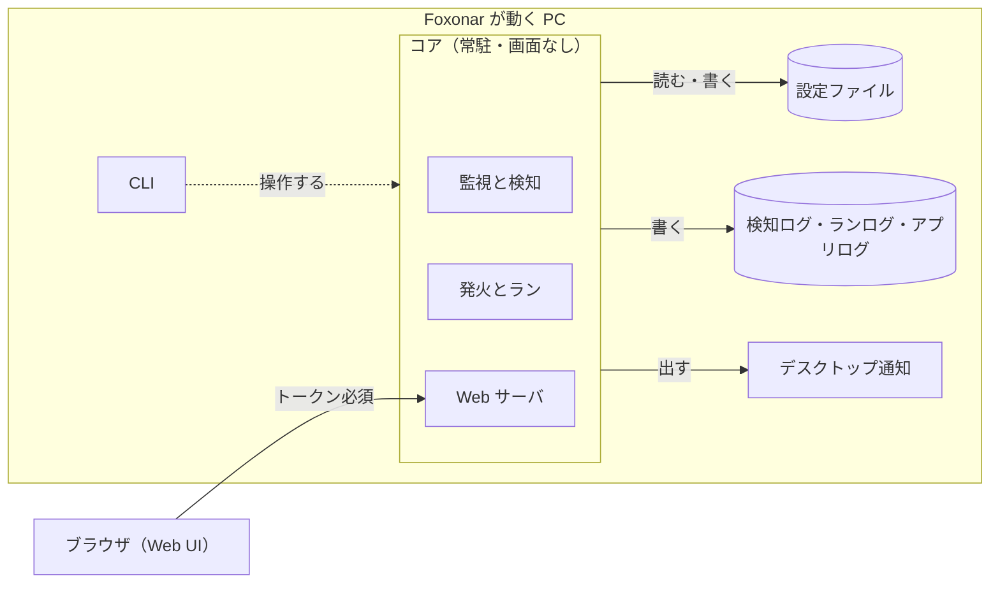
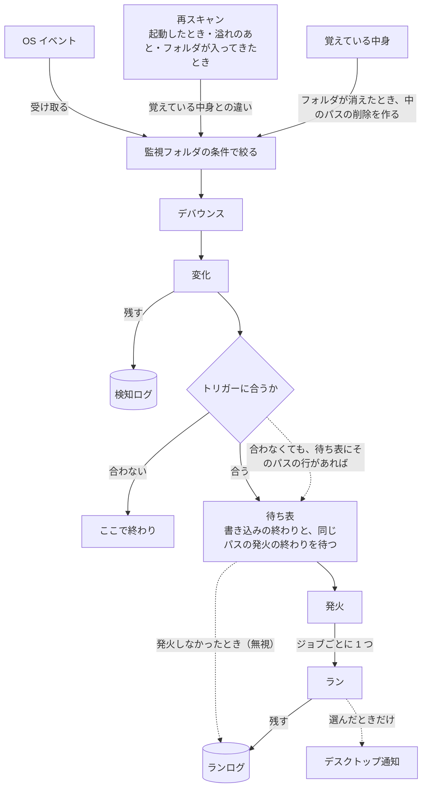
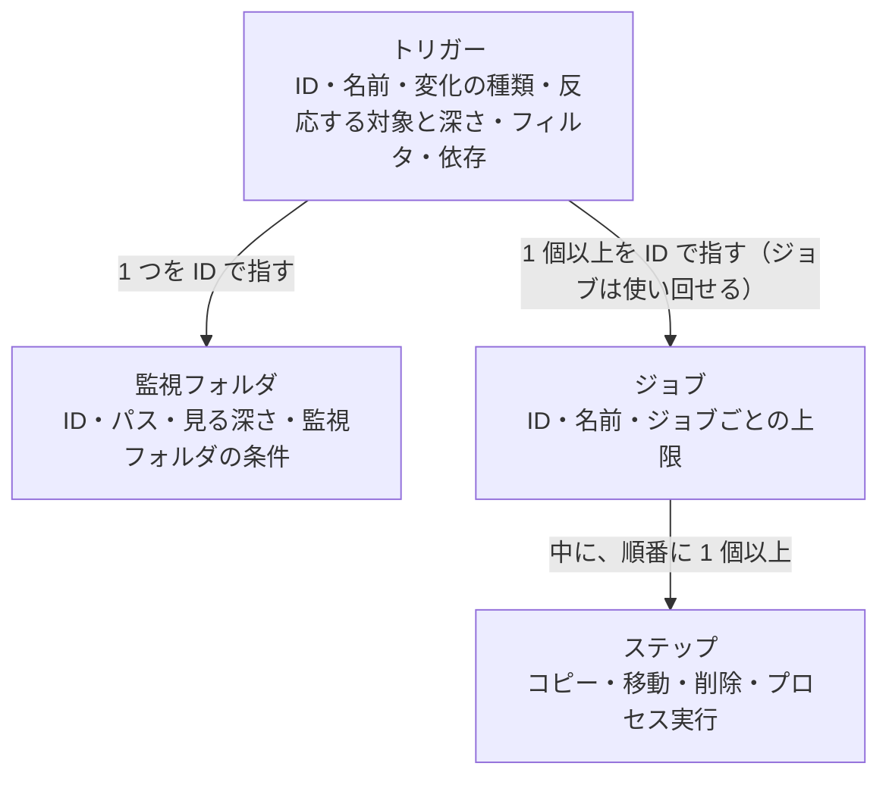
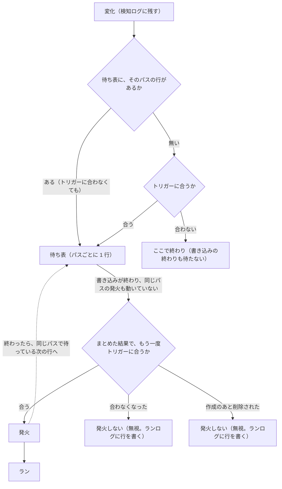

# 設計書

Foxonar の設計書です。決まった「どうやるか」だけを書きます。

- ここに書いてあることは、決まったこと。仮に決めたものは「仮決め」と書く。
- まだ決めていないことと、その案は [宿題一覧](todo.ja.md) に書く。決まったら、ここへ書き、宿題一覧から消す。
- 言葉は [用語集](glossary.ja.md) の意味で使う。
- 「論点 J」などは、[議論の記録](decisions.ja.md) の見出しを指す。
- 章は外側から内側への順に並べる：目的と範囲 → 全体の構成 → Web UI → 設定ファイル → 監視と検知 → ランの実行 → ログ → デスクトップ通知。
- 日本語のみ。英訳は、設計の方針が固まってから作る。

## 1. 目的と範囲

### 1.1 Foxonar がすること

- Foxonar は、監視フォルダを見張り、変化を検知して、トリガーに合ったらジョブを走らせる常駐アプリ。利用者が設定したとおりに動く。
- ジョブが無くても、監視フォルダにどんなファイルが来たかを、検知ログで確かめられる（論点 Q、T）。
- 対応する OS は Windows と Linux。Linux は、画面のないサーバーも含む（論点 O）。
- 使い方は 2 つの形がある（論点 P）。

| 形 | 起動のしかた | Web UI の開き方 | デスクトップ通知 |
|---|---|---|---|
| デスクトップで使う | ログイン時に起動 | 同じ PC のブラウザ | 出せる |
| サーバーとして動かす | サービス | SSH のトンネルを使い、手元のブラウザ | 出せない |

### 1.2 やらないこと

- シェルを通したコマンドの実行（論点 F）。外部のプログラムは、プロセス実行で動かす。
- ほかの PC やスマホからの接続は、最初は作らない。あとで足す（論点 O）。

## 2. 全体の構成

### 2.1 部品



| 部品 | 役割 | 論点 |
|---|---|---|
| コア | 監視フォルダを見張り、変化を検知して、発火とランを行う常駐のプログラム。画面を持たない。Web UI を閉じていても動き続ける | O |
| Web UI | コアの中の Web サーバが出す画面。ブラウザで開き、設定とログを見たり変えたりする | O |
| CLI | ターミナルから操作するコマンド | O |
| 設定ファイル | 監視フォルダ、トリガー、ジョブなどを書いたファイル。Web UI から書くのが基本で、人が直接編集してもよい | S |
| 検知ログ | 検知した変化 1 件ごとの記録 | Q |
| ランログ | ラン 1 回分ごとの記録 | Q |
| アプリログ | Foxonar 自身の動き（起動、停止、設定の読み込み、エラーなど）の記録 | Q |
| デスクトップ通知 | OS の通知（Windows のトースト通知など）。用語集の「通知」とは別物。何を知らせるかは利用者が選ぶ | R |

- `core` は Rust に最初からある `core` と名前がぶつかるので、コードではクレート名を `foxonar-core` にするなどして避ける（論点 O）。

### 2.2 動きの流れ



- ログやデスクトップ通知には、直接書き込むのではなく、用語集の「通知」として流し、それぞれが購読する。
- トリガーに合わなかった変化も、検知ログには残る。
- トリガーに合った変化は、待ち表で、書き込みの終わりと、同じパスの発火の終わりを待ってから発火する（5.9、論点 V）。
- 監視フォルダの条件で絞るのは、デバウンスの前（5.5、論点 W）。
- 変化のもとは 3 つある。OS イベント、再スキャンで見つけた違い（5.2）、覚えている中身から作ったもの（5.6）。どれも監視フォルダの条件で絞り、デバウンスを通して変化になる（論点 Y）。
- 溢れたときは、検知ログに「ここで抜けがあった」行を 1 行残す（7.1）。
- トリガーに合ったのに発火しなかったとき（自分が起こした変化、作成のあと削除された、待ち表でまとめ直したら合わなくなった、待っている間に設定を読み直したら合わなくなった。5.7、5.9、4.2）は、ランログに「無視」の行を残す（7.2）。

### 2.3 起動のしかた（論点 P）

- ログイン時にユーザーとして起動する形（デスクトップ向け）と、OS のサービスとして起動する形（サーバー向け）を選べる。
- サービスでも、動かすユーザーを決められる。
- サービスの注意：
  - Windows のサービスは「セッション 0」で動くので、画面もデスクトップ通知も出せない。
  - Windows のサービスは、既定では強い権限（LocalSystem）で動く。プロセス実行のステップも、その権限で走る。
  - ドライブ文字（`Z:` など）はログインごとの割り当てなので、サービスからは見えない。共有フォルダは UNC パス（`\\server\share`）で書く。

### 2.4 二重起動の防止

- 同じ設定ファイルを使うコアは、1 つだけ動ける。違う設定ファイルなら、複数のコアが同時に動いてよい。
  - 複数のコアを動かす例：別々のユーザーの権限で動かす。片方が止まっても、もう片方は動かしておく。
  - 1 つのコアの中でもワーカーは並行に動くので、負荷分散のためだけなら、コアは 1 つで足りる。
- この「二重起動の防止」は、用語集の「ロック」（このパスは発火中、という印）とは別のもの。紛れないように「ロック」とは呼ばない。
- 違う設定ファイルのコアどうしが、同じ監視フォルダ（または重なる場所）を見張っていても、Foxonar は気づかない。同じパスについて、両方のコアのランが走る。ロックはコアの中だけの印なので、ほかのコアとは譲り合わない。利用者の責任とし、利用者向けの説明に書く（Roze）。
  - 例：コア 1 が `C:\in` のファイルを `D:\done` へ移動し、コア 2 が同じファイルをアップロードする。先に移動が終わると、アップロードは「ファイルが無い」で失敗する。

### 2.5 コアを止めるとき

- 止める場面：Web UI や CLI で止める、サービスとして止める、PC を再起動する、など。
- 新しい発火は始めない。
- 発火したがまだ始まっていないラン（同時実行数の上限や、依存先を待っているラン）も、猶予の間は始めない。枠が空いても、依存先が成功しても、待ったままにし、次に起動したときに続きから始める。猶予の終わりに止められるかもしれないため。
- 走っているランは、決めた猶予の間だけ、終わるのを待つ。猶予を過ぎたら、走っているステップを止め、そのランは「中断」として残す。
  - 止め方は 6.5。プロセス実行のステップでは、子プロセスと、子が切り離さずに起動したプロセスを止める。切り離されたプロセスは止めない（6.3）。
  - ステップの途中で止めても、残りのステップは走らない（6.1）。たとえば「変換してから元のファイルを消す」ジョブで、変換中に止めても、元のファイルは消えない。
  - 猶予が要る理由：終わるまで待つと、長いジョブ（10 分かかる変換など）があると止まらない。PC の再起動では、OS が待つ時間に限りがある（Windows のサービスはふつう数秒〜20 秒、Linux の systemd は既定 90 秒）。
- まだ始まっていないもの（待ち表の行と、同時実行数の上限や依存先で待っているラン）は、捨てずに覚えておき、次に起動したときに続きから動かす。
  - 待ち表の行は、待ち表に入れた時点で、検知ログ・ランログと同じ SQLite に書く。コアが落ちたときにも残るため。
  - 発火したが始まっていないランは、発火したときに、ランログに結果「待っている」の行として書く（7.2）。発火したときの設定で走る（4.2）ので、そのときの設定も一緒に覚えておく。
- 中断したランを、次に起動したときに自動でやり直すかは、ジョブごとに選べる（6.6）。
  - 理由：覚えている中身は検知するたびに更新されるので（5.2）、捨てると、次に起動したときの再スキャンでも拾われず、ジョブが走らないままになる。

## 3. Web UI（論点 O）

### 3.1 つなぎ方と守り方

- コアの中の Web サーバが出す。
- 既定では、その PC からの接続（`127.0.0.1`）だけを受け付ける。
- 合言葉（トークン）は、同じ PC からの接続でも SSH のトンネルでも、いつでも必要。
- HTTPS：`127.0.0.1` で待ち受けるときは HTTP も許す。それ以外のアドレスで待ち受けるときは、HTTPS だけにする。
  - 同じ PC からの接続も SSH のトンネルも、コアから見るとどちらも `127.0.0.1` からの接続になる。
- 画面のないサーバーでは、SSH のトンネルを使って手元のブラウザから開く。例：`ssh -L 8400:localhost:8400 user@server`（ポート番号は仮）。
- ほかの PC やスマホからの接続は、あとで足す。そのときは HTTPS を強制する。

### 3.2 できること

- 設定を見る・変える。
- 検知ログ・ランログ・アプリログを見る。検知ログとランログを ID でたどる（7.2）。

## 4. 設定ファイル（論点 S）

### 4.1 形式と書き手

- 設定は Web UI から書くのが基本。人が設定ファイルを直接編集してもよい。
- そのため、人が読める形にする。
- 形式は TOML にする。コメントが書け、Rust の `Cargo.toml` と同じ形のため。
- 注意：
  - Web UI で開いている間に人がファイルを直接書き換え、Web UI が古い内容のまま保存すると、人の書き換えが消える。
  - Web UI から保存すると、人が書いたコメントや並び順が消えることがある。
- Web UI から保存するときは、開いたあとに設定ファイルが書き換わっていないかを、保存の前に確かめる。書き換わっていたら保存せず、「開いたあとに書き換えられています。読み込み直してから、もう一度直してください」と知らせる。人の直しが消えないようにするため。Web UI を 2 つのタブで開き、両方から保存したときも同じ。

### 4.2 読み直し

- 設定ファイルが書き換わったことに気づくと、コアが自動で読み直す。Web UI から保存したときも、人が直接編集したときも、同じしくみで読み直す。一時停止のボタンは付けない。
- 読み直したことは、時刻とともにアプリログに書く（7.2）。
- 読み直したあと、最初の発火から新しい設定を使う。それより前に発火したランは止めず、発火したときの設定のまま最後まで走る。依存でつながったランも、同じ設定で走る。
  - コアの中では、発火ごとに、発火したときの設定を持たせることで、この動きを作る。
  - 待ち表で待っているパスは、まだ発火していない。待っている間に設定を読み直したら、発火するとき（待ち表を出るとき）の設定で、トリガーに合うかを確かめ直す。トリガーが消えていれば発火しない（論点 S、V）。
    - トリガーが消えた・変わって合わなくなったときは、無視として、ランログに「無視」の行を書く（理由「設定を読み直したら、トリガーが無くなった」など。7.2）。
- 設定の読み込みの失敗：TOML の書き間違い、必ず書く項目が無い（5.2）、無い ID を指している、など。
  - 動いている間に読み直して失敗したら、壊れた設定は使わず、前の設定のまま動き続ける。アプリログと Web UI で、読み込みに失敗したこと（何行目の、何が悪いか）と、前の設定のまま動いていることを知らせる。
  - 起動したときに失敗したら、起動しない。理由をアプリログに書いて終わる。Web UI もコアの中にあるので、設定ファイルを直接直す（Roze）。
  - 注意：動いている間に読み直しに失敗し、直さないまま止めると（PC の再起動など）、次は起動しない。

### 4.3 設定の部品のつながり



- 図には、主な項目だけを書いている。ほかに、監視フォルダごとのデバウンス時間（5.4）・書き込みが終わったかを確かめる間隔（5.9）・止まっている間に起きたことの扱い（5.2）、ステップごとの上書きとごみ箱（4.4）・成功とみなす終了コード（6.3）、ステップごととジョブごとの時間の上限（6.4）などがある。
- 監視フォルダ、トリガー、ジョブは、それぞれ ID を持つ。トリガーが走らせるジョブも、依存先のジョブも、ID で指す（論点 Q）。監視フォルダの ID は、トリガーから指すために要る（論点 U）。
- トリガーは監視フォルダの外に書き、監視フォルダを ID で指す。設定の形を正規化するため。ジョブも ID で指すので、形が揃う（論点 U）。
- 1 つのトリガーが見張る監視フォルダは、1 つだけ。1 つの監視フォルダを指すトリガーは、0 個以上でよい。トリガーの無い監視フォルダを書いてよい（論点 T、U）。
- 1 つのトリガーに、変化の種類を複数書ける（作成と変更、など）（論点 U）。
- 監視フォルダには「見る深さ」を数で書く。すぐ下を 1 段目と数え、書かなければ制限なし。これより深い所の変化は検知しない（論点 X）。
- トリガーには、反応する対象（ファイル、フォルダ、両方）と「反応する深さ」（数。書かなければ見る深さまで全部）を書ける。フィルタの名前のパターンは、名前だけに当てる（論点 X）。
- 同じジョブをほかの監視フォルダでも使いたいときは、トリガーを分けて書き、同じジョブを指す。

### 4.4 組み込みのステップ

- 組み込みのステップは、コピー、移動、削除の 3 つ。外部のプログラムは、プロセス実行で動かす。
- 同じフォルダの中での名前の変更は、移動でできる。
- 「フォルダを作る」は、独立したステップにしない。コピーと移動に、「行き先のフォルダが無ければ作る」かどうかを書けるようにする。独立したステップは、使う場面がはっきりしてから足す。
- コピーと移動では、行き先に同じ名前があったときに上書きするかどうかを、ステップごとに選べる。上書きしない場合は、そのステップの失敗になる（残りのステップも止まる。6.1）。
- 削除では、ごみ箱に入れるか、すぐ消すかを、ステップごとに選べる。
  - ごみ箱を選んだのに、ごみ箱が使えない場所（ネットワークドライブなど）だったときは、すぐ消さずに、そのステップの失敗にする。消えてほしくないから、ごみ箱を選んでいるため。
  - 注意：Windows のサービスで動かすと、動かすユーザー（LocalSystem など）のごみ箱に入るので、ログインしている人のごみ箱には見えない。画面のない Linux サーバーでは、ごみ箱を空にする人がいないので、たまり続ける。

## 5. 監視と検知

### 5.1 監視フォルダの条件

- 監視フォルダごとに、検知するものを絞れる（論点 T）。絞る条件の例：
  - 隠しファイルを含むか
  - ファイルとフォルダのどちらの変化を検知するか
  - 名前やパターン
- 絞り込みは 2 か所ある。

| 絞る場所 | 外れたもの |
|---|---|
| 監視フォルダの条件 | 検知しない。検知ログにも残らない |
| トリガーのフィルタ | 検知はする（検知ログに残る）が、発火しない |

- 「隠しファイル」の意味は OS で違う。Windows ではファイルの属性（隠し属性）、Linux では名前が `.` で始まるもの。
- 隠しファイルを含まない監視フォルダでは、隠しファイルの削除も検知しない（論点 T）。
  - Windows では、消えたあとのファイルの属性は確かめられない。削除が届いたパスが、覚えている中身（とデバウンス中のもの）にあれば検知し、無ければ捨てる。隠しファイルは初めから外れているので、覚えている中身に入っていない。
  - 例：Word が開いている間だけある隠しファイル `~$report.docx` は、Word を閉じて消えても、検知ログに出ない。
  - あとから隠し属性が付いたファイルは削除、外れたファイルは作成として扱う。名前変更で監視フォルダの条件から出入りしたとき（5.8）と同じ。
  - 属性を確かめる前に消えていた作成は、隠しファイルではないとみなして検知する。一瞬来たことも検知ログに残すため（5.4）。
- 監視フォルダの条件で外れたフォルダは、その中のパスも、見る深さの末端まですべて外す（`.gitignore` と同じ）。
  - 例：名前が `.git` のものを外すと、`.git\` だけでなく、`.git\index` や `.git\objects\` の中も検知しない。
  - フォルダが入ってきたときも、条件を先に当てる。外れたフォルダの中は再スキャンしない（5.6）。

### 5.2 止まっている間と、覚えている中身

- コアが止まっている間に起きたことは、監視フォルダごとに扱いを選べる。どちらかを必ず書く（書いていない設定は、読み込みの失敗になる）。
  - 再スキャンする：起動したときに再スキャンし、覚えている中身との違いを変化として扱う。
  - 覚えるだけ：起動したあとの変化だけを扱う。起動したときに中を読み、覚えている中身を今の様子に合わせるが、違いは変化にしない（再スキャンではない）。
    - 合わせる理由：覚えている中身は、動いている間にも使う（隠しファイルの削除の見分け 5.1、溢れのあとの再スキャン、フォルダが消えたときの中のパス 5.6）。古いままだと、溢れのあとの再スキャンで、止まっている間に起きたことまで変化として出てしまう。
- 覚えている中身は、変化を検知するたびに更新し、コアを止めても残る（論点 Y）。動いている間は、上の選び方に関係なく覚える（5.6 で、フォルダが消えたときに使うため）。
- 覚えている中身には、パスごとに、ファイルかフォルダか、大きさ、更新日時を覚える（論点 Y）。再スキャンでは、この 3 つとパスで比べる。
  - 止まっている間に上書きされたファイルも、大きさか更新日時が変わるので、変更として見つかる。
  - 大きさも更新日時も同じまま中身だけ変わったファイルは、見つからない。
- 注意：止まっている間の名前変更は、比べただけではどの名前からどの名前に変わったか分からないので、削除と作成に見える。
- 覚えている中身が無いとき（初めて起動したとき、設定に新しい監視フォルダを足したとき）に、すでにあるファイルをどう扱うかも、監視フォルダごとに選べる。これも必ず書く。
  - 覚えるだけ：今あるファイルを、覚えている中身に入れるだけで、発火しない。
  - すべて作成として扱う：今あるファイルのパスすべてを、作成の変化として扱う（トリガーに合えばランが走る）。たまったファイルをまとめて片付けたいときに使う。
- 監視フォルダのパス・見る深さ・監視フォルダの条件を変えたときは、見る範囲が変わった部分だけを扱い直す。起動したときも、動いている間に設定を読み直したときも同じ。
  - 見え始めた部分：覚えている中身が無いときと同じ扱い（覚えるだけ、またはすべて作成として扱う）。
  - 見えなくなった部分：削除の変化にせず、覚えている中身から消す（忘れる）。
  - 理由：覚えている中身とそのまま比べると、パスを `C:\in` から `D:\in` に変えただけで、`C:\in` のファイルがすべて削除に見え、削除のトリガー（例：バックアップからも消す）が動いてしまう。変えるたびに全部をやり直すと、条件を少し変えただけで、すべてのパスに、もう一度ランが走ることがある。
- 溢れのあとの再スキャンで見つけた違いも、起動したときの再スキャンと同じく、変化として扱う（トリガーに合えば発火する）。溢れで取りこぼした分を取り戻すため（論点 V）。
- 溢れたら、すぐには再スキャンせず、落ち着いてから 1 回だけ行う（論点 V）。
  - デバウンスと同じ考え方で、最後の溢れや OS イベントから数え直し、一定の時間なにも届かなくなったら、監視フォルダ全体（見る深さまで）を再スキャンする。その間に何度溢れても、再スキャンは 1 回にまとめる。
  - ずっと落ち着かない監視フォルダ（ログが書き足され続けるなど）でも、最初の溢れから一定の時間がたったら、落ち着いていなくても 1 回行う。
  - 例：20,000 個のファイルのコピー中（10:00:00〜10:03:00）に 3 回溢れた。検知ログには溢れの行が 3 行残り、再スキャンはコピーが終わって落ち着いた 10:03:05 ごろに 1 回だけ。
  - 止まっている間に起きたことの扱いに関係なく行う。溢れは、起動したあとのことのため。
  - どの監視フォルダで溢れたか OS が知らせないときは、すべての監視フォルダを再スキャンする。

### 5.3 監視フォルダの外との移動

- 監視フォルダの外から入ってきた移動は作成、外へ出ていった移動は削除として扱う。
  - 監視フォルダから見れば、本当に「来た」「無くなった」ので自然であり、OS の知らせ方とも合う。
  - 監視フォルダ A から監視フォルダ B への移動は、A では削除、B では作成になる。
  - 見る深さより深い所との間の移動も、外との移動と同じ扱いになる（論点 X）。

### 5.4 デバウンスのまとめ方

- 1 つのパスの状態は「無い」と「ある」の 2 つ。作成は「無い → ある」、削除は「ある → 無い」、変更は「ある」のまま。名前変更は、ここではまとめない（5.5）。
- デバウンス時間の間に、同じパスの OS イベント（名前変更のものを除く）が複数届いたときは、1 つにまとめる。まとめた結果は、はじめとおわりの状態で決める。
  - 無い → ある は作成、ある → 無い は削除、ある → ある は変更。
  - 途中で何回切り替わっても、はじめとおわりだけを見る。切り替わりの数が奇数なら、おわりははじめと逆。偶数なら、はじめと同じ。
- ただし、はじめもおわりも「無い」ときは、1 つにまとめず、作成と削除の 2 つを残す。一瞬でもファイルが来たことを、検知ログで分かるようにするため。
- デバウンス時間は、最後の OS イベントから数え直す。書き込みが続いている間は待ち続けるので、大きなファイルのコピーは作成 1 つになる。デバウンス時間より長く間が空いたら、そこで区切り、別々にまとめる。
- デバウンス時間は、監視フォルダごとに変えられる。0 にすると、デバウンスしない（OS イベント 1 つが変化 1 つ）（論点 W）。

| はじめ | 切り替わりの数 | おわり | 例 | まとめた結果 |
|---|---|---|---|---|
| ある | 0 | ある | 直接上書き | 変更 1 つ |
| ある | 1 | 無い | 削除 | 削除 1 つ |
| ある | 2 | ある | 消してから作り直す。一時ファイルを監視フォルダの条件で外しているときの Word などの保存 | 変更 1 つ |
| ある | 3 | 無い | 作り直して、すぐ消した | 削除 1 つ |
| 無い | 1 | ある | 大きなファイルのコピー | 作成 1 つ |
| 無い | 2 | 無い | 一時ファイル（来てすぐ消えた） | 作成と削除の 2 つ（検知ログに残る）。トリガーに合っても、待ち表で打ち消し合うので、ランは走らない（5.9） |
| 無い | 3 | ある | 来て、すぐ作り直された | 作成 1 つ |

- 確かめたこと：PowerShell の FileSystemWatcher（Windows では notify と同じ ReadDirectoryChangesW を使う）で、保存のしかたを 3 通り再現した（2026-10-19）。OS イベントは、変化の種類と紛れないように、FileSystemWatcher の呼び方（Created、Changed、Deleted、Renamed）で書く。
  - 直接上書き：元のパスに Changed が 2 回届く（中身を空にする、書き込む）。
  - 一時ファイルとの入れ替え（Word と同じ形）：元のパスには Changed が 1 回も届かない。元のパスから別の名前への Renamed（ある → 無い）と、一時ファイルから元のパスへの Renamed（無い → ある）だけが届く。
  - 消してから作り直す：元のパスに Deleted、Created、Changed が届く。
  - 消してから作り直すのは、元のパスから見れば「ある → 無い → ある」なので、変更 1 つになる。
  - 入れ替えは Renamed で届くので、一時ファイルを監視フォルダの条件で外していれば変更 1 つ、外していなければ名前変更などがそのまま見える（5.5。論点 W）。

### 5.5 名前変更のまとめ方（論点 W）

- 名前変更の OS イベント（Renamed）は、ほかの OS イベントとまとめない。名前変更の変化 1 つとして残し、そこが区切りになる。Created・Changed・Deleted は、区切りの前と後で、それぞれ 5.4 の「はじめとおわり」でまとめる。
  - 例：名前を変えたすぐあと（デバウンス時間の中）に書き込みが来たら、名前変更 1 つと変更 1 つ。
  - 理由：名前変更は名前変更として取りたい。同時に起きた名前変更と変更は、別にしたほうが、そのあとのジョブを正確に設定できる（Roze）。
- 片側が監視フォルダの条件の外の Renamed は、Created か Deleted として扱い（論点 T）、5.4 の「はじめとおわり」でまとめる。
- 監視フォルダの条件で絞るのは、デバウンスの前（OS イベントの段階）。片側が外の Renamed を、Created や Deleted として扱ってからまとめるため。
- そのため、まとめた結果は監視フォルダの条件で変わる。

| デバウンス時間の中で起きたこと | A：一時ファイルを外していない | B：一時ファイル（`*.tmp`、`~*` など）を監視フォルダの条件で外している |
|---|---|---|
| 名前を変えただけ | 名前変更 1 つ | 名前変更 1 つ |
| 名前を変えて、すぐ書き込み | 名前変更 1 つと変更 1 つ | 名前変更 1 つと変更 1 つ |
| 仮の名前 `scan_01.tmp` で書いて、`scan_01.pdf` に名前を変えた | `scan_01.tmp` の作成と、名前変更 1 つ | `scan_01.pdf` の作成 1 つ（外から中への名前変更） |
| Word などの保存（一時ファイルとの入れ替え） | 一時ファイルの作成、名前変更 2 つ、一時ファイルの削除 | 元のファイルの変更 1 つ（消えて → 現れた） |
| 続けて 2 回名前を変えた（a → b → c） | 名前変更 2 つ | 名前変更 2 つ |
| 大きなファイルのコピー | 作成 1 つ | 作成 1 つ |

- トリガーの書き方の目安：
  - ダウンロードやスキャンを待つ：変化の種類に、作成と名前変更の両方を書く（A なら名前変更で、B なら作成で拾える）。
  - 保存を拾う：A なら変更と名前変更、B なら変更。
- トリガーのフィルタは、検知には効かない。検知したあとで、そのトリガーを発火させるかを決めるだけなので、上の表はトリガーのフィルタでは変わらない。

### 5.6 フォルダの変化（論点 X）

- 監視フォルダには、ファイルだけでなくフォルダも来る。フォルダごと入ってきた・消えたときは、フォルダ自身の変化に加えて、中のパス（ファイルもフォルダも、見る深さまで）1 つずつにも、同じ変化（作成・削除）があったとして扱う。
  - 理由：OS は、フォルダごとの移動・ごみ箱への削除では、中のパスについて何も知らせない。コピーや Shift+Delete では 1 つずつ知らせる。どちらのやり方でも、同じ結果にする。
  - 入ってきたとき：フォルダの中を再スキャンし、見つけたパスを作成として扱う。コピーの途中で読んでも、読んで見つけた作成と、OS から届いた同じパスの Created は、デバウンスで 1 つにまとまる（論点 Y）。
  - 消えたとき：中身はもう見えないので、覚えている中身から、中のパスの削除を作る。
- フォルダの名前が変わったときは、フォルダ 1 つの名前変更だけにする。中のパスの名前変更は作らず、覚えている中身のパスだけを書き換える（論点 X、あとで変更）。
  - 理由：フォルダの名前を変えただけで、中のファイルの名前は変わっていない。`C:\Program` を `C:\Program2` にしただけで、配下すべてに名前変更が出るのは過剰（Roze）。
  - そのため、中のファイルを 1 つずつドラッグで別のフォルダへ移したとき（OS が名前変更として知らせる）とは、結果が違う。
- 検知では、フォルダも中のパスも、1 つずつ別の変化にする。どれに反応するかは、トリガーの「反応する対象」と「反応する深さ」で選ぶ（4.3）。
- 例：監視フォルダ `C:\watch`（見る深さは制限なし）に、`hoge\` が中身ごと入ってきた。

```
C:\watch
  hoge\          1 段目のフォルダ
    test.txt     2 段目のファイル
    sub\         2 段目のフォルダ
      a.txt      3 段目のファイル
```

| 検知する変化 | トリガー F：フォルダ・作成・反応する深さ 1 | トリガー T：ファイル・作成・`*.txt` |
|---|---|---|
| `hoge\` の作成 | 反応する | 反応しない（フォルダ） |
| `hoge\test.txt` の作成 | 反応しない（ファイル） | 反応する |
| `hoge\sub\` の作成 | 反応しない（2 段目） | 反応しない（フォルダ） |
| `hoge\sub\a.txt` の作成 | 反応しない（ファイル） | 反応する |

- 注意：
  - 中のファイルが多いと、覚えておく量と、中を読む時間が増える。中のパスの変化が一度に大量のランになることもある（同時実行数で抑える）。
  - Windows の OS は、「そのフォルダだけ」か「全部の深さ」でしか見張れない。見る深さを途中で切ると、深い所の OS イベントも届くので、Foxonar が捨てる。Linux はフォルダごとに見張るので、見る深さまでしか見ない。

### 5.7 自分が起こした変化

- ランが起こした変化では、そのランのもとになったトリガーは発火しない。ほかのトリガーは発火してよい（例：監視フォルダ `inbox` のトリガーのジョブが、監視フォルダ `work` へ移動し、`work` のトリガーのジョブが続きを行う）。
  - これは無視に当たる。理由「自分が起こした変化」を添えて、通知として流す（論点 V）。ランログに、走るはずだったジョブごとに「無視」の行を書く（7.2）。
- 複数のトリガーをまたいで回るループ（トリガー X → Y → X）は、設定の組み方なので、利用者の責任とする。
- ランが起こした変化だと見分けられるのは、組み込みのステップ（コピー、移動、削除）が書いたパスだけ。プロセス実行で動かしたプログラムが書いたものは、OS イベントに「誰が書いたか」が入っていないので見分けられない。ここも利用者の責任とする（論点 M と同じ考え方）。
- Foxonar 自身のファイル（アプリログ、SQLite など）の変化は、監視フォルダの中にあっても検知しない。

### 5.8 名前変更とフィルタ

- トリガーのフィルタは、変更後のパスに当てる（用語集のランの定義「変更後のパスを対象パスとし」と揃える）。
- ブラウザのダウンロードのように、別の名前（`photo.jpg.crdownload` など）で書いてから名前を変えるものを待ちたいときは、トリガーの変化の種類に「作成」と「名前変更」の両方を書く。仮の名前を監視フォルダの条件で外していれば作成で、外していなければ名前変更で拾える（5.5）。
- 監視フォルダの条件の外から中への名前変更は作成、中から外への名前変更は削除として扱う。外から入ってきた移動を作成とするのと同じ考え方（論点 T）。
  - 例：`*.crdownload` を外している監視フォルダで、`photo.jpg.crdownload` が `photo.jpg` になると、`photo.jpg` の作成になる。この場合は、トリガーに「名前変更」を書かなくても、作成で拾える。

### 5.9 待ち表で待つもの（論点 V）



- 変化がトリガーに合ったら、そのパスを待ち表に置く。次の 2 つが済むまで、発火しない。
  - そのパスへの書き込みが終わっている（書き込み完了待ち）。
    - 仮決め：Roze は、アプリの負荷が高くならないか心配している。確かめるのはトリガーに合ったパスだけ。実装で負荷を確かめてから決める。
    - フォルダの作成では、フォルダの中に新しい変化が来なくなり、中のファイルへの書き込みがすべて終わるまで待つ（論点 Z）。
      - 例：トリガー `zip-folder`（フォルダ・作成 → zip にしてアップロード）。写真 500 枚の入ったフォルダ `photos_1020\` をコピーすると、最後の写真が届き終わってから発火し、zip に 500 枚入る。
      - 同じドライブの中でフォルダごと移動したときは、中身ごと一度に来るので、すぐ発火する。
  - 同じパスの発火が動いていない（ロック）。
- トリガーに合わず、待ち表に行も無いパスは、書き込みの終わりを待たない。ジョブが無いので、待つ意味が無い。
- ランが起こした変化で、もとのトリガーが発火しないもの（5.7）は、待たずに無視になる。
- 同じパスの発火が動いている間に、そのパスの次の変化が届いても、捨てない。待ち表で待ち、今の発火が終わってから、もう一度発火する。
  - 例：`report.xlsx` をアップロードしている間に、人がもう一度保存した。終わったあと、新しい版をもう一度アップロードする。
  - 待っている間に同じパスの変化が何度届いても、待ち表の 1 行にまとめる。走るのは 1 回。
  - まとめ方は、デバウンスと同じ「はじめとおわり」。発火するときに、まとめた結果でトリガーに合うかを見直す。
  - 待ち表に行があるパスに届いた変化は、どのトリガーにも合わなくても、その行にまとめる（論点 V）。
    - 例：トリガーは `upload`（変更 → アップロード）と `cloud-delete`（削除 → クラウドからも消す）の 2 つで、作成のトリガーは無い。`report.xlsx` のアップロード中に、削除（検知 302。cloud-delete に合う）と、ごみ箱から戻した作成（検知 303。どれにも合わない）が届いた。行は「ある → 無い → ある」で変更 1 つになり、upload が走る（ランに書く検知 ID は 303）。cloud-delete は走らない。
  - まとめ直したら合わなくなったトリガーは、無視になる。理由「まとめ直したら、トリガーに合わなくなった」を添えて通知として流し、ランログに、走るはずだったジョブごとに「無視」の行を書く（7.2）。上の例では、cloud-delete のジョブに無視の行を書く。
  - 名前変更は、待ち表でも区切りにする。名前変更が入った行のあとに、同じパスの変化が届いたら、別の行にして、名前変更の発火が終わってから順に発火する（論点 W・Y）。
    - 例：`scan_01.pdf` の名前変更（検知 201）のすぐあとに、書き足しの変更（検知 202）が届いた → ラン 60（名前変更）、終わってからラン 61（変更）。
    - 例：アップロード（作成と変更のトリガー）の発火中に、変更、削除の順に届いた。はじめは「ある」、おわりは「無い」なので削除 1 つ。作成と変更のトリガーは合わなくなり、削除のトリガーが発火する。
  - はじめもおわりも「無い」（作成のあと削除された）ときは、差し引きで何も起きていないので、何も走らせずに行を消す。デバウンスでは作成と削除の 2 つを残すが、それは検知ログに「一瞬来た」ことを残すため。待ち表は何を走らせるかを決める所なので、扱いを分ける。
    - 例：コピーの途中で取り消された。検知ログには作成と削除が残るが、アップロードも「クラウドからも消す」も走らない。
    - これは無視に当たる。理由「作成のあと削除された」を添えて、通知として流す。ランログに、走るはずだったジョブごとに「無視」の行を書く（7.2）。
  - 名前変更は、変更後のパスの行に入る（対象パスは変更後のパス）。名前変更で元のパスが無くなっても、元のパスの行は残る。その行から発火したランは、始める直前に対象パスが無いので無視になる（6.2）。
- 書き込みが終わったかを確かめる間隔は、監視フォルダごとに変えられる（ネットワークドライブでは、1 回の確認が遅いので長くする）。
- 待っている間は、ワーカーを使わない。
- 待ち表の行は、コアを止めても消えない。次に起動したときに、続きから待つ（2.5）。

### 5.10 書き込みが終わらないとき

- 書き込みが終わるまで待つ。デバウンス中に書き込みが続く場合も、書き込み完了待ちの場合も同じ。フォルダの中身を待つとき（5.9）も、中に変化が届き続けている間は待ち続ける。
- 待っている間は、ワーカーを使わない（デバウンス中はデバウンスの中で、書き込み完了待ちは待ち表で待つ）。ずっと書き足されるファイルがいくつあっても、ほかのパスのランは止まらない。
- 一定の時間を過ぎても終わらないときは、アプリログと Web UI で「待っている」ことを知らせる。待つのはやめない。

### 5.11 監視フォルダを見失ったとき（論点 AA）

- 一定の間隔（数秒）ごとに、監視フォルダがまだあるか、見張りを始めたときと同じフォルダかを確かめる。無い、または違うフォルダのときは、見失ったとする。Linux では、OS の知らせ（監視フォルダ自身の削除・名前変更）でも、見失ったとする。
- 見失ったとき：
  - その監視フォルダの見張りを止める。
  - 中のパスを削除の変化にしない。覚えている中身は残す。
  - アプリログと Web UI で、見失ったことを知らせる。デスクトップ通知では知らせない（8 章）。
  - 人が本当に監視フォルダを消したときは、OS が中のパスの削除を知らせてくるので、それは削除の変化になる（Windows でも Linux でも、実験で確かめた）。
- 同じパスに監視フォルダがまた現れたら、自動で見張り直す。中を読み、覚えている中身と比べる。違うフォルダが同じパスにあったときも、見失ったうえで、すぐにまた現れたものとして扱う。
  - 違いの扱いは、5.2 の「止まっている間に起きたこと」の選び方に従う（再スキャンする：違いを変化にする。覚えるだけ：覚えている中身を今の様子に合わせるだけ）。
  - ただし、覚えている中身にあって、無くなっていたパスは、削除の変化にせず、覚えている中身から忘れる。
  - 例：USB メモリ A（`photo1.jpg`・`photo2.jpg`）を、監視フォルダ `E:\in` として見張っている。A を抜くと見失う。別の USB メモリ B（`scan.pdf`）を挿すと見張り直し、再スキャンするを選んでいれば、`scan.pdf` の作成だけが出る。`photo1.jpg`・`photo2.jpg` の削除は出ない。
  - 注意：見失っていた間に本当に消されたファイルは、削除の変化として出ない。
- 注意：監視フォルダの名前が変わると、見失ったと分かるまでの間、OS は名前を変えた先の変化を、もとのパスとして知らせてくる（Windows でも Linux でも、実験で確かめた）。もとのパスにはもう何も無いので、そこから発火したランは、ほとんどが始める直前の確かめ（6.2）で無視になる。

## 6. ランの実行

### 6.1 失敗と依存

- 発火、ラン、依存、同時実行数の決まりは、用語集のとおり（論点 D、H、L、M、N、V）。発火中に同じパスの変化が届いたときは、無視せずに待ち表で待たせる（5.9）。
- ジョブの中のステップが失敗したら、残りのステップは走らせない。そのランは失敗になる（GitHub Actions の既定と同じ）。コピーに失敗したのに元のファイルを消す、といったことを防ぐため。
- ランが失敗すると、そのジョブに依存するジョブは始めない（用語集の「依存」のとおり）。
- 依存先のランが無視になったときも、後のジョブは始めない。依存の決まりは「依存先が成功してから始める」なので、成功しなかったものはすべて同じ扱いにする。後のジョブのランは無視になり、理由「依存先が成功しなかった」をランログに残す。
  - 例：ジョブ A（サムネイルを作る）→ ジョブ B（そのサムネイルをアップロードする）。ファイルを置いてすぐ消すと、A のランは始める直前に対象パスが無いので無視になる。B のランは A の結果が無いので始めない。
  - 依存が A → B → C と続くときも、A が成功しなければ、B も C も始めない。

### 6.2 始める直前の確かめ

- 削除以外の変化で発火したランは、始める直前に対象パスがあるかを確かめる。無ければ、そのランは無視になる（理由「対象パスが無い」をランログに残す）（論点 D）。
  - 例：同じ発火の中で、依存でつながっていない別のジョブが、先に対象パスのファイルを移動・削除していた場合。
  - 削除で発火したランは、対象パスが無いのが当たり前なので、確かめない。
  - 依存先があるランも確かめない。依存先がすべて成功したら、そのまま始める（論点 M）。
    - 例：ジョブ A が対象パスのファイルを `done\` へ移動し、A に依存するジョブ B が Slack に知らせる。B は走る。
    - B に渡る `${path}` などは、移動の前のパスのまま。B がファイルを開こうとするステップなら、そこで失敗になる。
- ランの途中で対象パスが無くなった場合は、そのステップの失敗になる。

### 6.3 ステップの成否

- 組み込みのステップ（コピー、移動、削除）は、OS がエラーを返したら失敗（権限が無い、容量が足りない、上書きしない設定で行き先に同じ名前がある、など）。
- プロセス実行のステップは、終了コードで決める。既定では 0 だけが成功。ステップごとに「成功とみなす終了コード」を書ける。
  - 例：robocopy は、1（コピーした）も成功の意味なので、0〜7 を成功と書く。8 以上は失敗。
- プログラムを起動できなかった、Foxonar の外から途中で止められた（タスクマネージャー、Linux のシグナルなど）、時間の上限を超えた（6.4）ときは、終了コードに関係なく失敗。コアを止めたとき・コアが落ちたときは中断（2.5、論点 Y）。
- 標準エラーへの出力は、成否に使わない。ffmpeg のように、うまくいっていても途中経過を標準エラーに出すプログラムがあるため。
- 注意：PowerShell のスクリプトで `Write-Error` を書いただけでは、終了コードは 0 のまま（成功に見える）。失敗させたいときは `exit 1` を書く、と利用者向けの説明に書く。
- プロセス実行のステップは、起動したプログラム（Foxonar の子プロセス）が終わったら終わる。終わるのを待っている間、ワーカーは眠っていて、OS が終わりと終了コードを知らせる。出力は OS がラン 1 回ごとのファイルへ直接書く（7.1）。
- 子プロセスが切り離して起動したプロセス（例：`cmd /c start "" notepad.exe` の notepad）は、Foxonar は見ない。子が終わった時点でステップは終わる。切り離したプロセスがそのあと何をするかは、利用者の責任とする（5.7 と同じ考え方）。

### 6.4 時間の上限

- 時間の上限は、ステップごとにも、ジョブごとにも書ける。書かなければ上限なし。
  - ステップごとの上限は、そのステップが始まってから数える。ジョブごとの上限は、ランが始まってから数える（同時実行数の上限や依存先を待っている時間は数えない）。
- 上限を超えたら、走っているステップを止め、そのランは失敗にする（理由「時間の上限を超えた」）。残りのステップは走らず、そのジョブに依存するジョブも始めない（6.1）。
  - 止まった理由は、利用者が書いた上限なので、中断（Foxonar の側の事情）ではなく失敗。
- 上限を書かなかったランが長くかかったり固まったりして、ワーカーや同時実行数の枠をふさいでも、利用者の責任とする（Roze：どれくらい時間がかかるか分からないことがあるため）。
  - 例：入力を待つスクリプト（PowerShell の `Read-Host`、bat の `pause`）は、Foxonar から動かすと誰も入力できないので終わらない。利用者向けの説明に書く。
- 止め方は 6.5。

### 6.5 ステップの止め方

- 時間の上限を超えたとき（6.4）と、コアを止める猶予を過ぎたとき（2.5）は、走っているステップを次のように止める。
- プロセス実行のステップ：まず終わるように頼む（Linux ではシグナル、Windows ではウィンドウを閉じる知らせなど）。一定の時間待っても終わらなければ、強制的に止める。止める相手は、子プロセスと、子が切り離さずに起動したプロセス（6.3）。
  - 例：ffmpeg で変換中なら、頼まれた ffmpeg が自分で後片付けをし、書いていたファイルを読める形で閉じられる。いきなり止めると、書きかけのファイルが壊れたまま残ることがある。
- 組み込みのステップ（コピー・移動）：Foxonar が自分で止める。書きかけの行き先のファイルを消してから止める。別のドライブへの移動（コピーしてから元を消す）なら、元のファイルは残る。

### 6.6 やり直し

- 失敗・中断したランを、Web UI や CLI から手でやり直すことはできない（Roze）。もう一度走らせたいときは、もう一度変化を起こす（ファイルを監視フォルダから出して戻す、など）。削除で発火したランは、やり直す方法が無い。
- 中断したランを、次に起動したときに自動でやり直すかは、ジョブごとに選べる。
  - 何度やっても同じ結果になるジョブ（変換、サムネイル）と、やり直すと困るジョブ（CSV への追記、送信）があるため。
  - やり直すジョブのランは、新しいラン ID のランとして、最初のステップから、発火したときの設定で走る（2.5）。ランログの「理由・エラーの中身」に「ラン 45 のやり直し」のように、もとのラン ID を書く。もとのランの行は中断のまま残す。
  - やり直さないジョブのランは、中断のまま。そのランに依存するジョブは始めない（依存先が成功しなかった。6.1）。

## 7. ログ（論点 Q）

### 7.1 3 つのログと保存のしかた

| ログ | 何を残すか |
|---|---|
| 検知ログ | 検知した変化 1 件ごと。作成・変更・削除・名前変更のすべて。トリガーに合わなかった変化も残す。溢れも 1 行残す |
| ランログ | ラン 1 回分ごと。無視して走らなかったランも残す |
| アプリログ | Foxonar 自身の動き（起動、停止、設定の読み込み、エラーなど） |

- 検知ログとランログは、SQLite（ファイル 1 つの小さなデータベース）に残す。Web UI で絞り込んだり、ID でたどったり、古いものを消したりしやすいため。
- アプリログは、テキストのファイルに残す。困ったときに、人が上から読むため。
- プロセス実行のステップがあるランでは、ラン 1 回ごとに出力のファイルを作り、ランログからたどれるようにする。中身は、ステップごとの始まり・終わりの時刻と終了コードと、成功しなかったとき（失敗・中断）のプロセス実行の出力。
  - ランログはラン 1 回で 1 行のままにし、ステップごとの記録はこのファイルに書く。
  - 成功したランでは、プロセス実行の出力（標準出力も標準エラーも）を残さない（Roze：成功したときは、成功したと分かれば足りる）。
  - 成功しなかったときは、標準エラーを残し、標準出力は最後の数行だけを残す。robocopy のように、エラーを標準出力に出すプログラムがあるため。
- 溢れたときは、検知ログに「ここで抜けがあった」行を 1 行残し（変化の種類の列に、この行だけ「溢れ」と書く。溢れは変化ではないが、同じ列で見分ける。パスは監視フォルダ）、アプリログにも書く。そのあとの再スキャンで見つけた変化は、ふつうの行で続く。検知ログだけ見ていても、抜けに気づけるようにするため。
- 検知ログには OS イベントではなく変化を残すので、ファイル 1 つのコピーで出る行は少ない。ただし、デバウンス時間より長くかかるコピーでは、複数の変化（作成のあとに変更、など）になることがある。

### 7.2 列と ID

- 検知ログの列：検知 ID、日時、監視フォルダ ID、ファイルかフォルダか、変化の種類、パス、変更前のパス（名前変更のときだけ）、見つけ方。発火やランのことは書かない。
  - 見つけ方：再スキャンで見つけた変化にだけ、「再スキャン（起動したとき）」「再スキャン（溢れのあと）」「再スキャン（フォルダが入ってきたとき）」と書く。OS が知らせた変化（デバウンスで OS イベントとまとめたものも）と、覚えている中身から作った変化（5.6）は空。日時は見つけた時刻なので、起動したときの再スキャンでは、夜の間に置かれたファイルも朝の時刻になる。それと分かるようにするため。
  - 監視フォルダ ID：同じ場所を 2 つの監視フォルダが見ているときも見分けられ、Web UI で監視フォルダごとに絞り込める。
  - ファイルかフォルダか：消えたあとは、パスだけではどちらだったか分からないため（論点 X）。
- ランログの列：ラン ID、検知 ID、トリガー ID、そのときのトリガーの名前、ジョブ ID、そのときのジョブの名前、始まった時刻、終わった時刻、結果、止まったステップ、終了コード、理由・エラーの中身。
  - トリガーの名前・ジョブの名前：あとで名前を変えたり、トリガーやジョブを消したりしても、古いランログが読めるようにするため（論点 Q）。
  - どの版の設定で走ったかは書かない。設定を読み直したことは、時刻とともにアプリログに書く（版の番号は付けない。Roze）。
  - 検知 ID：もとになった変化の検知 ID。待ち表で複数の変化を 1 行にまとめたときは、最後の変化の検知 ID を書く（Roze、論点 Y）。それより前の変化の行からは、ランへたどれない。
  - 結果には、待っている（同時実行数の上限か、依存先を待っている）・走っている・成功・失敗・無視（と、無視の理由）（6.1、6.2）・中断（2.5）がある。
  - 無視の行は始まらないので、無視した時刻を「始まり」に書き、「終わり」は空にする。
  - 止まったステップ：失敗・中断したとき、何番目の、どのステップで止まったか。
  - 終了コード：プロセス実行のステップが返した値。成功のときも残す（robocopy の 1 など、成功の意味の値もあるため。6.3）。止まったときは止まったステップの値、成功したときは最後に走ったプロセス実行のステップの値。ステップごとの値は、出力のファイル（7.1）に書く。
  - 理由・エラーの中身：失敗・中断・無視したときの理由の文。無視は、その理由（例：自分が起こした変化（ラン 42）、作成のあと削除された（検知 110））。組み込みのステップは OS のエラー（例：アクセスが拒否されました）、プロセス実行は標準エラーの最後の数行、標準エラーが空なら標準出力の最後の数行（どちらもラン 1 回ごとのファイルに残る。7.1）、中断はその理由（例：コアを止めたため）。組み込みのステップの失敗は終了コードが無いので、これが無いと理由が分からない。
- ランログの行は、発火したときに書き、結果を書き換えていく。すぐ始められないとき（同時実行数の上限や、依存先を待つ）は「待っている」、始めたら「走っている」、終わったら成功・失敗などにする。依存先が成功しなかったら、「待っている」から「無視」に書き換える。無視したランは、無視したときに書く。トリガーに合ったのに発火しなかったときも、走るはずだったジョブごとに「無視」の行を書く。「なぜジョブが走らなかったか」は、全部ランログで分かる。
  - 発火したときに書くのは、コアが落ちても、待っているランが残るようにするため（2.5）。Web UI で、待っているランも見える。
  - トリガーに合ったのに発火しないのは、自分が起こした変化（5.7）、作成のあと削除された（5.9）、待ち表でまとめ直したら合わなくなった（5.9）、待っている間に設定を読み直したら合わなくなった（4.2）とき。
  - 理由・エラーの中身の例：「まとめ直したら、トリガーに合わなくなった（検知 302〜303）」「設定を読み直したら、トリガーが無くなった」。
  - Web UI で、今動いているランが見える。
  - コアが落ちて「走っている」のまま残った行は、次に起動したときに「中断」に直す。落ちても、ランの記録が消えない。「待っている」の行は、次に起動したときに続きから動かす。
- ID は 2 種類ある。

| ID | 誰が決める |
|---|---|
| 検知 ID、ラン ID | 実行時に、コアが振る |
| 監視フォルダ ID、トリガー ID、ジョブ ID | 設定に書く |

- Web UI では、ランログの行から「もとの変化」を、検知ログの行から「この変化で走ったラン」を、たどって見せる。
- 例（ジョブ ID とトリガー ID は仮の名前）：

検知ログ

| 検知 ID | 日時 | 監視フォルダ ID | ファイルかフォルダか | 変化の種類 | パス | 変更前のパス | 見つけ方 |
|---|---|---|---|---|---|---|---|
| 100 | 09:00:03 | inbox | ファイル | 作成 | `C:\in\dog.jpg` | | 再スキャン（起動したとき） |
| 101 | 10:01:05 | inbox | ファイル | 作成 | `C:\in\photos\cat.jpg` | | |
| 102 | 10:03:12 | inbox | ファイル | 名前変更 | `C:\in\memo.txt` | `C:\in\memo_old.txt` | |
| 103 | 10:05:40 | inbox | フォルダ | 削除 | `C:\in\tmp\` | | |
| 104 | 10:10:00 | inbox | | 溢れ | `C:\in\` | | |

ランログ

| ラン ID | 検知 ID | トリガー ID | トリガーの名前 | ジョブ ID | ジョブの名前 | 始まり | 終わり | 結果 | 止まったステップ | 終了コード | 理由・エラーの中身 |
|---|---|---|---|---|---|---|---|---|---|---|---|
| 42 | 101 | photos | 写真が来たら | thumbnail | サムネイル | 10:01:06 | 10:01:08 | 成功 | | 0 | |
| 43 | 101 | photos | 写真が来たら | backup | バックアップ | 10:01:06 | 10:01:09 | 失敗 | 2 番目（プロセス実行 robocopy） | 16 | ERROR 5 (0x00000005) D:\backup\ アクセスが拒否されました。 |
| 44 | 101 | photos | 写真が来たら | upload | アップロード | 10:01:09 | | 無視 | | | 依存先が成功しなかった（ラン 43） |
| 45 | 101 | photos | 写真が来たら | convert | 変換 | 10:01:06 | 10:01:40 | 中断 | 1 番目（プロセス実行 ffmpeg） | | コアを止めたため |

## 8. デスクトップ通知（論点 R）

- OS の通知（Windows の右下に出るトースト通知など）を「デスクトップ通知」と呼ぶ。用語集の「通知」とは別物で、通知を購読するものの 1 つ。
- 何を知らせるかは、利用者が選ぶ。選べるのは次の 3 つ（論点 R）。

| 選べるもの | 例 | 書く場所 |
|---|---|---|
| 変化を検知したとき | 「inbox に report.pdf が来ました」 | 監視フォルダ。ジョブが無い監視フォルダでも使える |
| ランが成功したとき | 「サムネイル：cat.jpg が成功しました」 | トリガーかジョブ（宿題一覧 8） |
| ランが失敗したとき（中断も含む） | 「バックアップ：cat.jpg が失敗しました（アクセスが拒否されました）」 | トリガーかジョブ（宿題一覧 8） |

- 一度にたくさん届いたときは、最初の 1 つはすぐ出し、続けて届いたものは、落ち着いてから 1 つにまとめて出す。まとめるのは、同じ種類（検知・成功・失敗）で、同じ監視フォルダ（検知のとき）か、同じジョブ（ランのとき）のものだけ。
  - 例：写真 500 枚が一度に来た → 「inbox に cat.jpg が来ました」、数秒後に「inbox にほか 499 個が来ました」。
- Foxonar 自身の困りごと（溢れた、設定の読み込みに失敗した、書き込みが終わらない、監視フォルダを見失った）は、デスクトップ通知では知らせない。アプリログと Web UI で知らせる（5.2、4.2、5.10、5.11）。
- Windows のサービスと、画面のないサーバーでは出せない（論点 P）。
