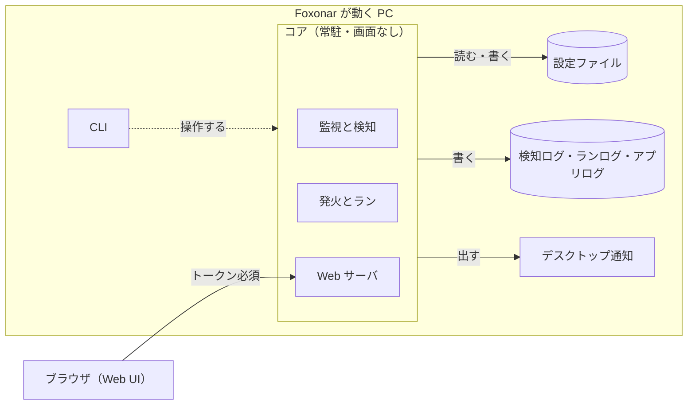
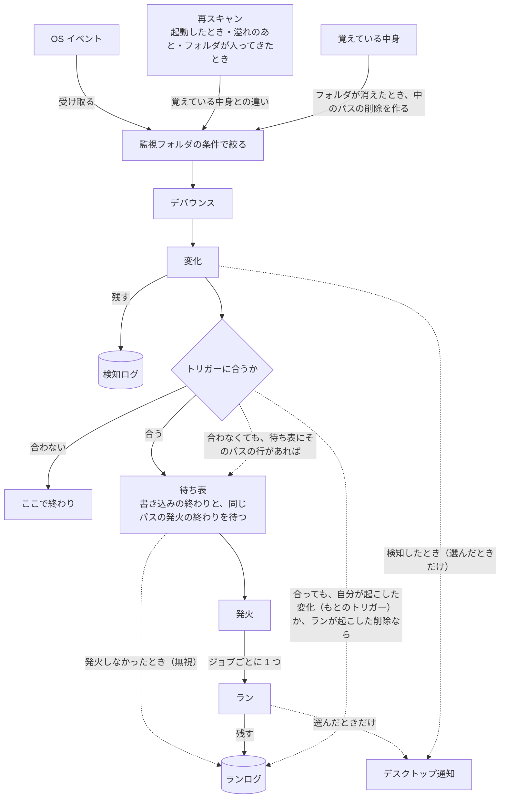
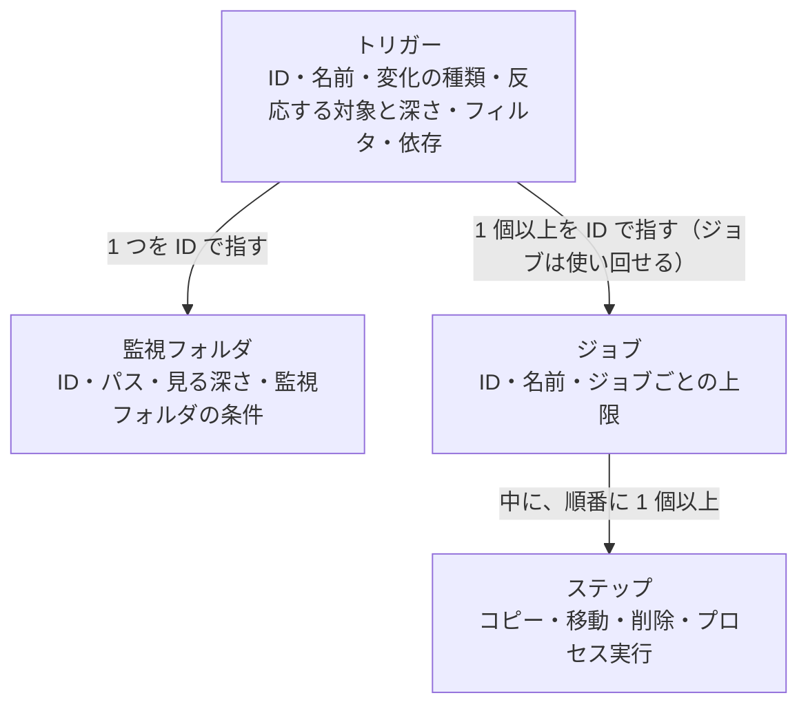
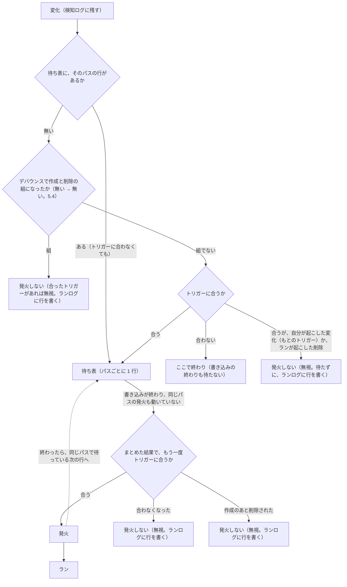

# 設計書

Foxonar の設計書です。決まった「どうやるか」と、そう決めた理由を書きます。

- ここに書いてあることは、決まったこと。仮に決めたものは「仮決め」と書く。
- 本文に書いた以上の理由・採らなかった案・確かめたことがある節には、最後に「理由」の枠を置き、そこに書く。似た話題が出たら、ここを見る。
- まだ決めていないことと、その案は [宿題一覧](todo.ja.md) に書く。決まったら、ここの節にやり方と理由を書き、宿題一覧から消す。
- 言葉は [用語集](glossary.ja.md) の意味で使う。
- 動きの流れを、例を選んで 1 段ずつ追えるページ：[flow.html](flow.html)（ブラウザで開く）。見取り図なので、食い違うときはこの設計書に従う。
- 2026-10-21 までの話し合いの経緯は、昔の議論の記録 `docs/archive/` に残してある。git には入れず、手元にだけ置いている（ふだんは読まなくてよい）。
- 章は外側から内側への順に並べる：目的と範囲 → 全体の構成 → Web UI → 設定ファイル → 監視と検知 → ランの実行 → ログ → デスクトップ通知。最後の 9 章は、何で作るか（物理設計）。
- 英訳は [design.md](design.md)。この日本語版が正本で、英訳は区切りごとに追いつかせる。食い違うときは日本語版に従う。

## 決まったことの要約

| 章 | 決まったこと |
|---|---|
| 1. 目的と範囲 | 監視フォルダを見張り、変化を検知して、トリガーに合ったらジョブを走らせる常駐アプリ。Windows と Linux（画面のないサーバーも）。シェルは使わない。ライセンスは MIT OR Apache-2.0 |
| 2. 全体の構成 | 常駐する「コア」は画面を持たない。画面は Web UI。ログイン時の起動とサービスを選べる。同じ設定ファイルのコアは 1 つだけ。止めるときは猶予の間だけ待ち、走り終わらないランは中断にする。まだ始まっていないものは、次に起動したときに続きから |
| 3. Web UI | コアの中の Web サーバが出す。既定は同じ PC からだけ。合言葉はいつでも必要。`127.0.0.1` 以外は HTTPS だけ |
| 4. 設定ファイル | TOML。全体の設定・監視フォルダ・トリガーの `foxonar.toml` と、ジョブの `jobs.toml` の 2 つ。Web UI から書くのが基本で、人が直接直してもよい。書き換わったら自動で読み直す。起動したときに読めなければ起動しない。トリガーは監視フォルダとジョブを ID で指す。削除はすぐ消す（ごみ箱なし） |
| 5. 監視と検知 | OS イベント → 監視フォルダの条件で絞る → デバウンス → 変化。変化は作成・変更・削除・名前変更・移動。名前変更・移動は区切り。フォルダごとの出入りは中のパスにも広げる。トリガーに合ったら待ち表で、書き込みの終わりと同じパスの発火の終わりを待つ。覚えている中身を持ち、止まっている間のことは監視フォルダごとに選ぶ。監視フォルダを見失ったら知らせて止め、現れたら覚えるだけで見張り直す（起動したときに無いときも、止まっている間に入れ替わっていたときも同じ）。Windows は ReadDirectoryChangesExW に直した notify のフォーク |
| 6. ランの実行 | トリガー 1 つで複数のジョブが並行に走る。順番は依存で書く。ジョブの中のステップは逐次で、失敗したら止まる。依存先が成功しなかったら始めない。成否は終了コード。ステップを止めるときは頼んでから、だめなら強制 |
| 7. ログ | 検知ログ・ランログ（SQLite）とアプリログ（テキスト）。検知 ID とラン ID でたどれる。「なぜジョブが走らなかったか」は全部ランログで分かる |
| 8. デスクトップ通知 | 検知・成功・失敗のどれを知らせるかを利用者が選ぶ。一度にたくさん届いたらまとめる |
| 9. 作り方 | 開発は主に WSL の Ubuntu-24.04 で行う。リポジトリは WSL と Windows の 2 か所に clone し、GitHub でそろえる。Windows での確かめも、WSL から Windows 向けにビルドして行う。Rust の版は `rust-toolchain.toml` で 1.98.1 に決める。push のたびに GitHub Actions で両方の OS で確かめる。パッケージは 1 つ（lib と main）。並行は tokio。状態はコアのループ 1 つが持ち、決まりの部分は OS と時計から切り離す（`logic/` と `sys/`）。ループに届くものは 1 つの enum。SQLite は 1 つのファイル（監視フォルダごとの前の設定と、待っているランのジョブの写しも覚える）、ID はループが通し番号で振る。最初に作る「最小の流れ」のクレートは tokio・notify・toml・globset と regex・rusqlite など。作る順は 9.5 |

## 1. 目的と範囲

### 1.1 Foxonar がすること

- Foxonar は、監視フォルダを見張り、変化を検知して、トリガーに合ったらジョブを走らせる常駐アプリ。利用者が設定したとおりに動く。
- ジョブが無くても、監視フォルダにどんなファイルが来たかを、検知ログで確かめられる。
- 対応する OS は Windows と Linux。Linux は、画面のないサーバーも含む。
- 使い方は 2 つの形がある。

| 形 | 起動のしかた | Web UI の開き方 | デスクトップ通知 |
|---|---|---|---|
| デスクトップで使う | ログイン時に起動 | 同じ PC のブラウザ | 出せる |
| サーバーとして動かす | サービス | SSH のトンネルを使い、手元のブラウザ | 出せない |

### 1.2 やらないこと

- シェルを通したコマンドの実行。外部のプログラムは、プロセス実行で動かす（4.4）。
- ほかの PC やスマホからの接続は、最初は作らない。あとで足す。

> **理由**
> - シェルを使わない：シェルに文字列を渡すと、
>   - ファイル名がコマンドとして実行される。`"{path}"` と引用しても防げない（`$(touch pwned).jpg` という名前のファイルで、sh では `touch pwned` が実行される）。監視フォルダに書き込める人なら誰でも、Foxonar の権限でコマンドを実行できてしまう。
>   - 引用やエスケープの決まりがシェルごと（sh、cmd、PowerShell）に違い、同じ設定を OS をまたいで使えない。
>   - 失敗が見えにくい（パイプの途中の失敗が成功扱いになる）。止めにくい（シェルの子が残る）。
>   - 採らなかった案：対象パスを環境変数でも渡す（シェルの文字列に安全に渡すための案だったので、シェルをやめて不要になった）。
> - ほかの PC やスマホからの接続をあとにする：守りと証明書の用意が要るので、まず同じ PC と SSH のトンネルで始める。

### 1.3 ライセンス

- Foxonar のライセンスは MIT OR Apache-2.0。使う人が、どちらかを選べる。本文は、リポジトリの一番上の `LICENSE-MIT` と `LICENSE-APACHE`。
- 著作権の表示は `Copyright (c) 2026 capypara20`。
- 送ってもらった変更（プルリクエストなど）は、送った人がとくに断らなければ、同じ 2 つのライセンスで公開する。

## 2. 全体の構成

### 2.1 部品



| 部品 | 役割 |
|---|---|
| コア | 監視フォルダを見張り、変化を検知して、発火とランを行う常駐のプログラム。画面を持たない。Web UI を閉じていても動き続ける |
| Web UI | コアの中の Web サーバが出す画面。ブラウザで開き、設定とログを見たり変えたりする |
| CLI | ターミナルから操作するコマンド |
| 設定ファイル | 監視フォルダ、トリガー、ジョブなどを書いたファイル。全体の設定・監視フォルダ・トリガーを書く `foxonar.toml` と、ジョブを書く `jobs.toml` の 2 つ（9.6）。Web UI から書くのが基本で、人が直接編集してもよい |
| 検知ログ | 検知した変化 1 件ごとの記録 |
| ランログ | ラン 1 回分ごとの記録 |
| アプリログ | Foxonar 自身の動き（起動、停止、設定の読み込み、エラーなど）の記録 |
| デスクトップ通知 | OS の通知（Windows のトースト通知など）。用語集の「通知」とは別物。何を知らせるかは利用者が選ぶ |

- `core` は Rust に最初からある `core` と名前がぶつかるので、コードではクレート名を `foxonar-core` にするなどして避ける。

> **理由**
> - コアに画面を持たせず、画面を Web UI にする：ネイティブ GUI（egui など）と Web の画面を比べた。ネイティブ GUI はポートを開けないので安全側だが、画面のない Linux では動かず、ほかの PC やスマホからも使えない。Web なら、画面のないサーバーからも、いつかはほかの PC からも使える。代わりに Web サーバを守る工夫が要る（3.1）。

### 2.2 動きの流れ



- ログやデスクトップ通知には、直接書き込むのではなく、用語集の「通知」として流し、それぞれが購読する。
- トリガーに合わなかった変化も、検知ログには残る。
- トリガーに合った変化は、待ち表で、書き込みの終わりと、同じパスの発火の終わりを待ってから発火する（5.9）。
- 監視フォルダの条件で絞るのは、デバウンスの前（5.5）。
- 変化のもとは 3 つある。OS イベント、再スキャンで見つけた違い（5.2）、覚えている中身から作ったもの（5.6）。どれも監視フォルダの条件で絞り、デバウンスを通して変化になる。
- 溢れたときは、検知ログに「ここで抜けがあった」行を 1 行残す（7.1）。
- トリガーに合ったのに発火しなかったとき（自分が起こした変化、ランが起こした削除、作成のあと削除された、待ち表でまとめ直したら合わなくなった、待ち表で待っている間に設定を読み直したら合わなくなった、待ち表で待っている間に監視フォルダを見失った。5.7、5.9、4.2、5.11）は、ランログに「無視」の行を残す（7.2）。

> **理由**
> - 変化のもとを 3 つとも、デバウンスに通す：フォルダがコピーで来たとき、中を読んで作った作成と、OS から届いた同じパスの Created が、別々の 2 行になるのはおかしい（作成は 1 回しか起きていない）。同じパスなら 1 つにまとまるよう、どれもデバウンスを通す。

### 2.3 起動のしかた

- ログイン時にユーザーとして起動する形（デスクトップ向け）と、OS のサービスとして起動する形（サーバー向け）を選べる。
- サービスでも、動かすユーザーを決められる。
- サービスの注意：
  - Windows のサービスは「セッション 0」で動くので、画面もデスクトップ通知も出せない。
  - Windows のサービスは、既定では強い権限（LocalSystem）で動く。プロセス実行のステップも、その権限で走る。
  - ドライブ文字（`Z:` など）はログインごとの割り当てなので、サービスからは見えない。共有フォルダは UNC パス（`\\server\share`）で書く。

### 2.4 二重起動の防止

- 同じ設定ファイル（同じ `foxonar.toml`）を使うコアは、1 つだけ動ける。違う設定ファイルなら、複数のコアが同時に動いてよい。
  - 複数のコアを動かす例：別々のユーザーの権限で動かす。片方が止まっても、もう片方は動かしておく。
  - 1 つのコアの中でもワーカーは並行に動くので、負荷分散のためだけなら、コアは 1 つで足りる。
- この「二重起動の防止」は、用語集の「ロック」（このパスは発火中、という印）とは別のもの。紛れないように「ロック」とは呼ばない。
- 違う設定ファイルのコアどうしが、同じ監視フォルダ（または重なる場所）を見張っていても、Foxonar は気づかない。同じパスについて、両方のコアのランが走る。ロックはコアの中だけの印なので、ほかのコアとは譲り合わない。利用者の責任とし、利用者向けの説明に書く。
  - 例：コア 1 が `C:\in` のファイルを `D:\done` へ移動し、コア 2 が同じファイルをアップロードする。先に移動が終わると、アップロードは「ファイルが無い」で失敗する。

### 2.5 コアを止めるとき

- 止める場面：Web UI や CLI で止める、サービスとして止める、PC を再起動する、など。
- 新しい発火は始めない。
- 発火したがまだ始まっていないラン（同時実行数の上限や、依存先を待っているラン）も、猶予の間は始めない。枠が空いても、依存先が成功しても、待ったままにし、次に起動したときに続きから始める。
- 走っているランは、決めた猶予の間だけ、終わるのを待つ。猶予を過ぎたら、走っているステップを止め、そのランは「中断」として残す。
  - 止め方は 6.5。プロセス実行のステップでは、子プロセスと、子が切り離さずに起動したプロセスに、終わるように頼む。強制的に止める相手は、OS で違う（6.5）。切り離されたプロセスは止めない（6.3）。
  - ステップの途中で止めても、残りのステップは走らない（6.1）。たとえば「変換してから元のファイルを消す」ジョブで、変換中に止めても、元のファイルは消えない。
- まだ始まっていないもの（待ち表の行と、同時実行数の上限や依存先で待っているラン）は、捨てずに SQLite に残し、次に起動したときに続きから動かす。
  - 待ち表の行は、待ち表に入れた時点で、検知ログ・ランログと同じ SQLite に書く。
  - 発火したが始まっていないランは、発火したときに、ランログに結果「待っている」の行として書く（7.2）。
  - ランは発火したときの設定で走る（4.2）ので、発火したときに、どのランについても、そのときの設定を SQLite に残す。まだ始まっていないランを続きから動かすときも、中断したランを次に起動したときにやり直すとき（6.6）も、これを使う。
- 中断したランを、次に起動したときに自動でやり直すかは、ジョブごとに選べる（6.6）。

> **理由**
> - 待っているランを猶予の間に始めない：猶予の終わりに止められるかもしれないため。
> - 猶予を決めて待つ：終わるまで待つと、長いジョブ（10 分かかる変換など）があると止まらない。PC の再起動では、OS が待つ時間に限りがある（Windows のサービスはふつう数秒〜20 秒、Linux の systemd は既定 90 秒）。
> - まだ始まっていないものを捨てない：覚えている中身は検知するたびに更新されるので（5.2）、捨てると、次に起動したときの再スキャンでも拾われず、ジョブが走らないままになる。
> - 待ち表の行を SQLite に書く：コアが落ちたときにも残るため。

## 3. Web UI

### 3.1 つなぎ方と守り方

- コアの中の Web サーバが出す。
- 既定では、その PC からの接続（`127.0.0.1`）だけを受け付ける。
- 合言葉（トークン）は、同じ PC からの接続でも SSH のトンネルでも、いつでも必要。
- HTTPS：`127.0.0.1` で待ち受けるときは HTTP も許す。それ以外のアドレスで待ち受けるときは、HTTPS だけにする。
  - 同じ PC からの接続も SSH のトンネルも、コアから見るとどちらも `127.0.0.1` からの接続になる。
- 画面のないサーバーでは、SSH のトンネルを使って手元のブラウザから開く。例：`ssh -L 8400:localhost:8400 user@server`（ポート番号は仮）。
- ほかの PC やスマホからの接続は、あとで足す。そのときは HTTPS を強制する。

> **理由**
> - 守りが要る：Web UI から設定を変えられる＝プログラムを実行させられる、ということなので。
> - 合言葉をいつでも必要にする：1 台の PC をほかのユーザーも使っていると、その人も `127.0.0.1` に接続できる。ブラウザで開いた別のサイトから localhost に要求を送る攻撃（CSRF、DNS リバインディング）もあるので、「localhost だけで待ち受ける」だけでは足りない。
> - `127.0.0.1` では HTTP も許す：HTTPS を強制することも考えたが、同じ PC の中の接続は PC の外に出ず、SSH のトンネルはすでに暗号化されている。自分で作った証明書はブラウザが警告を出し、公開の認証局は `localhost` 向けの証明書を出さない。HTTPS にしても守りはほとんど増えず、警告の手間だけが増える。localhost の危険は、合言葉などで防ぐ。

### 3.2 できること

- 設定を見る・変える。
- 検知ログ・ランログ・アプリログを見る。検知ログとランログを ID でたどる（7.2）。
- ログは、ふだんは Web UI で見る。ログのファイルを開くのは、困ったときだけのつもり。

## 4. 設定ファイル

### 4.1 形式と書き手

- 設定は Web UI から書くのが基本。人が設定ファイルを直接編集してもよい。
- そのため、人が読める形にする。形式は TOML にする。
- 注意：
  - Web UI で開いている間に人がファイルを直接書き換え、Web UI が古い内容のまま保存すると、人の書き換えが消える。
  - Web UI から保存すると、人が書いたコメントや並び順が消えることがある。
- 設定ファイルは、全体の設定・監視フォルダ・トリガーを書く `foxonar.toml` と、ジョブを書く `jobs.toml` の 2 つに分け、同じフォルダに置く。書き方は 9.6。
- Web UI から保存するときは、開いたあとに設定ファイル（2 つのどちらか）が書き換わっていないかを、保存の前に確かめる。書き換わっていたら保存せず、「開いたあとに書き換えられています。読み込み直してから、もう一度直してください」と知らせる。Web UI を 2 つのタブで開き、両方から保存したときも同じ。

> **理由**
> - TOML：コメントが書け、Rust の `Cargo.toml` と同じ形のため。
> - 2 つに分ける：「何を見張るか」と「何をするか」が分かれて読みやすい。ジョブは使い回すもの（4.3）なので、ジョブだけの一覧があると探しやすい。
>   - 採らなかった案：1 つのまま（いちばん簡単だが、ジョブが増えると長くなる）、フォルダの中の `*.toml` をすべて読み、好きな数に分けられる（自由だが、ファイルをまたぐ定義順や、Web UI がどのファイルに書くかを決める必要がある）。

### 4.2 読み直し

- 設定ファイルが書き換わったことに気づくと、コアが自動で読み直す。Web UI から保存したときも、人が直接編集したときも、同じしくみで読み直す。一時停止のボタンは付けない。
  - 2 つのファイルのどちらかが書き換わったら、両方を読み直し、ID の指し先が合っているかを一緒に確かめる。
  - 例：`foxonar.toml` のトリガーに `jobs = ["resize"]` と書いて保存したが、`jobs.toml` にはまだ `resize` が無い。このときは読み込みの失敗になり、前の設定のまま動き続ける（下）。`jobs.toml` に `resize` を書いて保存すると、新しい設定で動く。
- 読み直したことは、時刻とともにアプリログに書く（7.2）。
- 読み直したあと、最初の発火から新しい設定を使う。それより前に発火したランは止めず、発火したときの設定のまま最後まで走る。依存でつながったランも、同じ設定で走る。
  - コアの中では、発火ごとに、発火したときの設定を持たせることで、この動きを作る。
  - 待ち表で待っているパスは、まだ発火していない。待っている間に設定を読み直したら、発火するとき（待ち表を出るとき）の設定で、トリガーに合うかを確かめ直す。トリガーが消えていれば発火しない。
    - トリガーが消えた・変わって合わなくなったときは、無視として、ランログに「無視」の行を書く（理由「設定を読み直したら、トリガーが無くなった」など。7.2）。
- 設定の読み込みの失敗：TOML の書き間違い、必ず書く項目が無い（5.2）、無い ID を指している、知らないキーがある（9.6）、など。監視フォルダが無いことは、読み込みの失敗にしない（見失ったとする。5.11）。
  - 動いている間に読み直して失敗したら、壊れた設定は使わず、前の設定のまま動き続ける。アプリログと Web UI で、読み込みに失敗したこと（何行目の、何が悪いか）と、前の設定のまま動いていることを知らせる。
  - 起動したときに失敗したら、起動しない。理由をアプリログに書いて終わる。Web UI もコアの中にあるので、設定ファイルを直接直す。
  - 注意：動いている間に読み直しに失敗し、直さないまま止めると（PC の再起動など）、次は起動しない。

> **理由**
> - 起動したときに失敗したら起動しない。
>   - 採らなかった案：最後に正しく読めた設定で起動する。
> - 設定の版を書かない：設定ファイルの版は要らないが、読み直したことはログに欲しい。

### 4.3 設定の部品のつながり



- 図には、主な項目だけを書いている。ほかに、監視フォルダごとのデバウンス時間（5.4）・書き込みが終わったかを確かめる間隔（5.9）・止まっている間に起きたことの扱いと、覚えている中身が無いときの扱い（5.2）、ステップごとの上書き（4.4）・成功とみなす終了コード（6.3）、ステップごととジョブごとの時間の上限（6.4）、ジョブごとの、中断したランを自動でやり直すか（6.6）などがある。
- 監視フォルダ、トリガー、ジョブは、それぞれ ID を持つ。トリガーが走らせるジョブも、依存先のジョブも、ID で指す。
  - ID は、利用者が設定に書く。使える文字は英数字と `-`・`_`（例：`inbox`）。同じ種類の中で重ならないようにする（トリガーとジョブに同じ ID を使うのはよい）。
  - ID とは別に、わかりやすい名前（日本語でよい。例：「受信箱」）を書ける。名前は Web UI やランログに出す。いつ変えてもよい。書かなければ、ID を名前の代わりに出す。
  - 例：監視フォルダの名前を「受信箱」から「仕事の受信箱」に変えても、ID（`inbox`）はそのままなので、トリガーの指し先も、覚えている中身（9.3）も、そのまま使える。
- トリガーは監視フォルダの外に書き、監視フォルダを ID で指す。
- 1 つのトリガーが見張る監視フォルダは、1 つだけ。1 つの監視フォルダを指すトリガーは、0 個以上でよい。トリガーの無い監視フォルダを書いてよい。
- 1 つのトリガーに、変化の種類を複数書ける（作成と変更、など）。
- 1 つのトリガーに、ジョブを複数書ける。ジョブ同士の依存もトリガーに書く（6.1）。
- 監視フォルダには「見る深さ」を数で必ず書く。すぐ下を 1 段目と数え、0 なら制限なし（キーは `max_depth`。9.6）。これより深い所の変化は検知しない。
- トリガーには、反応する対象（ファイル、フォルダ、両方）と「反応する深さ」（数。書かなければ見る深さまで全部）を書ける。フィルタの名前のパターンは、名前だけに当てる。
- フィルタのパターンは、glob（`*.jpg`、`{*.jpg,*.png}`、`scan_??.pdf`）でも、正規表現（`^IMG_\d{4}`）でも書ける。どちらで書いたかを、設定の中で書き分ける。
  - glob は、いつも名前全体に当てる。正規表現は、名前の一部に合えばよい（名前全体に合わせたいときは `^` と `$` を書く）。
  - 大文字と小文字は、OS に合わせる。Windows では区別せず（`*.jpg` は `CAT.JPG` にも合う）、Linux では区別する（`*.jpg` は `CAT.JPG` に合わない）。
- 同じジョブをほかの監視フォルダでも使いたいときは、トリガーを分けて書き、同じジョブを指す。

> **理由**
> - ID と名前を分ける：名前を ID にすると、名前を変えたときに、指している所をすべて直す必要があり、監視フォルダなら別の監視フォルダとして扱われ、覚えている中身を引き継がない（9.3。「すべて作成として扱う」なら、中のファイルにもう一度ランが走る）。ランログも、ID と「そのときの名前」を別の列で持っている（7.2）。英数字に絞るのは、CLI で打ちやすくするため。
>   - 採らなかった案：わかりやすい名称を ID にする（書くのは 1 つで済むが、上の困りごとがある）、Foxonar が ID を振って設定ファイルに書き足す（人が書いている最中の設定ファイルを、Foxonar が書き換えることになる）。
> - トリガーを外に書き、ID で指す：設定の形を正規化できる。ジョブも ID で指すので、形が揃う。構成は少し複雑になるが、正規化するならこの形がいちばんよい。
> - 監視フォルダは 1 つだけ：変化の種類を複数使いたいなら、1 つのトリガーに複数書けば足りる。複数の監視フォルダで同じジョブを使うことはまず無く、要るならトリガーを分けて同じジョブを指せばよい。
> - トリガーの無い監視フォルダを許す：ジョブが無くても、検知ログを残したい場合がある（1.1）。
> - ジョブを複数書ける：1 つに限ると、同じ条件で別のジョブを走らせたいとき、同じ条件のトリガーを 2 つ書くことになる。
> - 深さを数で書く：`**` のようなパターンより直感的。
> - フィルタを glob と正規表現の両方で書ける：ふだんは読みやすい glob で書き、「数字 4 けただけ」のような細かい指定が要るときだけ正規表現を使う。前に作った cat-watcher も、両方（globset と regex）を使っていた。
>   - 採らなかった案：glob だけ（正規表現は要ると分かってから足す）、正規表現だけ（読みにくく、`.` を `\.` と書き忘れるなどの間違いが起きやすい）。
> - 正規表現は名前の一部に合えばよい：正規表現のふつうの動きなので、正規表現を知っている人が迷わない。
>   - 採らなかった案：glob と同じく、名前全体に合う必要がある。
> - 大文字と小文字は OS に合わせる：その OS のファイルの名前の決まり（Windows は区別しない、Linux は区別する）と同じになる。同じ設定でも、OS で結果が変わることがある。
>   - 採らなかった案：どちらの OS でも区別しない、どちらの OS でも区別する。
> - トリガーにも反応する深さを置く：監視フォルダの側だけにすると、深さの違う監視フォルダを同じ場所に 2 つ作ることになり、検知ログに同じ変化が 2 行ずつ残る。

### 4.4 ステップ

- 組み込みのステップは、コピー、移動、削除の 3 つ。外部のプログラムは、プロセス実行で動かす。
- 同じフォルダの中での名前の変更は、移動でできる。
- 「フォルダを作る」は、独立したステップにしない。コピーと移動に、「行き先のフォルダが無ければ作る」かどうかを書けるようにする。
- コピーと移動では、行き先に同じ名前があったときに上書きするかどうかを、ステップごとに選べる。上書きしない場合は、そのステップの失敗になる（残りのステップも止まる。6.1）。
- 削除は、すぐ消す。ごみ箱には入れない。
  - 消えてほしくないときは、削除の代わりに、移動で退避用のフォルダへ移す。
- プロセス実行のプログラムは、フルパスでも、PATH から探す名前でも書ける。パスの中に環境変数も書ける。
  - 注意：常駐するコアの PATH は、ターミナルの PATH と違うことがある（Windows のサービスや systemd から起動した場合など）。「ターミナルでは動くのに、常駐させると動かない」が起きやすい。
- `.bat` と `.cmd` は、そのまま起動できる。`.ps1` は、プログラムに `powershell`（または `pwsh`）を指定し、引数を `-File スクリプト ${path}` とする。
- プレースホルダは、`${path}` のように `${` と `}` で名前を囲んで書く。ランごとに、対象パスなどの値に置き換わる。
  - 例：引数に `["${path}", "-resize", "200x200"]` と書くと、対象パスが `C:\in\photos\cat.jpg` のランでは、`C:\in\photos\cat.jpg -resize 200x200` を渡す。
  - 使えるプレースホルダは次のとおり（監視フォルダが `C:\in`、対象パスが `C:\in\photos\cat.jpg`、変化を検知したのが 2026-10-25 23:59:10 の場合）。安全のための決まりは、宿題一覧 4.3。

| プレースホルダ | 値 | 使う場面の例 |
|---|---|---|
| `${path}` | `C:\in\photos\cat.jpg` | 対象パスをプログラムに渡す |
| `${dir}` | `C:\in\photos` | 同じフォルダに結果を書く（`${dir}\thumb_${name}`） |
| `${name}` | `cat.jpg` | 名前だけを知らせる |
| `${stem}` | `cat` | 拡張子を変えて書き出す（`${stem}.webp`） |
| `${ext}` | `jpg`（点は含めない。拡張子が無ければ空） | 拡張子で書き分ける |
| `${rel}` | `photos\cat.jpg`（監視フォルダからの相対パス） | サブフォルダの構成を保ったままコピーする |
| `${old_path}` | 変更前のパス（名前変更・移動のときだけ値がある） | 古い名前のものを消す |
| `${date}` | `2026-10-25`（変化を検知した日） | 来た日ごとのフォルダへ移す（`D:\archive\${date}\${name}`） |
| `${time}` | `23-59-10`（変化を検知した時刻。`:` の代わりに `-`） | 名前に時刻を付けて重ならないようにする（`${stem}_${date}_${time}.${ext}`） |
| `${env:NAME}` | 環境変数 `NAME` の値 | `${env:USERPROFILE}` など |

  - `${date}` と `${time}` は、ランに書く検知 ID の変化（7.2。待ち表で 1 行にまとめたときは最後の変化）を検知した日時。手元の時計の時刻で書く。
    - 例：23:59 に検知し、同時実行数の上限で待って、翌日 00:01 にランが始まっても、`${date}` は検知した日の `2026-10-25`。

> **理由**
> - フォルダを作るステップを独立させない：独立したステップは、使う場面がはっきりしてから足す。
> - プレースホルダを `${path}` の形にする：VS Code のタスク設定と同じ形で、OS に関係なく同じ書き方になる（`$HOME` と `%USERPROFILE%` のような違いが無い）。
>   - 採らなかった案：`{path}` の形（短いが、引数にそのまま `{` を書くプログラム（JSON を渡す、など）と紛れやすい）。
> - `${date}`・`${time}` を検知した日時にする：ファイルが来た日で分けられる。待っていたランでも、来た日とずれない。中断したランをやり直しても同じ値になるので、同じ名前になる。時刻に `:` を使わないのは、Windows のファイル名に使えないため。
>   - 採らなかった案：ランが始まった日時（待ちが長いと来た日とずれ、やり直すと別の名前になる）、`${date:%Y%m%d}` のように書式も書けるようにする（自由だが、書式の決まりを覚える必要がある。要ると分かってから足す）。
> - ごみ箱をやめる：ごみ箱に入れるクレート（`trash`）は、Windows のネットワークの場所で、成功と返したのに、ごみ箱に入れずに消した（2026-10-21 の実験）。「ごみ箱が使えない場所なら失敗にする」は、そのままでは作れない。サービスでは別のユーザーのごみ箱に入る、画面の無いサーバーではたまり続ける、といった注意もあった。しくみの上で難しいので、やめた。
>   - 採らなかった案：ローカルのドライブだけごみ箱を許し、消す前にドライブの種類を調べる。
> - `.bat` と `.cmd` を許す：Windows は内部で cmd を起動して渡すので、しくみとしてはシェルを通すのと同じ。ただ、Rust 1.77.2 以降の標準ライブラリは、cmd 向けに引数をエスケープし、安全にできない引数はエラーにする（CVE-2024-24576 の修正）。変わった名前のファイルで失敗することはあっても、意図しないコマンドは実行されない。禁止すると、使いたい人は `cmd /C ...` と書くことになり、こちらは保護の対象外なので、かえって危ない。

## 5. 監視と検知

### 5.1 監視フォルダの条件

- 監視フォルダごとに、検知するものを絞れる。絞る条件の例：
  - 隠しファイルを含むか
  - ファイルとフォルダのどちらの変化を検知するか
  - 名前やパターン
- 絞り込みは 2 か所ある。

| 絞る場所 | 外れたもの |
|---|---|
| 監視フォルダの条件 | 検知しない。検知ログにも残らない |
| トリガーのフィルタ | 検知はする（検知ログに残る）が、発火しない |

- 「隠しファイル」の意味は OS で違う。Windows ではファイルの属性（隠し属性）、Linux では名前が `.` で始まるもの。
- 隠しファイルを含まない監視フォルダでは、隠しファイルの削除も検知しない。
  - Windows では、Deleted の OS イベントに付いてくる属性で、隠しファイルだったかを見分ける（5.12）。新しい版の命令が使えず、古い版に切り替えた監視フォルダでは、消えたあとの属性は確かめられないので、Deleted が届いたパスが、覚えている中身（とデバウンス中のもの）にあれば検知し、無ければ捨てる。隠しファイルは初めから外れているので、覚えている中身に入っていない。
  - 例：Word が開いている間だけある隠しファイル `~$report.docx` は、Word を閉じて消えても、検知ログに出ない。
  - あとから隠し属性が付いたファイルは削除、外れたファイルは作成として扱う。名前変更・移動で監視フォルダの条件から出入りしたとき（5.8）と同じ。
  - 属性を確かめる前にパスが消えていた Created は、隠しファイルではないとみなして検知する。
- 監視フォルダの条件で外れたフォルダは、その中のパスも、見る深さの末端まですべて外す（`.gitignore` と同じ）。
  - 例：名前が `.git` のものを外すと、`.git\` だけでなく、`.git\index` や `.git\objects\` の中も検知しない。
  - フォルダが入ってきたときも、条件を先に当てる。外れたフォルダの中は再スキャンしない（5.6）。

> **理由**
> - 監視フォルダで絞る：すべての変化を検知ログに残すと、Office の一時ファイル（`~$…`）やダウンロード中の `.crdownload`・`.part` などで量が増える。
> - 隠しファイルの削除も検知しない：条件が「隠しファイルを含まない」なら、削除も検知しないのが自然。
> - あとから隠し属性が付いたら削除にする：付いたときに覚えている中身から消さないと、あとで消したときに削除が出てしまう。
> - 分からないときは検知する：一瞬来たことも検知ログに残す（5.4）ほうに合わせる。

### 5.2 止まっている間と、覚えている中身

- コアが止まっている間に起きたことは、監視フォルダごとに扱いを選べる。どちらかを必ず書く（書いていない設定は、読み込みの失敗になる）。
  - 再スキャンする：起動したときに再スキャンし、覚えている中身との違いを変化として扱う。
  - 覚えるだけ：起動したあとの変化だけを扱う。起動したときに中を読み、覚えている中身を今の様子に合わせるが、違いは変化にしない（再スキャンではない）。
  - 起動したときに監視フォルダが無いとき、止まっている間に別のフォルダに入れ替わっていたときは、この選び方に従わない（5.11）。
- 覚えている中身は、変化を検知するたびに更新し、コアを止めても残る。動いている間は、上の選び方に関係なく覚える。
- 覚えている中身には、パスごとに、ファイルかフォルダか、大きさ、更新日時を覚える。再スキャンでは、この 3 つとパスで比べる。
  - フォルダは、あるか無いかだけで比べる（大きさと更新日時は比べない）。フォルダの更新日時は、中のものが変わると変わるが、フォルダの変更は作らない（5.6）ため。
  - 止まっている間に上書きされたファイルも、大きさか更新日時が変わるので、変更として見つかる。
  - 大きさも更新日時も同じまま中身だけ変わったファイルは、見つからない。
- 注意：止まっている間の名前変更・移動は、比べただけではどこからどこへ変わったか分からないので、削除と作成に見える。
- 覚えている中身が無いとき（初めて起動したとき、設定に新しい監視フォルダを足したとき）に、すでにあるファイルをどう扱うかも、監視フォルダごとに選べる。これも必ず書く。
  - 覚えるだけ：今あるファイルを、覚えている中身に入れるだけで、発火しない。
  - すべて作成として扱う：今あるファイルのパスすべてを、作成の変化として扱う（トリガーに合えばランが走る）。たまったファイルをまとめて片付けたいときに使う。
- 監視フォルダのパス・見る深さ・監視フォルダの条件を変えたときは、見る範囲が変わった部分だけを扱い直す。起動したときも、動いている間に設定を読み直したときも同じ。
  - 見え始めた部分：覚えている中身が無いときと同じ扱い（覚えるだけ、またはすべて作成として扱う）。
  - 見えなくなった部分：削除の変化にせず、覚えている中身から消す（忘れる）。
- 溢れのあとの再スキャンで見つけた違いも、起動したときの再スキャンと同じく、変化として扱う（トリガーに合えば発火する）。
- 溢れたら、すぐには再スキャンせず、落ち着いてから 1 回だけ行う。
  - デバウンスと同じ考え方で、最後の溢れや OS イベントから数え直し、一定の時間なにも届かなくなったら、監視フォルダ全体（見る深さまで）を再スキャンする。その間に何度溢れても、再スキャンは 1 回にまとめる。
  - ずっと落ち着かない監視フォルダ（ログが書き足され続けるなど）でも、最初の溢れから一定の時間がたったら、落ち着いていなくても 1 回行う。
  - 例：20,000 個のファイルのコピー中（10:00:00〜10:03:00）に 3 回溢れた。検知ログには溢れの行が 3 行残り、再スキャンはコピーが終わって落ち着いた 10:03:05 ごろに 1 回だけ。
  - 止まっている間に起きたことの扱いに関係なく行う。溢れは、起動したあとのことのため。
  - どの監視フォルダで溢れたか OS が知らせないときは、すべての監視フォルダを再スキャンする（Linux の inotify は、どこで溢れたかを知らせない）。

> **理由**
> - どちらかを必ず書く：書かないという選択肢は無い。どちらを選んでも、ジョブが走るか走らないかが大きく変わるので、利用者が選ぶ。
> - 「覚えるだけ」でも覚え直す：覚えている中身は、動いている間にも使う（隠しファイルの削除の見分け 5.1、溢れのあとの再スキャン、フォルダが消えたときの中のパス 5.6）。古いままだと、溢れのあとの再スキャンで、止まっている間に起きたことまで変化として出てしまう。覚え直しても違いは変化にしないので、「何もしない」意図は守れる（「何もしないなら覚え直す必要はないのでは？」という問いへの答え）。
> - 大きさと更新日時で比べる：止まっている間に上書きされたファイルも見つかる（rsync や Syncthing と同じ見分け方）。覚えるものを増やすと重くなるので避けたい。
>   - 採らなかった案：ファイル ID（止まっている間の名前変更も見分けられるが、USB メモリや一部のネットワークドライブでは毎回変わる）、中身の指紋（起動のたびに全部のファイルを読むので遅い）。
> - 範囲が変わった部分だけ扱い直す：覚えている中身とそのまま比べると、パスを `C:\in` から `D:\in` に変えただけで、`C:\in` のファイルがすべて削除に見え、削除のトリガー（バックアップからも消す、など）が動いてしまう。全部をやり直すと、条件を少し変えただけで、すべてのパスにもう一度ランが走ることがある。
> - 溢れのあとの違いも変化にする：溢れで取りこぼした分を取り戻すため。
> - 落ち着いてから 1 回だけ：溢れるのは大量のコピーなどで忙しいとき。溢れるたびにすぐ再スキャンすると、重いコピーの最中に、何度もフォルダ全体を読み直すことになる。デバウンスと同じ考え方。

### 5.3 監視フォルダの外との移動

- 監視フォルダの外から入ってきた移動は作成、外へ出ていった移動は削除として扱う。
  - 監視フォルダ A から監視フォルダ B への移動は、A では削除、B では作成になる。
  - 見る深さより深い所との間の移動も、外との移動と同じ扱いになる。
- 同じ監視フォルダの中で、パスの入っているフォルダが変わったときは、移動の変化にする（5.5、5.6）。

> **理由**
> - 外との移動を作成・削除にする：監視フォルダから見れば、本当に「来た」「無くなった」ので自然であり、OS の知らせ方とも合う。

### 5.4 デバウンスのまとめ方

- 1 つのパスの状態は「無い」と「ある」の 2 つ。作成は「無い → ある」、削除は「ある → 無い」、変更は「ある」のまま。名前変更と移動は、ここではまとめない（5.5）。
- デバウンス時間の間に、同じパスの OS イベント（名前変更・移動のものを除く）が複数届いたときは、1 つにまとめる。まとめた結果は、はじめとおわりの状態で決める。
  - 無い → ある は作成、ある → 無い は削除、ある → ある は変更。
  - 途中で何回切り替わっても、はじめとおわりだけを見る。切り替わりの数が奇数なら、おわりははじめと逆。偶数なら、はじめと同じ。
- ただし、はじめもおわりも「無い」ときは、1 つにまとめず、作成と削除の 2 つを残す。
- デバウンス時間は、最後の OS イベントから数え直す。書き込みが続いている間は待ち続けるので、大きなファイルのコピーは作成 1 つになる。デバウンス時間より長く間が空いたら、そこで区切り、別々にまとめる。
- デバウンス時間は、監視フォルダごとに変えられる。0 にすると、デバウンスしない（OS イベント 1 つが変化 1 つ）。

| はじめ | 切り替わりの数 | おわり | 例 | まとめた結果 |
|---|---|---|---|---|
| ある | 0 | ある | 直接上書き | 変更 1 つ |
| ある | 1 | 無い | 削除 | 削除 1 つ |
| ある | 2 | ある | 消してから作り直す。一時ファイルを監視フォルダの条件で外しているときの Word などの保存 | 変更 1 つ |
| ある | 3 | 無い | 作り直して、すぐ消した | 削除 1 つ |
| 無い | 1 | ある | 大きなファイルのコピー | 作成 1 つ |
| 無い | 2 | 無い | 一時ファイル（来てすぐ消えた） | 作成と削除の 2 つ（検知ログに残る）。どちらがトリガーに合っても、組として打ち消すので、ランは走らない（5.9） |
| 無い | 3 | ある | 来て、すぐ作り直された | 作成 1 つ |

- OS イベントは、変化の種類と紛れないように、FileSystemWatcher の呼び方（Created、Changed、Deleted、Renamed）で書く。

> **理由**
> - デバウンスを残す：「そもそもデバウンスしない」案も考えた（しくみが簡単で、待たずに反応し、OS が知らせたことが何も消えない）。やめると困る場面がある。
>   - 一時ファイルを外した監視フォルダで Word の保存をすると、削除と作成の 2 つになり、削除のトリガー（バックアップからも消す、など）が動いてしまう。
>   - Linux で大きなファイルをコピーすると、書き込みのたびに OS イベントが届く（1 GB で 9,000 件ほど。2026-10-20 の実験）ので、検知ログが数千行になる。
>   - 直接上書きでは Changed が 2 回届くので、変更が 2 つになる。
>   - 「ばらばらに検知したい」場面のために、0 も選べるようにした。
> - はじめもおわりも「無い」ときは 2 つ残す：一瞬でもファイルが来たことを、検知ログで分かるようにするため。
> - 確かめたこと：PowerShell の FileSystemWatcher（Windows では ReadDirectoryChangesW を使う）で、保存のしかたを 3 通り再現した（2026-10-19）。
>   - 直接上書き：元のパスに Changed が 2 回届く（中身を空にする、書き込む）。
>   - 一時ファイルとの入れ替え（Word と同じ形）：元のパスには Changed が 1 回も届かない。元のパスから別の名前への Renamed（ある → 無い）と、一時ファイルから元のパスへの Renamed（無い → ある）だけが届く。一時ファイルを監視フォルダの条件で外していれば変更 1 つ、外していなければ名前変更などがそのまま見える（5.5）。
>   - 消してから作り直す：元のパスに Deleted、Created、Changed が届く。元のパスから見れば「ある → 無い → ある」なので、変更 1 つになる。

### 5.5 名前変更・移動のまとめ方

- 名前変更・移動の OS イベント（Renamed と、Windows で背番号から組み合わせた移動。5.12）は、ほかの OS イベントとまとめない。名前変更・移動の変化 1 つとして残し、そこが区切りになる。Created・Changed・Deleted は、区切りの前と後で、それぞれ 5.4 の「はじめとおわり」でまとめる。
  - 例：名前を変えたすぐあと（デバウンス時間の中）に書き込みが来たら、名前変更 1 つと変更 1 つ。
- 名前と入っているフォルダの両方が変わったときは、名前変更でもあり移動でもある 1 つの変化にする。名前変更のトリガーも、移動のトリガーも反応する。
- 片側が監視フォルダの条件の外の名前変更・移動は、Created か Deleted として扱い（5.8）、5.4 の「はじめとおわり」でまとめる。
- 監視フォルダの条件で絞るのは、デバウンスの前（OS イベントの段階）。片側が外の Renamed を、Created や Deleted として扱ってからまとめるため。
- そのため、まとめた結果は監視フォルダの条件で変わる。

| デバウンス時間の中で起きたこと | A：一時ファイルを外していない | B：一時ファイル（`*.tmp`、`~*` など）を監視フォルダの条件で外している |
|---|---|---|
| 名前を変えただけ | 名前変更 1 つ | 名前変更 1 つ |
| 名前を変えて、すぐ書き込み | 名前変更 1 つと変更 1 つ | 名前変更 1 つと変更 1 つ |
| 仮の名前 `scan_01.tmp` で書いて、`scan_01.pdf` に名前を変えた | `scan_01.tmp` の作成と、名前変更 1 つ | `scan_01.pdf` の作成 1 つ（外から中への名前変更） |
| Word などの保存（一時ファイルとの入れ替え） | 一時ファイルの作成、名前変更 2 つ、一時ファイルの削除 | 元のファイルの変更 1 つ（消えて → 現れた） |
| 続けて 2 回名前を変えた（a → b → c） | 名前変更 2 つ | 名前変更 2 つ |
| 別のサブフォルダへ移した（`a.txt` → `sub\a.txt`） | 移動 1 つ | 移動 1 つ |
| 名前も変えて、別のサブフォルダへ移した（`a.txt` → `sub\b.txt`） | 名前変更・移動 1 つ（名前変更でもあり、移動でもある） | 名前変更・移動 1 つ |
| 大きなファイルのコピー | 作成 1 つ | 作成 1 つ |

- トリガーの書き方の目安：
  - ダウンロードやスキャンを待つ：変化の種類に、作成と名前変更の両方を書く（A なら名前変更で、B なら作成で拾える）。
  - 保存を拾う：A なら変更と名前変更、B なら変更。
- トリガーのフィルタは、検知には効かない。検知したあとで、そのトリガーを発火させるかを決めるだけなので、上の表はトリガーのフィルタでは変わらない。
- 移動を見分けるかどうかの、監視フォルダごとの設定は作らない。トリガーに「移動」を書くかどうかで選ぶ。

> **理由**
> - 名前変更・移動を区切りにする：名前変更は名前変更として取りたい。同時に起きた名前変更と変更は、別にしたほうが、そのあとのジョブを正確に設定できる。
>   - 採らなかった案：元のパスが「ある → 無い」、新しいパスが「無い → ある」のときだけ名前変更にし、ほかは「はじめとおわり」で数える。仮の名前で書いてすぐ名前を変えたファイルは作成、Word の保存は変更、と場合によって決まりが分かれる。完全に統一したほうがよい。
> - 移動を名前変更と分ける：サブフォルダへ移しても、名前は変わっていない（名前変更と呼ぶ Linux のほうが、誤検知に近い。名前変更は作成・変更・削除の 3 つに収まらないので、分類を増やすのがよい）。削除＋作成と呼ぶと、移しただけで作成や削除のトリガーが走る（例：`inbox\report.pdf` → `inbox\done\report.pdf` で、サムネイルとクラウドからの削除が走る）。
>   - 採らなかった案：削除＋作成と呼ぶ（作るのは簡単だが、あとで移動に変えると、今までのトリガーの動きが変わる）、名前変更と呼ぶ（名前は変わっていない）。
> - 名前も変わったときは両方に当たる：名前変更のトリガーも、移動のトリガーも動いてほしい。
>   - 採らなかった案：移動だけにする、名前変更だけにする。
> - 確かめたこと（2026-10-21）：監視フォルダの中で別のサブフォルダへ移すと、Windows は Deleted＋Created（＋移した先のフォルダの Changed）、Linux は Renamed として知らせる。Windows でも、新しい版の命令なら背番号で組み合わせられる（5.12）。

### 5.6 フォルダの変化

- 監視フォルダには、ファイルだけでなくフォルダも来る。フォルダごと入ってきた・消えたときは、フォルダ自身の変化に加えて、中のパス（ファイルもフォルダも、見る深さまで）1 つずつにも、同じ変化（作成・削除）があったとして扱う。
  - 入ってきたとき：フォルダの中を再スキャンし、見つけたパスを作成として扱う。コピーの途中で読んでも、読んで見つけた作成と、OS から届いた同じパスの Created は、デバウンスで 1 つにまとまる（2.2）。
  - 消えたとき：中身はもう見えないので、覚えている中身から、中のパスの削除を作る。
- フォルダの名前が変わったときは、フォルダ 1 つの名前変更だけにする。中のパスの名前変更は作らず、覚えている中身のパスだけを書き換える。
  - そのため、中のファイルを 1 つずつ別のフォルダへ移したとき（ファイルごとに移動が出る）とは、結果が違う。
- フォルダが、同じ監視フォルダの中の別のフォルダへ移ったときも、フォルダ 1 つの移動だけにする。中のパスの移動は作らず、覚えている中身のパスだけを書き換える。
- フォルダの変更は作らない。Windows では、フォルダの中で何か起きると、そのフォルダ自身の Changed が届くが、隠し属性の出入り（5.1）を見るためだけに使い、変化にはしない。
- 検知では、フォルダも中のパスも、1 つずつ別の変化にする。どれに反応するかは、トリガーの「反応する対象」と「反応する深さ」で選ぶ（4.3）。
- 例：監視フォルダ `C:\watch`（見る深さは 0 で制限なし）に、`hoge\` が中身ごと入ってきた。

```
C:\watch
  hoge\          1 段目のフォルダ
    test.txt     2 段目のファイル
    sub\         2 段目のフォルダ
      a.txt      3 段目のファイル
```

| 検知する変化 | トリガー F：フォルダ・作成・反応する深さ 1 | トリガー T：ファイル・作成・`*.txt` |
|---|---|---|
| `hoge\` の作成 | 反応する | 反応しない（フォルダ） |
| `hoge\test.txt` の作成 | 反応しない（ファイル） | 反応する |
| `hoge\sub\` の作成 | 反応しない（2 段目） | 反応しない（フォルダ） |
| `hoge\sub\a.txt` の作成 | 反応しない（ファイル） | 反応する |

- 注意：
  - 中のファイルが多いと、覚えておく量と、中を読む時間が増える。中のパスの変化が一度に大量のランになることもある（同時実行数で抑える）。
  - Windows の OS は、「そのフォルダだけ」か「全部の深さ」でしか見張れない。見る深さを途中で切ると、深い所の OS イベントも届くので、Foxonar が捨てる。Linux はフォルダごとに見張るので、見る深さまでしか見ない。

> **理由**
> - フォルダの出入りを中のパスにも広げる：OS は、フォルダごとの移動・ごみ箱への削除では、中のパスについて何も知らせない。コピーや Shift+Delete では 1 つずつ知らせる。そのままだと、同じことをしても、やり方でジョブが走ったり走らなかったりする。どちらのやり方でも同じ結果にする（5.5 と同じ、統一の考え方）。
>   - きっかけ：監視フォルダにはフォルダも来る。cat-watcher でも、フォルダを指定したトリガーで、フォルダの作成と中のファイルの作成を分けるかが紛らわしかった。
>   - 「難しくないか」という心配について：入ってきたときは再スキャンと同じしくみで中を読み、消えたときは覚えている中身から作るので、新しいしくみは少ない。Facebook の Watchman も、中身を覚えておき、1 つずつ知らせる。
> - フォルダの名前変更は 1 つだけ：名前を変えただけで、中のファイルの名前は変わっていない。`C:\Program` を `C:\Program2` にしただけで、配下すべてに名前変更が出るのは過剰。
> - フォルダの変更を作らない：Windows は、フォルダの中で何か起きるたびにフォルダの Changed を届け、Linux は届けない（2026-10-21 の実験）。そのまま使うと OS で動きが違う。フォルダを監視対象にしても、変更を検知して使う場面がほとんど無い。「フォルダの中の変更」が欲しくなったら、Foxonar がすぐ下のパスの変化から作る形で、あとで足す。

### 5.7 自分が起こした変化

- ランが起こした変化では、そのランのもとになったトリガーは発火しない。
- ランが起こした削除では、どのトリガーも発火しない。監視フォルダの外への移動（5.3）や、監視フォルダの条件の外への名前変更（5.8）で、削除になったものも同じ。検知ログには、ふつうの削除として残す。
  - 例：トリガー photos のジョブ archive が、`C:\in\cat.jpg` を `D:\archive\` へ移した。監視フォルダ `inbox` では cat.jpg の削除（検知 701）になるが、トリガー cloud-delete（削除 → クラウドからも消す）は発火しない。アップロードしたばかりの cat.jpg は、クラウドに残る。
- 削除のほかの変化（作成・変更・名前変更・移動）では、もとのトリガーのほかは発火してよい。
  - 例：監視フォルダ `inbox` のトリガーのジョブが、cat.jpg を監視フォルダ `work` へ移した。`inbox` では削除なので、どのトリガーも発火しない。`work` では作成になり、`work` のトリガーのジョブが続きを行う。
- 発火しないのは、どちらも無視に当たる。理由「自分が起こした変化」「ランが起こした削除」を添えて、通知として流す。ランログに、走るはずだったジョブごとに「無視」の行を書く（7.2。例：ランが起こした削除（ラン 42））。
- 複数のトリガーをまたいで回るループ（トリガー X → Y → X）は、設定の組み方なので、利用者の責任とする。
- ランが起こした変化だと見分けられるのは、組み込みのステップ（コピー、移動、削除）が書いたパスだけ。プロセス実行で動かしたプログラムが書いたものは、OS イベントに「誰が書いたか」が入っていないので見分けられない。ここも利用者の責任とする。
- Foxonar 自身のファイル（アプリログ、SQLite など）の変化は、監視フォルダの中にあっても検知しない。

> **理由**
> - もとのトリガーだけ発火させない：自分のジョブが自分を呼び続けるのを防ぐ。ほかのトリガーへのつなぎ（`inbox` → `work`）は使いたい。
> - ランが起こした削除は、どのトリガーも発火させない：ジョブが片付けのために移した・消したファイルで、削除のトリガー（クラウドからも消す、など）が動くと、アップロードしたばかりのものが消える。削除のトリガーは、人が消したことを写すためのもの。検知ログには残すので、消えたことは分かる。
>   - 採らなかった案：今のまま（トリガーのフィルタはパスでしか絞れないので、利用者には避ける方法がほぼ無い）。ランが起こした変化では、同じ監視フォルダのトリガーをどれも発火させない（同じフォルダの中で raw を jpg にしてアップロード、のようなつなぎが使えなくなる）。
> - 移し先での作成は発火させる：ランが起こした変化をどれも発火させないと、`inbox` → `work` のつなぎが使えなくなる。また、プロセス実行のスクリプト（`.ps1` でのコピーなど）が書いたものは見分けられず、どのみち発火する（上）。組み込みのステップで移したときだけ走らないと、同じことをしても、やり方で動きが変わる。
>   - 採らなかった案：ランが起こした変化は、どれも発火させない（GitHub Actions に近い）。
>   - 注意：ランが起こした削除も、見分けられるのは組み込みのステップだけ。プロセス実行のプログラム（`robocopy /MOV` など）が外へ移したものは、削除のトリガーが発火する。

### 5.8 名前変更・移動とフィルタ

- トリガーのフィルタ・反応する対象・反応する深さは、変更後のパスに当てる（用語集のランの定義「変更後のパスを対象パスとし」と揃える）。
  - 例：反応する深さ 1 のトリガーは、`inbox\a.pdf` を `inbox\done\a.pdf`（2 段目）へ移した移動には反応しない。
- ブラウザのダウンロードのように、別の名前（`photo.jpg.crdownload` など）で書いてから名前を変えるものを待ちたいときは、トリガーの変化の種類に「作成」と「名前変更」の両方を書く。仮の名前を監視フォルダの条件で外していれば作成で、外していなければ名前変更で拾える（5.5）。
- 監視フォルダの条件の外から中への名前変更・移動は作成、中から外への名前変更・移動は削除として扱う。
  - 例：`*.crdownload` を外している監視フォルダで、`photo.jpg.crdownload` が `photo.jpg` になると、`photo.jpg` の作成になる。この場合は、トリガーに「名前変更」を書かなくても、作成で拾える。

> **理由**
> - 変更後のパスに当てる：ランの対象パスは変更後のパス。削除ではファイルがもう無く、名前変更・移動では 2 つのパスにまたがるので、ランの対象は「ファイル」ではなく「パス」にし、変更後のパスを対象、変更前のパスは付随する情報にした。トリガーの当て方もそれに揃える。
> - 条件の外との名前変更・移動を作成・削除にする：外から入ってきた移動を作成とする（5.3）のと同じ考え方。

### 5.9 待ち表で待つもの



- 変化がトリガーに合ったら、そのパスを待ち表に置く。次の 2 つが済むまで、発火しない。
  - そのパスへの書き込みが終わっている（書き込み完了待ち）。
    - 仮決め：書き込み完了待ちの位置（トリガーに合ったあと、発火の前）。確かめるのはトリガーに合ったパスだけ。実装で負荷を確かめてから決める。
    - フォルダの作成では、フォルダの中に新しい変化が来なくなり、中のファイルへの書き込みがすべて終わるまで待つ。
      - 例：トリガー `zip-folder`（フォルダ・作成 → zip にしてアップロード）。写真 500 枚の入ったフォルダ `photos_1020\` をコピーすると、最後の写真が届き終わってから発火し、zip に 500 枚入る。
      - 同じドライブの中でフォルダごと移動したときは、中身ごと一度に来るので、すぐ発火する。
  - 同じパスの発火が動いていない（ロック）。
- トリガーに合わず、待ち表に行も無いパスは、書き込みの終わりを待たない。
- デバウンスで「無い → 無い」になった作成と削除の組（5.4）は、待ち表にそのパスの行が無ければ、トリガーに関係なく、組として打ち消す。どちらかがトリガーに合っても、待ち表に入れず、発火しない。
  - 例：トリガー upload（作成・`*.pdf`）と cloud-delete（削除・フィルタなし）。`big.zip` のコピーを始めてすぐ取り消すと、作成（検知 501）と削除（検知 502）になる。作成は upload に合わず、削除は cloud-delete に合うが、どちらも発火しない。
  - これは無視に当たる。理由「作成のあと削除された」を添えて、通知として流す。ランログに、作成か削除に合ったトリガーのジョブごとに「無視」の行を書く（7.2。上の例では、cloud-delete のジョブに「作成のあと削除された（検知 501〜502）」）。
  - 待ち表にそのパスの行があるときは、組にせず、ほかの変化と同じく、その行にまとめる（下）。
- ランが起こした変化で発火しないもの（もとのトリガーと、ランが起こした削除。5.7）は、待たずに無視になる。
- 同じパスの発火が動いている間に、そのパスの次の変化が届いても、捨てない。待ち表で待ち、今の発火が終わってから、もう一度発火する。
  - 例：`report.xlsx` をアップロードしている間に、人がもう一度保存した。終わったあと、新しい版をもう一度アップロードする。
  - 待っている間に同じパスの変化が何度届いても、待ち表の 1 行にまとめる。走るのは 1 回。
  - まとめ方は、デバウンスと同じ「はじめとおわり」。発火するときに、まとめた結果でトリガーに合うかを見直す。
  - 待ち表に行があるパスに届いた変化は、どのトリガーにも合わなくても、その行にまとめる。
    - 例：トリガーは `upload`（変更 → アップロード）と `cloud-delete`（削除 → クラウドからも消す）の 2 つで、作成のトリガーは無い。`report.xlsx` のアップロード中に、削除（検知 302。cloud-delete に合う）と、ごみ箱から戻した作成（検知 303。どれにも合わない）が届いた。行は「ある → 無い → ある」で変更 1 つになり、upload が走る（ランに書く検知 ID は 303）。cloud-delete は走らない。
  - まとめ直したら合わなくなったトリガーは、無視になる。理由「まとめ直したら、トリガーに合わなくなった」を添えて通知として流し、ランログに、走るはずだったジョブごとに「無視」の行を書く（7.2）。上の例では、cloud-delete のジョブに無視の行を書く。
  - 名前変更・移動は、待ち表でも区切りにする。名前変更・移動が入った行のあとに、同じパスの変化が届いたら、別の行にして、名前変更・移動の発火が終わってから順に発火する。
    - 例：`scan_01.pdf` の名前変更（検知 201）のすぐあとに、書き足しの変更（検知 202）が届いた → ラン 60（名前変更）、終わってからラン 61（変更）。
    - 例：アップロード（作成と変更のトリガー）の発火中に、変更、削除の順に届いた。はじめは「ある」、おわりは「無い」なので削除 1 つ。作成と変更のトリガーは合わなくなり、削除のトリガーが発火する。
  - はじめもおわりも「無い」（作成のあと削除された）ときは、何も走らせずに行を消す。
    - 例：コピーの途中で取り消された。検知ログには作成と削除が残るが、アップロードも「クラウドからも消す」も走らない。
    - これは無視に当たる。理由「作成のあと削除された」を添えて、通知として流す。ランログに、走るはずだったジョブごとに「無視」の行を書く（7.2）。
  - 名前変更・移動は、変更後のパスの行に入る（対象パスは変更後のパス）。名前変更・移動で元のパスが無くなっても、元のパスの行は残る。その行から発火したランは、始める直前に対象パスが無いので無視になる（6.2）。
  - 1 行にまとめた変化からのランには、最後の変化の検知 ID を書く（7.2）。
- 書き込みが終わったかを確かめる間隔は、監視フォルダごとに変えられる。
- 待っている間は、ワーカーを使わない。
- 待ち表の行は、コアを止めても消えない。次に起動したときに、続きから待つ（2.5）。

> **理由**
> - 書き込み完了待ちを、トリガーに合ったあとにする（仮決め）：合わないパスは、ジョブが無いので待つ意味が無い。アプリの負荷が高くならないかが心配なので、仮決めにしている。
>   - 採らなかった案：デバウンスの続きで待つ（トリガーに合うかを見る前に待つ）。ジョブの無いファイルまで待つことになる。
> - フォルダの作成では中身を待つ：フォルダができてすぐ発火すると、中身のコピーが終わる前にジョブが走る（`zip-folder` なら 3 枚ほどしか入らない zip ができる）。
>   - 採らなかった案：待つかをトリガーごとに選ぶ（設定が 1 つ増える。待っても、同じドライブの中の移動ならすぐ発火するので、困る場面が少ない）。
> - 発火中に届いた変化を捨てない：捨てると、アップロードしている間にもう一度保存したファイルが、古い版のまま残る。そのジョブが終わってから、もう一度走らせるべき。
> - 合わない変化も行にまとめる：合う変化だけをまとめると、行の「はじめとおわり」が本当の様子とずれる。上の `report.xlsx` の例で作成をまとめないと、行は削除のままで、手元にあるファイルがクラウドから消える。
> - 作成のあと削除されたら走らせない：待ち表は何を走らせるかを決める所なので、来て消えただけのファイルに、アップロードや「クラウドからも消す」を走らせない。デバウンスで作成と削除の 2 つを残すのは、検知ログに「一瞬来た」ことを残すためで、目的が違う。
> - 作成と削除の組を打ち消す：組の片方ずつ見ると、作成がどのトリガーにも合わないとき、待ち表に行ができず、削除だけが発火してしまう（クラウドに無い `big.zip` を消しに行く）。「来て消えただけのファイルに走らせない」（上）を、トリガーの組み方に関係なく守る。
>   - 採らなかった案：削除だけで発火させ、5.4 の表を直す。
> - 名前変更・移動を区切りにする：5.5 と揃える。
> - 最後の検知 ID だけを書く。それより前の変化の行からは、ランへたどれないが、それでよいとした。
> - 確かめる間隔を監視フォルダごとに変えられる：ネットワークドライブでは、1 回の確認が遅いので長くする。
> - 確かめたこと（2026-10-20）：Windows には「書き込みのために開いていたものを閉じた」の知らせが無い。コピーは書き始めた瞬間に最後の大きさになり、休みながら書くものは休みのたびに大きさが止まるので、「大きさがしばらく変わらない」は当てにならない。「ひとりじめで開けるか」は、閉じた直後に開けるようになった。Linux は閉じた瞬間に知らせが届いた。判定の方法は、宿題一覧 5 章。

### 5.10 書き込みが終わらないとき

- 書き込みが終わるまで待つ。デバウンス中に書き込みが続く場合も、書き込み完了待ちの場合も同じ。フォルダの中身を待つとき（5.9）も、中に変化が届き続けている間は待ち続ける。
- 待っている間は、ワーカーを使わない（デバウンス中はデバウンスの中で、書き込み完了待ちは待ち表で待つ）。ずっと書き足されるファイルがいくつあっても、ほかのパスのランは止まらない。
- 一定の時間を過ぎても終わらないときは、アプリログと Web UI で、書き込みの終わりを待ち続けていることを知らせる。待つのはやめない。

> **理由**
> - 待つのをやめない：途中で発火すると、書きかけのファイルでジョブが走る。

### 5.11 監視フォルダを見失ったとき

- 一定の間隔（数秒）ごとに、監視フォルダがまだあるか、見張りを始めたときと同じフォルダかを確かめる。同じフォルダかは、監視フォルダ自身の背番号（Windows はファイル ID、Linux は inode）で見分ける。無い、または違うフォルダのときは、見失ったとする。Linux では、OS の知らせ（監視フォルダ自身の削除・名前変更）でも、見失ったとする。
  - 確かめるのは、監視フォルダのパス 1 つだけ。中は読まない。
- 起動したときに監視フォルダが無いときも、見失ったとして起動する（設定の読み込みの失敗にしない。4.2）。初めて起動したときも、前に見張っていた監視フォルダでも同じ。ほかの監視フォルダは、ふつうに見張る。
  - 検知ログに「見失った」の行を 1 行残し、アプリログと Web UI でも知らせる。
  - 前に見張っていた監視フォルダが現れたら、下の「また現れた」と同じに扱う。初めての監視フォルダ（覚えている中身が無い）が現れたら、5.2 の「覚えている中身が無いとき」の扱いに従う。
  - 例：監視フォルダ inbox（`E:\in`、USB メモリ）と docs（`C:\docs`）。USB を挿さずに 09:00 に起動すると、inbox は見失ったまま起動し、docs は 09:00 から見張る。09:30 に USB を挿すと、inbox を見張り始める。
  - 例：新しく足した監視フォルダ camera（`E:\DCIM`。覚えている中身が無いときは「すべて作成として扱う」）。SD カードを挿さずに起動し、あとで写真 300 枚の入った SD カードを挿すと、300 枚が作成になり、トリガーに合えばランが走る。
- 起動したときに監視フォルダがあれば、背番号を、前に見張っていたときの番号（SQLite の `folders`。9.3）と比べる。違えば、止まっている間に別のフォルダに入れ替わったとし、下の「また現れた」と同じに扱う（5.2 の選び方には従わず、覚えるだけ）。同じなら、5.2 の選び方に従う。
  - 例：「再スキャンする」の監視フォルダ inbox（`E:\in`）。止まっている間に USB メモリ A（`photo1.jpg`・`photo2.jpg`）を B（`scan.pdf`）に差し替えて起動すると、背番号が違うので「また現れた」になる。`photo1.jpg`・`photo2.jpg` の削除も、`scan.pdf` の作成も出ず、削除のトリガー（クラウドからも消す）は走らない。
- 見失ったとき：
  - その監視フォルダの見張りを止める。
  - 中のパスを削除の変化にしない。覚えている中身は残す。
  - その監視フォルダの待ち表の行を消し、走るはずだったジョブごとに、ランログに「無視」の行を書く。発火したがまだ始まっていないラン（結果が「待っている」）は、「無視」に書き換える。どちらも、理由は「監視フォルダを見失った」（7.2）。走っているランは止めない。
  - 検知ログに「見失った」の行を 1 行残す（7.1）。アプリログと Web UI でも知らせる。デスクトップ通知では知らせない（8 章）。
  - 人が本当に監視フォルダを消したときは、OS が中のパスの Deleted を返してくるので、それは削除の変化になる。
- 同じパスに監視フォルダがまた現れたら、自動で見張り直す。違うフォルダが同じパスにあったときも、見失ったうえで、すぐにまた現れたものとして扱う。
  - 中を読み、覚えている中身を今の様子に合わせるだけで、違いは変化にしない（5.2 の「覚えるだけ」と同じ動き）。監視フォルダごとの 5.2 の選び方には従わない。
  - 検知ログに「また現れた」の行を 1 行残す（7.1）。アプリログと Web UI でも知らせる。
  - 例：USB メモリ A（`photo1.jpg`・`photo2.jpg`）を、監視フォルダ `E:\in` として見張っている。A を抜くと見失う。別の USB メモリ B（`scan.pdf`）を挿すと見張り直すが、`scan.pdf` の作成も、`photo1.jpg`・`photo2.jpg` の削除も出ない。そのあと B に置いた `new.jpg` は、ふつうに検知する。
  - 注意：見失っていた間に置かれた・変えられた・消されたファイルは、変化として出ない。
- 注意：監視フォルダの名前が変わると、見失ったと分かるまでの間、OS は名前を変えた先の OS イベントを、もとのパスで返してくる（Windows でも Linux でも）。もとのパスにはもう何も無いので、そこから発火したランは、ほとんどが始める直前の確かめ（6.2）で無視になる。

> **理由**
> - 決まりを作った：監視フォルダそのものが消えたとき・名前が変わったときの決まりが無かった（考え漏れ）。起きる場面は、USB メモリを抜いた、ネットワークドライブが切れた、人が消した・名前を変えた・ごみ箱に入れた、など。
> - 数秒ごとに確かめる：Windows は、監視フォルダの名前を変えても OS が何も知らせない（見張りがフォルダについて行く）ので、確かめに行くしかない。USB やネットワークが切れたときも、同じしくみで気づける。確かめるのはパス 1 つだけなので軽い（例：監視フォルダ 10 個を 3 秒ごとなら、1 秒に 3 回）。
>   - 採らなかった案：1 つ上のフォルダも見張る（上のフォルダごと消えると気づけない）。
> - 起動したときに無くても起動する：USB メモリを挿し忘れただけで、ほかの監視フォルダまで見張られなくなるのを防ぐ。挿し忘れるたびに起動に失敗するのは手間。
>   - 採らなかった案：設定の読み込みの失敗にする（4.2 のとおり、起動しない）。
> - 初めての監視フォルダは、現れたら 5.2 に従う：覚えている中身が無いので、前の記憶との食い違いを防ぐ「また現れた」の決まりは要らない。利用者が選んだ扱い（たまったファイルをすべて作成として扱う、など）を守る。
>   - 採らなかった案：初めてでも覚えるだけ（起動のときに挿していなかっただけで、選んだ扱いが効かない）。
> - 起動したときも背番号を比べる：比べないと、止まっている間に USB メモリを差し替えただけで、前の中身がすべて削除になり、削除のトリガーが走る。中身を比べるだけでは、「差し替えた」のか「止まっている間に消して置いた」のかが区別できない。
>   - 入れ替わったら「また現れた」と同じ：動いている間と同じ決まりにする。同じ USB でも背番号が変わったときも、止まっていた間の変化を拾わないだけで済む。
>   - 採らなかった案：確かめない。覚えている中身が無いときの扱いにする（「すべて作成として扱う」なら、背番号が変わっただけの同じ USB でも、中身すべてにランが走る）。
> - 削除の変化にしない：削除にすると、USB を抜いただけで、削除のトリガー（クラウドからも消す、など）が中のファイルすべてに走る。
>   - 採らなかった案：中のパスをすべて削除にする（5.6 のフォルダが消えたときと同じ扱い）。
> - 待ち表の行と待っているランを消し、無視を書く：待ち表などからもデータを消す。「なぜジョブが走らなかったか」は全部ランログで分かるようにする（7.2）。
> - 検知ログに行を残す：監視フォルダが消えたことを、はっきり示す。検知ログだけ見ていても、その間の抜けに気づける。
> - また現れたら、覚えるだけで見張り直す：最初にあったファイルは、すべて無視する。別の USB メモリを挿したときなどに、前のファイルがすべて削除に見えたり、中のファイルがすべて作成に見えたりするのを防ぐ。
>   - 採らなかった案：5.2 の選び方に従う（一度決めたが変えた）。無くなっていたものも削除にする。フォルダの背番号で違うフォルダと分かったら、覚えている中身が無いときの扱いにする（同じ USB でも挿し直すと背番号が変わることがある）。自動では戻さず、利用者が戻す。
> - 確かめたこと（2026-10-21）：監視フォルダを消すと、Windows（notify）は中のファイルの削除だけを知らせ、Linux は監視フォルダ自身の削除も知らせた。名前を変えると、Windows は何も知らせず、Linux は知らせた。どちらも、名前を変えた先の OS イベントをもとのパスで返し、作り直しても見張りは戻らなかった。

### 5.12 OS イベントの受け取り方

- OS イベントは notify で受け取る。notify はフォークし、Windows の部分を ReadDirectoryChangesExW に直したものを使う。
  - フォークで直すこと：ReadDirectoryChangesExW に替える、OS イベント 1 件ごとの背番号（FileId）と属性を Foxonar に渡す、受け取ったバイト数 0 を溢れの印にする、監視フォルダが消えても黙って見張りをやめない。
  - 溢れは、受け取ったバイト数が 0 のときに分かる（5.2、7.1）。
  - 同じ背番号の Deleted と Created が続けて届いたら、1 つの移動として組み合わせる（5.5）。
  - Deleted の OS イベントに付いてくる属性で、隠しファイルだったかを見分ける（5.1）。
- 新しい版の命令が使えない場所（ネットワークの場所など）では、古い版（ReadDirectoryChangesW）に切り替える。
  - 背番号が無いので、その監視フォルダでは、移動は削除＋作成になる。消えたあとの属性も分からない（5.1）。
  - 見張りを始めたときに、アプリログと Web UI で「この監視フォルダでは移動を見分けられない」と知らせる。
- Linux では、notify の inotify の部分を、そのまま使う。フォルダをまたぐ Renamed は、移動にする（5.5）。
- フォークは GitHub に `capypara20/notify` として置き、Foxonar の Cargo.toml から git で指す。直しは本家（notify-rs/notify）に送り、取り込まれたら本家に戻す。
  - 最小の流れ（9.5）では、crates.io の notify をそのまま使う。Windows の溢れや移動（背番号）を作るときに、フォークに替える。

```toml
# 最小の流れ
notify = "8.2"
# Windows の直しを作るときから
notify = { git = "https://github.com/capypara20/notify", branch = "foxonar" }
```

> **理由**
> - Windows で新しい版の命令を使う：notify は古い版（ReadDirectoryChangesW）を使い、溢れ（受け取ったバイト数 0）を捨てる。背番号も来ないので、移動の Deleted と Created を組み合わせられない（notify が使っている Windows の API が古いのは問題）。
> - notify はやめずにフォークする：notify は使い続け、Windows の部分だけを直す。
>   - 採らなかった案：notify を使わず、ReadDirectoryChangesExW を Foxonar が直接使う（一度決めたが変えた）。
> - 使えない場所では古い版に切り替え、知らせる。
>   - 採らなかった案：知らせずに、削除＋作成にするだけ。
> - フォークを GitHub に置き、最小の流れでは本家を使う：WSL でも Windows でも GitHub Actions でも、git で同じものを取ってこられる。直しを本家に送りやすい。最小の流れの範囲（溢れや別のフォルダへの移動を扱わない）では、本家のままで困らないので、始めが軽い。
>   - 採らなかった案：今すぐ GitHub にフォークする、Foxonar のリポジトリの中に写して `path` で指す（cat-watcher の `notify-fork` と同じ形。本家の更新を取り込みにくく、直しを本家に送りにくい）。
> - 確かめたこと（2026-10-20〜21）：
>   - notify のままでは、Windows で溢れると、OS イベントを何百個ずつ黙って捨てた（20,000 個のうち届いたのは 5,000 個ほど。溢れの印もエラーも無し）。Linux では溢れの印が届いた。
>   - ReadDirectoryChangesExW（ローカルの NTFS）では、別のサブフォルダへの移動（ファイル・フォルダ・名前も変える移動）で、Deleted と Created に同じ背番号が付き、続けて届いた。消えた隠しファイルの Deleted にも、隠し属性が付いた。
>   - `\\wsl.localhost\...` では、新しい版はエラー 1（使えない）で、古い版も何も届かなかった。本物の SMB の共有フォルダ、USB メモリ（FAT32）、新しい版で溢れたときにバイト数 0 になるかは、まだ確かめていない。

## 6. ランの実行

### 6.1 失敗と依存

- 発火、ラン、依存、同時実行数の決まりは、用語集のとおり。
  - 1 つのトリガーに合うと、そのトリガーのジョブごとにランが 1 つずつできる。依存を書かなければ、ランは並行に走る。
  - 同じパスで同時に動ける発火は 1 つだけ。同じパスに複数のトリガーが合ったときは、トリガーの定義順に、発火を 1 つずつ動かす。発火中に同じパスの変化が届いたときは、待ち表で待たせる（5.9）。
  - ジョブの中のステップは、常に逐次に走る。
  - 同時実行数の上限（全体の上限と、ジョブごとの上限）に達しているときだけ、ランは始まるのを待ち、空いたら走る。待っても無視にはしない。
- ジョブの中のステップが失敗したら、残りのステップは走らせない。そのランは失敗になる（GitHub Actions の既定と同じ）。
- ランが失敗すると、そのジョブに依存するジョブは始めない。
- 依存先のランが無視になったときも、後のジョブは始めない。成功しなかったものはすべて同じ扱いにする。後のジョブのランは無視になり、理由「依存先が成功しなかった」をランログに残す。
  - 例：ジョブ A（サムネイルを作る）→ ジョブ B（そのサムネイルをアップロードする）。発火したあと、A のランが同時実行数の上限で待っている間にファイルを消すと、A のランは始める直前に対象パスが無いので無視になる。B のランは A の結果が無いので始めない（置いてすぐ消したときは、待ち表で打ち消し合うので、A のランもそもそもできない。5.9）。
  - 依存が A → B → C と続くときも、A が成功しなければ、B も C も始めない。
- 1 つのジョブは、複数のジョブに依存できる（合流）。依存先がすべて成功したら始める。
- 組み込みの移動や削除のステップを持つジョブが、ほかのジョブと依存なしで並行になっていると、設定の読み込み時に警告する。

> **理由**
> - ジョブごとに並行、ステップは逐次：ジョブの定義（ステップを順番に並べたもの）を変えずに済む。失敗の単位がジョブのままになる。1 つのランで同時に動くプロセスは常に 1 つなので、同時実行数でプロセスの数を抑えられる。
>   - 経緯：はじめは同じパスで同時に走らせない案だった。次にジョブの中のステップを並行にする案を考えたが、どの書き方（ジョブ単位の切り替え、ステップのグループ、ステップごとの依存）もジョブの定義を複雑にするので採らなかった。
>   - 使い分け：前の結果に依存するもの（アップロードしてから削除する、など）は、1 つのジョブのステップに並べる。依存しないもの（サムネイル、バックアップ）は、別々のジョブにする。
> - 依存をトリガーに書く：同じジョブを別のトリガーで使い回すと、一緒に走るジョブが変わるため。GitHub Actions はジョブに `needs` を書くが、ジョブを使い回さないのでそれで足りる。
> - 失敗したら残りを走らせない：コピーに失敗したのに元のファイルを消す、といったことを防ぐ。
> - 成功しなかったら始めない：依存の決まりは「依存先が成功してから始める」なので、失敗でも無視でも同じ扱い。
> - 合流は「すべて成功したら」だけ：「どれか 1 つ」「全部終わったら」は、使う場面がはっきりしてから足す。
> - 移動・削除の並行を警告する：同じパスで、片方が移動や削除をすると、もう片方が困る。プロセス実行が何をするかは Foxonar には分からないので、対象は組み込みのステップだけ。
> - 同時実行数は上限だけ：同じジョブでも、別のパスなら待つ必要はふつう無い。ただ、同時に 2 つ動くと壊れるジョブ（同じ `一覧.csv` に追記する、同時に 1 つしか起動できないプログラム、届いた順に連番を振る）があり、それは中身を知っている利用者にしか分からないので、ジョブごとの上限を書けるようにする。全体の上限は、一度に大量のファイルが届いたとき（まとめてコピー、zip の展開など）に PC を守るため。

### 6.2 始める直前の確かめ

- 削除以外の変化で発火したランは、始める直前に対象パスがあるかを確かめる。無ければ、そのランは無視になる（理由「対象パスが無い」をランログに残す）。
  - 例：同じ発火の中で、依存でつながっていない別のジョブが、先に対象パスのファイルを移動・削除していた場合。
  - 削除で発火したランは、対象パスが無いのが当たり前なので、確かめない。
  - 依存先があるランも確かめない。依存先がすべて成功したら、そのまま始める。
    - 例：ジョブ A が対象パスのファイルを `done\` へ移動し、A に依存するジョブ B が Slack に知らせる。B は走る。
    - B に渡る `${path}` などは、移動の前のパスのまま。B がファイルを開こうとするステップなら、そこで失敗になる。
- ランの途中で対象パスが無くなった場合は、そのステップの失敗になる。

> **理由**
> - 無いなら無視にする：前のジョブがファイルを移動・削除したあとに走るのは、失敗ではなく、走る理由が無くなっただけ。
> - 依存先があるランは確かめない：確かめると、上の例で B が無視になってしまう（A が成功しているなら、B は始まるはず）。

### 6.3 ステップの成否

- 組み込みのステップ（コピー、移動、削除）は、OS がエラーを返したら失敗（権限が無い、容量が足りない、上書きしない設定で行き先に同じ名前がある、など）。
- プロセス実行のステップは、終了コードで決める。既定では 0 だけが成功。ステップごとに「成功とみなす終了コード」を書ける。
  - 例：robocopy は、1（コピーした）も成功の意味なので、0〜7 を成功と書く。8 以上は失敗。
- プログラムを起動できなかった、Foxonar の外から途中で止められた（タスクマネージャー、Linux のシグナルなど）、時間の上限を超えた（6.4）ときは、終了コードに関係なく失敗。コアを止めたとき・コアが落ちたときは中断（2.5）。
- 標準エラーへの出力は、成否に使わない。
- 注意：PowerShell のスクリプトで `Write-Error` を書いただけでは、終了コードは 0 のまま（成功に見える）。失敗させたいときは `exit 1` を書く、と利用者向けの説明に書く。
- プロセス実行のステップは、起動したプログラム（Foxonar の子プロセス）が終わったら終わる。終わるのを待っている間、ワーカーは眠っていて、OS が終わりと終了コードを知らせる。出力は、ステップごとに、標準出力と標準エラーを別々の一時ファイルへ OS が直接書く。Foxonar は、結果を見てラン 1 回ごとの出力のファイルにまとめ（7.1）、一時ファイルを消す。
- 子プロセスが切り離して起動したプロセス（例：`cmd /c start "" notepad.exe` の notepad）は、Foxonar は見ない。子が終わった時点でステップは終わる。切り離したプロセスがそのあと何をするかは、利用者の責任とする。

> **理由**
> - 中断と失敗を分ける：Foxonar の側の事情（止めた、落ちた）で最後まで走らなかったものは中断。外から止められたのは利用者の側の事情なので失敗。
> - 標準エラーを成否に使わない：ffmpeg のように、うまくいっていても途中経過を標準エラーに出すプログラムがあるため。
> - 切り離したプロセスは見ない：見張り続けると、ステップがいつまでも終わらない。何をするかは Foxonar には分からない（5.7 と同じ考え方）。

### 6.4 時間の上限

- 時間の上限は、ステップごとにも、ジョブごとにも書ける。書かなければ上限なし。
  - ステップごとの時間の上限は、そのステップが始まってから数える。ジョブごとの時間の上限は、ランが始まってから数える（同時実行数の上限や依存先を待っている時間は数えない）。
- 上限を超えたら、走っているステップを止め、そのランは失敗にする（理由「時間の上限を超えた」）。残りのステップは走らず、そのジョブに依存するジョブも始めない（6.1）。
- 上限を書かなかったランが長くかかったり固まったりして、ワーカーや同時実行数の枠をふさいでも、利用者の責任とする。
  - 例：入力を待つスクリプト（PowerShell の `Read-Host`、bat の `pause`）は、Foxonar から動かすと誰も入力できないので終わらない。利用者向けの説明に書く。
- 止め方は 6.5。

> **理由**
> - 上限を超えたら失敗：止まった理由は、利用者が書いた上限なので、中断（Foxonar の側の事情）ではない。
> - 書かなければ上限なし：どれくらい時間がかかるか分からないことがある。

### 6.5 ステップの止め方

- 時間の上限を超えたとき（6.4）と、コアを止める猶予を過ぎたとき（2.5）は、走っているステップを次のように止める。
- プロセス実行のステップ：まず終わるように頼む（Linux ではシグナル、Windows では Ctrl+Break）。頼む相手は、子プロセスと、子が切り離さずに起動したプロセス（6.3）。一定の時間待っても終わらなければ、強制的に止める。
  - 例：ffmpeg で変換中なら、頼まれた ffmpeg が自分で後片付けをし、書いていたファイルを読める形で閉じられる。
  - 強制的に止める相手：Linux では、頼む相手と同じ（子と、子が切り離さずに起動したプロセス）。Windows では、子プロセスだけ。
  - 注意：Windows では、頼んでも終わらなかった孫（bat から起動した ffmpeg など）は、子を止めたあとも残って動き続けることがある。利用者向けの説明に書く。
    - 例：ジョブ convert のステップ 1 が `convert.bat`（中で `start "" notepad.exe report.txt` と `ffmpeg` を起動）。時間の上限で強制的に止めると、`convert.bat` は止まり、notepad は残る。ffmpeg は、Ctrl+Break で終わらなければ残る。
- 組み込みのステップ（コピー・移動）：Foxonar が自分で止める。書きかけの行き先のファイルを消してから止める。別のドライブへの移動（コピーしてから元を消す）なら、元のファイルは残る。

> **理由**
> - まず頼む：いきなり止めると、書きかけのファイルが壊れたまま残ることがある。
> - Windows で強制的に止めるのを子だけにする：子と孫をまとめて止める Windows のしくみ（ジョブオブジェクト）は、切り離したプロセスまで止める（下の確かめたこと）。切り離したプロセス（結果を見せる notepad など）は止めない、という 6.3 の決まりを守るほうを選んだ。Ctrl+Break は、同じグループの孫にも届く（Windows のしくみ。孫での確かめはまだ）ので、残るのは、頼んでも終わらない孫だけ。
>   - 採らなかった案：Windows では、切り離したプロセスも止まることを受け入れる（孫を取り残さないが、切り離したものまで止まり、6.3 と食い違う）。
> - 確かめたこと（2026-10-21）：Windows では、子を新しいグループで起動して Ctrl+Break を送ると、子は後片付けして終わった。コンソールの無いサービスのまねでも、子のコンソールにつながって送れた。Linux では、プロセスグループに SIGTERM・SIGKILL を送れた。ただし Windows で子と孫をまとめて強制的に止める（Windows のジョブオブジェクト）と、切り離したプロセスまで止まった。

### 6.6 やり直し

- 失敗・中断したランを、Web UI や CLI から手でやり直すことはできない。もう一度走らせたいときは、もう一度変化を起こす（ファイルを監視フォルダから出して戻す、など）。削除で発火したランは、もう一度変化を起こす方法が無い。
- 中断したランを、次に起動したときに自動でやり直すかは、ジョブごとに選べる。
  - やり直すジョブのランは、新しいラン ID のランとして、最初のステップから、発火したときの設定で走る（2.5）。ランログの「理由・エラーの中身」に「ラン 45 のやり直し」のように、もとのラン ID を書く。もとのランの行は中断のまま残す。
  - やり直さないジョブのランは、中断のまま。そのランに依存するジョブは始めない（6.1）。

> **理由**
> - 自動でやり直すかをジョブごとに選ぶ：何度やっても同じ結果になるジョブ（変換、サムネイル）と、やり直すと困るジョブ（CSV への追記、送信）があるため。

## 7. ログ

### 7.1 3 つのログと保存のしかた

| ログ | 何を残すか |
|---|---|
| 検知ログ | 検知した変化 1 件ごと。作成・変更・削除・名前変更・移動のすべて。トリガーに合わなかった変化も残す。溢れと、監視フォルダを見失ったこと・また現れたことも、1 行ずつ残す |
| ランログ | ラン 1 回分ごと。無視して走らなかったランも残す |
| アプリログ | Foxonar 自身の動き（起動、停止、設定の読み込み、エラーなど） |

- 検知ログとランログは、SQLite（ファイル 1 つの小さなデータベース）に残す。
- アプリログは、テキストのファイルに残す。
- 始まったラン 1 回ごとに出力のファイルを作り、ランログからたどれるようにする。組み込みのステップだけのランでも作る。中身は、ステップごとの始まり・終わりの時刻と結果（プロセス実行は終了コード、組み込みのステップは成功か、OS のエラー）と、成功しなかったとき（失敗・中断）のプロセス実行の出力。
  - ランログはラン 1 回で 1 行のままにし、ステップごとの記録はこのファイルに書く。
  - 成功したランでは、プロセス実行の出力（標準出力も標準エラーも）を残さない。
  - ランが成功しなかったとき（失敗・中断）は、すべてのプロセス実行のステップ（成功したステップも）について、標準エラーは最後の 1 MB までを残し、標準出力は最後の数行だけを残す。1 MB より前を捨てたときは、捨てたことを書く。
    - 標準出力の行数は、設定ファイルで変えられる。書かなかったときは 50 行（仮決め）。
  - 作り方：走っている間は、プロセス実行のステップごとに、標準出力と標準エラーを別々の一時ファイルへ OS が直接書く（6.3）。一時ファイルはランが終わるまで取っておき、Foxonar が結果を見て、上の決まりのとおりに出力のファイルへまとめ、一時ファイルを消す。
- 溢れたときは、検知ログに「ここで抜けがあった」行を 1 行残し（変化の種類の列に、この行だけ「溢れ」と書く。溢れは変化ではないが、同じ列で見分ける。パスは監視フォルダ）、アプリログにも書き、Web UI でも知らせる。そのあとの再スキャンで見つけた変化は、ふつうの行で続く。
- 監視フォルダを見失ったときと、また現れたときも、検知ログに 1 行ずつ残す（5.11。変化の種類の列に「見失った」「また現れた」と書く。パスは監視フォルダ）。アプリログにも書く。
- 検知ログには OS イベントではなく変化を残すので、ファイル 1 つのコピーで出る行は少ない。ただし、デバウンス時間より長くかかるコピーでは、複数の変化（作成のあとに変更、など）になることがある。

> **理由**
> - ログを 3 つに分ける：ジョブが無くても来たファイルを確かめたい（検知ログ）。ランの結果を見たい（ランログ）。Foxonar 自身の困りごとは別に読みたい（アプリログ）。
> - 検知ログとランログを SQLite に：Web UI で絞り込んだり、ID でたどったり、古いものを消したりしやすい。
> - アプリログをテキストに：困ったときに、人が上から読むため。
> - 成功したら出力を残さない：成功したときは、成功したと分かれば足りる。
> - 成功しなかったランでは、成功したステップの分も残す：失敗の原因が、前の成功したステップにあることがある。例：ステップ 1 `convert.bat` が成功したが、標準出力に「out.mp4（0 バイト）」と出していた。ステップ 2 `upload.ps1` は「ファイルが壊れています」で失敗した。
>   - 採らなかった案：失敗したステップの分だけ残す（ファイルは小さいが、上の例の手がかりが残らない）。
> - 標準エラーは最後の 1 MB まで：ffmpeg のように途中経過を標準エラーに出し続けるプログラムでは、長い変換で数 MB になる。エラーはたいてい最後に出る。
>   - 採らなかった案：上限なし（失敗のたびに数 MB のファイルが残る）、最後の 64 KB（長いエラーの説明が切れることがある）。
> - 標準出力の行数を設定で変えられるようにする：何行あれば足りるかは、動かすプログラムと失敗のしかたで変わり、今は決めきれない。既定の 50 行は仮決めで、実装してから実際のログを見て決め直す（robocopy は終わりのまとめだけで 15 行ほど使う）。
>   - 採らなかった案：行数を決め打ちにする（20・50・200 行）、行ではなく大きさで決める。
> - 組み込みのステップだけのランでも作る：どのランでも、ステップごとの時刻と結果を同じ形で見られる（大きなコピーにかかった時間なども分かる）。
>   - 採らなかった案：プロセス実行のステップがあるランだけ作る（ファイルは増えないが、組み込みのステップの時刻が残らない）。
> - 失敗したら標準出力の最後も残す：robocopy は、エラーも標準出力に出す。bat の `echo` や Python の `print` でエラーを書くスクリプトも同じ。標準エラーだけだと、失敗の理由が残らない。
> - 標準出力と標準エラーを別々の一時ファイルに書かせ、あとでまとめる：OS が 1 つのファイルへ直接書くと、2 つが混ざって並び、「標準エラーは残し、標準出力は最後の数行」に分けられない。書きながらでは成否が分からないので、「成功したら残さない」も決められない。ファイルに書かせれば、Foxonar が落ちても、プログラムは書き続けられ、ワーカーは眠って待てる（6.3）。
>   - 一時ファイルをランが終わるまで取っておくのは、成功したステップの分も残すため（下）。
>   - 採らなかった案：Foxonar がパイプで受け取りながら仕分ける（一時ファイルは要らないが、Foxonar が落ちるとプログラムの出力先が無くなり、プログラムが止まることがある。読むのが遅れるとプログラムが待たされる）。1 つのファイルに混ぜて書かせ、仕分けをやめる（いちばん簡単だが、robocopy のファイル一覧のような大きな標準出力が、失敗したら全部残る）。
> - 溢れ・見失ったの行を残す：検知ログで来たファイルを確かめるとき、抜けがあったことにも気づけるようにする。

### 7.2 列と ID

- 検知ログの列：検知 ID、日時、監視フォルダ ID、ファイルかフォルダか、変化の種類、パス、変更前のパス（名前変更・移動のときだけ）、見つけ方。発火やランのことは書かない。
  - 見つけ方：再スキャンで見つけた変化にだけ、「再スキャン（起動したとき）」「再スキャン（溢れのあと）」「再スキャン（フォルダが入ってきたとき）」と書く。OS イベントから生まれた変化（デバウンスで OS イベントとまとめたものも）と、覚えている中身から作った変化（5.6）は空。
  - 監視フォルダ ID：同じ場所を 2 つの監視フォルダが見ているときも見分けられ、Web UI で監視フォルダごとに絞り込める。
  - ファイルかフォルダか：消えたあとは、パスだけではどちらだったか分からないため。
  - 変化の種類：名前変更でもあり移動でもある変化は、「名前変更・移動」と書く。
- ランログの列：ラン ID、検知 ID、トリガー ID、そのときのトリガーの名前、ジョブ ID、そのときのジョブの名前、始まった時刻、終わった時刻、結果、止まったステップ、終了コード、理由・エラーの中身。
  - どの版の設定で走ったかは書かない。設定を読み直したことは、時刻とともにアプリログに書く（版の番号は付けない。4.2）。
  - 検知 ID：もとになった変化の検知 ID。待ち表で複数の変化を 1 行にまとめたときは、最後の変化の検知 ID を書く（5.9）。
  - 結果には、待っている（同時実行数の上限か、依存先を待っている）・走っている・成功・失敗・無視（と、無視の理由）（6.1、6.2）・中断（2.5）がある。
  - 無視の行は始まらないので、無視した時刻を「始まった時刻」に書き、「終わった時刻」は空にする。
  - 止まったステップ：失敗・中断したとき、何番目の、どのステップで止まったか。
  - 終了コード：プロセス実行のステップが返した値。成功のときも残す。止まったときは止まったステップの値、成功したときは最後に走ったプロセス実行のステップの値。ステップごとの値は、出力のファイル（7.1）に書く。
  - 理由・エラーの中身：失敗・中断・無視したときの理由の文と、やり直しのランの、もとのラン ID（例：ラン 45 のやり直し。6.6）。無視は、その理由（例：自分が起こした変化（ラン 42）、作成のあと削除された（検知 109〜110））。組み込みのステップは OS のエラー（例：アクセスが拒否されました）、プロセス実行は標準エラーの最後の数行、標準エラーが空なら標準出力の最後の数行（どちらもラン 1 回ごとのファイルに残る。7.1）、中断はその理由（例：コアを止めたため）。
- ランログの行は、発火したときに書き、結果を書き換えていく。すぐ始められないとき（同時実行数の上限や、依存先を待つ）は「待っている」、始めたら「走っている」、終わったら成功・失敗などにする。依存先が成功しなかったとき、始める直前に対象パスが無かったとき（6.2）、監視フォルダを見失ったとき（5.11）は、「待っている」から「無視」に書き換える。無視したランは、無視したときに書く。トリガーに合ったのに発火しなかったときも、走るはずだったジョブごとに「無視」の行を書く。
  - トリガーに合ったのに発火しないのは、自分が起こした変化・ランが起こした削除（5.7）、作成のあと削除された（5.9）、待ち表でまとめ直したら合わなくなった（5.9）、待ち表で待っている間に設定を読み直したら合わなくなった（4.2）、待ち表で待っている間に監視フォルダを見失った（5.11）とき。
  - 理由・エラーの中身の例：「まとめ直したら、トリガーに合わなくなった（検知 302〜303）」「設定を読み直したら、トリガーが無くなった」。
  - Web UI で、今動いているランと、待っているランが見える。
  - コアが落ちて「走っている」のまま残った行は、次に起動したときに「中断」に直す。「待っている」の行は、次に起動したときに続きから動かす。
  - 注意：ランログの「待っている」は、待ち表（発火の前に、パスが待つ所）とは別のもの。発火したあと、始まるのを待っている。
- ID は 2 種類ある。

| ID | 誰が決める |
|---|---|
| 検知 ID、ラン ID | 実行時に、コアが振る |
| 監視フォルダ ID、トリガー ID、ジョブ ID | 設定に書く |

- Web UI では、ランログの行から「もとの変化」を、検知ログの行から「この変化で走ったラン」を、たどって見せる。
- 例（ジョブ ID とトリガー ID は仮の名前）：

検知ログ

| 検知 ID | 日時 | 監視フォルダ ID | ファイルかフォルダか | 変化の種類 | パス | 変更前のパス | 見つけ方 |
|---|---|---|---|---|---|---|---|
| 100 | 09:00:03 | inbox | ファイル | 作成 | `C:\in\dog.jpg` | | 再スキャン（起動したとき） |
| 101 | 10:01:05 | inbox | ファイル | 作成 | `C:\in\photos\cat.jpg` | | |
| 102 | 10:03:12 | inbox | ファイル | 名前変更 | `C:\in\memo.txt` | `C:\in\memo_old.txt` | |
| 103 | 10:05:40 | inbox | フォルダ | 削除 | `C:\in\tmp\` | | |
| 104 | 10:10:00 | inbox | | 溢れ | `C:\in\` | | |

ランログ

| ラン ID | 検知 ID | トリガー ID | トリガーの名前 | ジョブ ID | ジョブの名前 | 始まった時刻 | 終わった時刻 | 結果 | 止まったステップ | 終了コード | 理由・エラーの中身 |
|---|---|---|---|---|---|---|---|---|---|---|---|
| 42 | 101 | photos | 写真が来たら | thumbnail | サムネイル | 10:01:06 | 10:01:08 | 成功 | | 0 | |
| 43 | 101 | photos | 写真が来たら | backup | バックアップ | 10:01:06 | 10:01:09 | 失敗 | 2 番目（プロセス実行 robocopy） | 16 | ERROR 5 (0x00000005) D:\backup\ アクセスが拒否されました。 |
| 44 | 101 | photos | 写真が来たら | upload | アップロード | 10:01:09 | | 無視 | | | 依存先が成功しなかった（ラン 43） |
| 45 | 101 | photos | 写真が来たら | convert | 変換 | 10:01:06 | 10:01:40 | 中断 | 1 番目（プロセス実行 ffmpeg） | | コアを止めたため |

> **理由**
> - 検知 ID とラン ID でつなぐ：検知ログの行から「この変化で走ったラン」を、ランログの行から「もとの変化」をたどりたい。検知ログには発火やランのことを書かず、つなぎはランログの検知 ID だけにする。
> - ラン ID が要る：ジョブ ID だけでは 1 行ずつを見分けられない。同じジョブが、別のパスについて何度も走るため。
> - トリガー ID が要る：ジョブを複数のトリガーから使い回すと、同じ変化・同じジョブのランが、別々のトリガーから走ることがある。
> - そのときの名前も書く：あとで名前を変えたり、トリガーやジョブを消したりしても、古いランログが読めるようにする。
> - 見つけ方の列：日時は見つけた時刻なので、起動したときの再スキャンでは、夜の間に置かれたファイルも朝の時刻になる。それと分かるようにする。
> - 終了コードを成功のときも残す：robocopy の 1 など、成功の意味の値もあるため（6.3）。
> - 理由・エラーの中身：組み込みのステップの失敗は終了コードが無いので、これが無いと理由が分からない。
> - 発火したときに書く：発火したがまだ始まっていないランを、コアが落ちても残すため（2.5）。ランログに書けば、Web UI で待っているランも見える。
>   - 採らなかった案：始めたときに書く（はじめはこうだった）、ランログとは別の所に書く。
> - 発火しなかったときも無視の行を書く：書かないと「なぜジョブが走らなかったか」が、ランログだけでは分からない。めったに起きないので、ログの量はほとんど増えない。

## 8. デスクトップ通知

- OS の通知（Windows の右下に出るトースト通知など）を「デスクトップ通知」と呼ぶ。用語集の「通知」とは別物で、通知を購読するものの 1 つ。
- 何を知らせるかは、利用者が選ぶ。選べるのは次の 3 つ。

| 選べるもの | 例 | 書く場所 |
|---|---|---|
| 変化を検知したとき | 「inbox に report.pdf が来ました」 | 監視フォルダ。ジョブが無い監視フォルダでも使える |
| ランが成功したとき | 「サムネイル：cat.jpg が成功しました」 | 未定（トリガーかジョブ。宿題一覧 8） |
| ランが成功しなかったとき（失敗・中断） | 「バックアップ：cat.jpg が失敗しました（アクセスが拒否されました）」 | 未定（トリガーかジョブ。宿題一覧 8） |

- 一度にたくさん届いたときは、最初の 1 つはすぐ出し、続けて届いたものは、落ち着いてから 1 つにまとめて出す。まとめるのは、同じ種類（検知・成功・失敗）で、同じ監視フォルダ（検知のとき）か、同じジョブ（ランのとき）のものだけ。
  - 例：写真 500 枚が一度に来た → 「inbox に cat.jpg が来ました」、数秒後に「inbox にほか 499 個が来ました」。
- Foxonar 自身の困りごと（溢れた、設定の読み込みに失敗した、書き込みが終わらない、監視フォルダを見失った）は、デスクトップ通知では知らせない。アプリログと Web UI で知らせる（7.1、4.2、5.10、5.11）。
- Windows のサービスと、画面のないサーバーでは出せない（2.3）。

> **理由**
> - デスクトップ通知を作る：監視フォルダが 1 つで、ファイルがたまにしか来ない場合に、来たことを知らせてほしい。
> - 利用者が選ぶ：「失敗だけ」を既定にする案は、上の要望（来たことを知らせる）に合わないので採らなかった。
> - 最初の 1 つはすぐ出す：ファイルがたまにしか来ない場合は、待たずにすぐ知らせたい。たくさん届いたときは、まとめないとデスクトップ通知で画面が埋まる。

## 9. 作り方

何で作るか（物理設計）を書く。1〜8 章の動きを、どの道具で、どう組み立てて作るか。

### 9.1 開発のしかた

- 開発は、主に WSL の Ubuntu-24.04 で行う。Windows でもあわせて動かし、確かめる。
- リポジトリは 2 か所に clone する。

| 場所 | パス | 使い方 |
|---|---|---|
| WSL（Ubuntu-24.04） | `~/developer/foxonar` | Rust のコードを書き、Linux で動かす。VS Code の WSL 拡張で開く |
| Windows | `C:\Users\capypara20\Developer\02_App\foxonar`（これまでの場所） | 設計の文書・作業メモ・Claude Code。Windows の Rust（gnu 版）で cargo も使える |

- 2 か所は GitHub を通してそろえる。片方で push し、もう片方で pull する。
- Claude は、WSL の側のファイルも `wsl` コマンドで読めるので、コードのレビューは push しなくてもできる。
- Windows で動かして確かめるときも、WSL から行う。
  - WSL で Windows 向けにビルドする（target は `x86_64-pc-windows-gnu`。リンクには mingw-w64 を使う）。
  - できた .exe を WSL から動かすと、Windows のプログラムとして走る。そのため、`cargo test --target x86_64-pc-windows-gnu` で、テストが Windows の上で走る。

```bash
cargo test                                   # Linux で
cargo test --target x86_64-pc-windows-gnu    # Windows で
```

- 注意：VS Code（WSL）の rust-analyzer は、そのままだと Linux 向けとしてコードを読むので、Windows だけのコード（`#[cfg(windows)]`）は薄く表示される。Windows の部分を書くときは、rust-analyzer の target の設定を Windows 向けに変える。
- Rust の版は、リポジトリの一番上の `rust-toolchain.toml` で決める。どちらの clone でも、rustup がこの版を使う。版を上げるときは、このファイルを直す。

```toml
[toolchain]
channel = "1.98.1"
components = ["rustfmt", "clippy"]
targets = ["x86_64-pc-windows-gnu"]
```

- Windows の rustup の既定の host は gnu にする（`rustup set default-host x86_64-pc-windows-gnu`）。Windows の clone でも、`rust-toolchain.toml` の 1.98.1 が gnu 版（`1.98.1-x86_64-pc-windows-gnu`）になる。初めて cargo を動かしたときに、rustup がこの版を取りに行く。
- 改行コードは、それぞれの git の設定に任せる（Windows の clone は CRLF、WSL の clone は LF で取り出す）。リポジトリの中身は、どちらからコミットしても LF になる。
- 設計の前の試し書きのうち、アイコン（`assets/`）と、exe にアイコンを埋め込む `build.rs` だけを残す。`Cargo.toml`・`Cargo.lock`・`src/` は、WSL の clone で `cargo new` から書き直す。
- WSL の git の名前とメールは、Windows と同じにする。GitHub へのログインは、Windows の git の資格情報マネージャー（Git Credential Manager）を WSL から呼んで使う。

```bash
git config --global user.name capypara20
git config --global user.email （Windows と同じ）
git config --global credential.helper "/mnt/c/ProgramData/scoop/apps/git/current/mingw64/bin/git-credential-manager.exe"
```

- push と PR のたびに、GitHub Actions で、Linux（`ubuntu-latest`）と Windows（`windows-latest`）の両方で、`cargo fmt --check`・`cargo clippy`・`cargo test` を走らせる。最初のコードを push したら作る。
  - GitHub Actions の Windows は、既定の MSVC 版の Rust のまま使う。手元（WSL からの Windows 向け）は gnu 版なので、Windows では 2 つの種類で確かめることになる。
- 用意（最初に 1 回）：Ubuntu で `sudo apt install mingw-w64` を行い、上の git の設定をして、WSL の clone を作る。Windows 向けの target は、`rust-toolchain.toml` を読んだ rustup が入れる。

> **理由**
> - WSL で開発する：開発には Linux のほうが軽く、相性がよい。動かしたいのは Windows なので、あわせて Windows でも確かめる。
> - Ubuntu-24.04：Rust（Windows と同じ 1.98.1）・git・python3 がそろっていて、設計の途中の実験（2026-10-20〜21）もここで動いた。
>   - 採らなかった案：archlinux（今の WSL の既定。ユーザーは root だけで、git も python3 も無い）。
> - 2 か所に clone する：WSL の中のファイルは速く、Linux の見張り（inotify）も試せる。Claude Code と AI の基盤（フックなど）は、これまでの Windows の場所のまま使える。
>   - 採らなかった案：WSL の 1 つだけ（Claude Code の使い方が変わり、フックが呼ぶ `python` が Ubuntu に無い）、Windows の 1 つのまま WSL から `/mnt/c` 越しに触る（遅い。Windows の側で変えたファイルに、WSL の道具が気づかない。`/mnt/c` には OS イベント（inotify の知らせ）が届かないため。2026-10-21 の実験）。
> - Windows での確かめも WSL から：書きかけのままでも、push と pull をせずに、Windows で確かめられる。
>   - 採らなかった案：Windows での確かめを、Windows の clone の cargo で行う（確かめるたびに、WSL で push し、Windows で pull する）、両方のやり方で確かめる。
> - Windows の clone でも cargo を使えるようにする：Windows にも Rust の開発の環境があってよい。既定の host を gnu にすれば、ふだん使っている gnu 版と同じ種類になり、Visual Studio Build Tools は要らない。
>   - 採らなかった案：MSVC 版を使う（Visual Studio Build Tools を入れる。数 GB）、Windows の clone では cargo を動かさない（一度そう書いたが、変えた）。
> - 版を決めて書く：片方だけ `rustup update` して、2 か所の版がずれるのを防ぐ。
>   - 採らなかった案：`channel = "stable"` と書く（その場所の最新の stable になり、ずれうる）、ファイルを置かない。
> - 改行コードをそろえない：Rust のコードは CRLF でも LF でも困らず、リポジトリの中身はどちらからコミットしても LF になる。
>   - 採らなかった案：`.gitattributes` で、どちらの clone でも LF で取り出す（設計の途中の実験では、Windows の側の `.sh` が CRLF になり、WSL で動かなかった）。
> - 試し書きはアイコンと `build.rs` だけ残す：`Cargo.toml` は eframe（ネイティブの画面）を使う形で、コアは画面を持たない設計（2.1）と合わない。
>   - 採らなかった案：全部コミットして WSL で続きを書く、何もしない（WSL の側に何も届かない）。
> - Windows のログインを使う：Windows で一度ログインしてあれば、WSL でも push できる。GitHub のログインの情報を、2 か所で別々に持たなくてよい。
>   - 採らなかった案：GitHub CLI（`gh auth login`。Windows とは別にログインが要る）、SSH の鍵。
> - 両方の OS で自動で確かめる：WSL から Windows で確かめるのを忘れても気づける。この PC の WSL を通さない、本物の Windows の機械でも動くか分かる。公開のリポジトリなので無料で使える。
>   - 採らなかった案：Linux だけ、作らない。
> - GitHub Actions の Windows は MSVC 版のまま：Actions の設定に何も足さなくてよい。MSVC 版は Windows の Rust で一般的な種類で、gnu 版と両方で動くことが分かる。片方だけで失敗することはありうる（アイコンの埋め込みに使う道具が、gnu は windres、MSVC は rc.exe と違う）。
>   - 採らなかった案：Actions も gnu 版にそろえる（windres を用意する設定が要る）。
> - 確かめたこと（2026-10-22）：
>   - Windows の git は scoop で入れたもので、資格情報マネージャー（2.8.0）もその中にある。WSL から呼ぶと動き、`git push --dry-run` でログインが通った（何も送らない確かめ）。
>   - Windows の clone に `rust-toolchain.toml` を置いて rustup を動かすと、`1.98.1-x86_64-pc-windows-msvc` を入れた（Windows の rustup の既定の host が MSVC だったため）。この PC には Visual Studio Build Tools が無く（vswhere も link.exe も無い）、MSVC 版ではリンクできないので消した。
>   - 既定の host を gnu にしたあと、自動で入れない設定（`RUSTUP_AUTO_INSTALL=0`）で確かめると、Windows の clone では `1.98.1-x86_64-pc-windows-gnu` を使おうとした。
>   - Windows は Rust 1.98.1（`stable-x86_64-pc-windows-gnu`）、VS Code に WSL 拡張と rust-analyzer がある。Ubuntu-24.04 は Rust 1.98.1（rustup）、git 2.43、python3 3.12。
>   - Windows 用のテストの .exe を WSL から動かすと、Windows のプログラムとして走った（`std::env::consts::OS` は `windows`、一時フォルダは `C:\Users\…\AppData\Local\Temp`）。
>   - mingw-w64 を使った WSL からのビルドと、`build.rs` のアイコンの埋め込みは、まだ確かめていない（mingw-w64 を入れるには sudo のパスワードが要る）。

### 9.2 プログラムの組み立て

- パッケージは `foxonar` の 1 つにする。部品は `src/lib.rs` の下のモジュールにし、`src/main.rs` は起動するだけ（設定を読み、コアを動かす）。

```
foxonar/
  Cargo.toml
  rust-toolchain.toml
  build.rs
  src/
    main.rs   ← 起動するだけ
    lib.rs    ← 部品をまとめる
    …         ← 部品（モジュール）
  tests/      ← lib を外から試すテスト
```

- 並行は async（tokio）で作る。
  - async でない部品（notify、SQLite への書き込み）は、専用のスレッドで動かし、tokio のチャネル（部品から部品へメッセージを送る通り道）でつなぐ。
- 状態（デバウンス中のもの、覚えている中身、待ち表、ロック）は、1 つの「コアのループ」だけが持つ。ほかの部品とは、チャネルでメッセージをやりとりする。

```
[受け取り役] ─OS イベント→ ┐
[時計]       ─時刻→        ├→ [コアのループ]（状態はここだけ）
[ワーカー]   ─ランの結果→  ┘     │
                                  ├─ランを頼む→ [ワーカー × N]
                                  └─通知を流す→ [ログの書き手] → SQLite
```

  - コアのループは、届いたメッセージを 1 つずつ処理する。
  - ループの中では重いことをしない。再スキャン（フォルダを読む）、プロセス実行、SQLite への書き込みは、ループの外の部品が行い、結果をメッセージで返す。
  - 通知は、コアのループが流し、ログの書き手などが購読する（2.2）。
  - コアのループに届くものは、1 つの型（enum）にまとめ、1 本のチャネルで受ける。届いた順が 1 つに決まり、テストではこの並びをそのまま渡せる。

```rust
enum Message {
    OsEvents(…),                 // 受け取り役から
    ScanDone { … },              // 再スキャンの結果
    Settled { path, done },      // 書き込みの確かめの結果
    Lost { folder, … },          // 見失ったかの確かめの結果
    RunFinished { run_id, result },
    ConfigChanged(…),            // 設定の読み直し
    Stop,                        // 止める合図
}
```

  - ループが出すもの：ランを頼む（ワーカーへ）、再スキャンや確かめを頼む（`sys/` へ）、通知（`notice.rs` へ）。
  - 時間（デバウンス時間が過ぎた、書き込みを確かめる時刻になった、など）は、ループが `logic/` にいちばん近い締め切りを聞き、その時刻まで眠って待つ。目を覚ましたら、`logic/` に今の時刻を渡す。締め切りが無ければ、メッセージが届くまで眠る。

```rust
loop {
    select! {
        msg = rx.recv() => { /* 届いたものを扱う */ }
        _ = sleep_until(次の締め切り) => { /* logic に今の時刻を渡す */ }
    }
}
```
- 決まりの部分（デバウンスのまとめ方、名前変更・移動のまとめ方、待ち表、トリガーに合うか、など）は、OS に触らず、時刻も外から渡す形で書く。OS に触る部分（OS イベントの受け取り、フォルダを読む、プロセスを動かす、SQLite）は薄くし、決まりの部分とは分ける。
  - 設計書の表（5.4、5.5、5.6、5.9 など）を、そのまま自動テストにする。
- 部品（モジュール）は、決まりの部分を `logic/`、OS に触る部分を `sys/` にまとめて並べる。`logic/` の中から `sys/` を使っていたら、それは間違いの印。

```
src/
  main.rs         起動
  lib.rs
  conf.rs         設定を読み、確かめる（4 章）
  logic/          決まり：OS にも時計にも触らない
    debounce.rs     デバウンス（5.4、5.5）
    known_state.rs  覚えている中身（5.2）
    trigger.rs      トリガーに合うか（4.3、5.8）
    pending.rs      待ち表とロック。いつ書き込みを確かめるか（間隔）も持つ（5.9）
  sys/            OS に触る部分（薄く）
    watch.rs        受け取り役：notify から OS イベントを受け取る（5.12）。設定ファイルの書き換えも受け取る（4.2）
    scan.rs         フォルダを読む（再スキャン）
    settle.rs       書き込みが終わったかを確かめる（5.9）
    lost.rs         監視フォルダがまだあるか、同じフォルダかを確かめる（5.11）
    exec.rs         プロセスを動かす・止める（6 章）
    fs_ops.rs       コピー・移動・削除（4.4）
  core_loop.rs    コアのループ
  worker.rs       ワーカー：ステップを順に走らせる
  notice.rs       通知を流す・購読する（2.2）。購読するのは log/ とデスクトップ通知
  log/            ログの書き手：SQLite とアプリログ（7 章）
```

  - OS に確かめに行く部分は `sys/` に、いつ確かめるか・確かめた結果をどう扱うかは `logic/` とコアのループに置く。
    - 例：待ち表に `report.xlsx` の行がある → コアのループが `sys/settle.rs` に確かめを頼む →「まだ開いている」が返る → `logic/pending.rs` の間隔をおいて、もう一度頼む。

  - コアのループのモジュールは `core_loop` と呼ぶ（`core` は Rust の `core` とぶつかるため）。決まりの部分は `logic` と呼ぶ（`rules` は、用語集の「使わない言葉」の英語にあたるので避ける）。OS に触る部分は `sys` と呼ぶ（Windows か Linux かで分けたフォルダと紛れないように）。
- Windows と Linux で違うところ（プロセスの止め方など）は、その部品の中だけを `#[cfg(windows)]`・`#[cfg(unix)]` で分ける。違う部分が大きくなったら、その部品の下に `windows.rs`・`unix.rs` を置く。
- フォルダにしたモジュールは、フォルダと同じ名前のファイルを横に置き、その中で子を宣言する（例：`src/sys.rs` に `pub mod watch;` と書き、中身は `src/sys/watch.rs`）。`mod.rs` は使わない。
- 上の一覧のファイル名は目安。実際の名前は、書いたコードに合わせ、変えたらこの一覧を直す。

> **理由**
> - フォルダと同じ名前のファイルを置く：Rust 2018 からの書き方。エディタのタブに `mod.rs` がいくつも並んで、どれがどれか分からなくなることが無い。
>   - 採らなかった案：`src/sys/mod.rs`（古い書き方。今も使えるが、混ぜるとエラーになるので、どちらかにそろえる）。
> - OS で違うところだけを分ける：ほとんどの部品は、notify と std が OS の違いを吸収するので、同じコードで動く。
>   - 採らなかった案：上から OS 名で分ける（`windows/`・`linux/`。同じコードが 2 か所にでき、片方だけ直し忘れる）。名前を `os/` にする（OS 名ごとのフォルダに見える）、`io/`（`std::io` と紛れる）。
> - 決まりと OS で分けて並べる：決まりの部分を OS と時計から切り離す（上）ことが、フォルダを見るだけで分かる。
>   - 採らなかった案：機能ごとに分ける（`detect/`・`pending/`・`run/` などの中で、決まりと OS を分ける）、平らに並べる（cat-watcher と同じ。ファイルが増えると探しにくい）。
> - 確かめに行く部分を役割ごとに置く：決まりと OS の分け方と、そろう。
>   - 採らなかった案：書き込みの確かめ・見失ったかの確かめ・設定ファイルの見張りを、1 つの `sys/checks.rs` にまとめる（中身が雑多になる）。
> - パッケージを 1 つにする：Cargo.toml が 1 つで迷わない。lib にしておけば、`tests/` のテストから部品を呼べる。前に作った cat-watcher も、1 つのパッケージにモジュールを並べた形だった。
>   - 採らなかった案：最初から workspace に分ける（`foxonar-core`・`foxonar`・`foxonar-web`。コアが画面や CLI に依存しないことをコンパイラが守ってくれるが、Cargo.toml が増え、学ぶことが増える）、`main.rs` だけにする（`tests/` から部品を呼べない）。
> - tokio にする：コアは同時に待つものが多い（OS イベント、パスごとのデバウンス時間、待ち表の行ごとの書き込みの確かめ、溢れのあと落ち着くまで、見失ったかの確かめ、走っているプロセスの終わり、時間の上限、止める合図と猶予、設定ファイルの書き換え、画面とサービス（9.5）の Web UI への接続）。時計・時間の上限・止める合図（`timeout`、`select!`）がそろっていて、Web UI に使う道具（axum など）も tokio が要る。cat-watcher も tokio だった。学ぶ順（thread-async-learn の ROADMAP：同期 → スレッド → epoll → 自作 Future → tokio → cat-watcher を読む）の先にも合う。
>   - 採らなかった案：スレッド（std。待つものごとに、締め切りを自分で管理する。Web UI を足すときに tokio が要る）、スレッドで始めて、画面とサービス（9.5）で tokio に移す（移すときに書き直しが出る）。
> - 状態を 1 つのループが持つ：状態を変えるのが 1 か所だけなので、鍵（Mutex）の取り合いのバグが起きない。届いた順に 1 つずつ処理するので、テストで同じ順番を何度でも再現できる。
>   - 採らなかった案：状態を `Arc<Mutex<…>>` で共有し、部品がそれぞれ鍵をかけて触る（鍵の順番を間違えると止まる。どの順で変わったかが、実行ごとに変わる）。
> - 届くものを 1 つの enum・1 本のチャネルにする：送り手ごとにチャネルを分けると、同時に届いたときの順番が実行ごとに変わる。
>   - 採らなかった案：送り手ごとのチャネルを `select!` で待つ。
> - 次の締め切りまで眠る：むだに起きず、時刻もずれない。`logic/` は今の時刻を受け取るだけで済む。
>   - 採らなかった案：一定の間隔（100 ミリ秒ごとなど）で起きて締め切りを見る（何も無くても起き続け、最大で間隔の分だけずれる）。
> - 決まりの部分を OS と時計から切り離す：本物のフォルダも本物の待ち時間も無しで、設計書の表を一瞬で、毎回同じ結果で試せる。OS イベントの届き方は、同じことをしても毎回少し違う（設計の途中の実験）。
>   - 採らなかった案：決まりの部分も、本物のフォルダと本物の時計で試す。
> - 確かめたこと（2026-10-22）：cat-watcher（約 11,000 行）は、1 つのパッケージにモジュールを並べ（`watcher.rs`・`router.rs`・`logger/`・`platform/` など）、tokio を使い、notify のフォークを `path` で指していた。

### 9.3 SQLite と ID

- SQLite のファイルは 1 つ（`foxonar.db`）にし、次の表を持つ。置き場所は宿題一覧 4.1。

| 表 | 中身 |
|---|---|
| `detection_log` | 検知ログ（列は 7.2） |
| `run_log` | ランログ（列は 7.2。ほかに、中だけで使う列を持つ。下） |
| `pending` | 待ち表（5.9。止めても残す。2.5） |
| `known_state` | 覚えている中身（5.2） |
| `folders` | 監視フォルダごとの、最後に見張ったときの設定 |
| 小さな表 | 最後に振った検知 ID とラン ID（下） |

- `known_state` は、監視フォルダ ID とフルパスの組で行を見分ける。同じ場所を、条件の違う 2 つの監視フォルダが見ていても、別々に覚える。

| 列 | 中身 |
|---|---|
| 監視フォルダ ID | どの監視フォルダの記憶か |
| パス | フルパス（`C:\in\photos\cat.jpg`） |
| ファイルかフォルダか | |
| 大きさ・更新日時 | 再スキャンで比べる（5.2） |

```
known_state
  監視フォルダ ID | パス           | ファイルかフォルダか | 大きさ | 更新日時
  inbox          | C:\in\cat.jpg  | ファイル            | 52 KB  | 10:01
  inbox          | C:\in\photos\  | フォルダ            |        | 09:00
  hidden-ok      | C:\in\.secret  | ファイル            | 1 KB   | 08:00   ← 同じ C:\in を「隠しファイルも含む」で見る別の監視フォルダ
```

- `folders` は、監視フォルダごとに、最後に見張ったときのパス・見る深さ・監視フォルダの条件と、監視フォルダ自身の背番号（Windows はファイル ID、Linux は inode）を覚える。起動したときに今の設定と比べ、見る範囲が変わった部分だけを扱い直す（5.2）。止まっている間に設定を書き換えても、変わったことが分かる。
  - 例：止まっている間に、監視フォルダ `inbox` を `C:\in` から `D:\in` に書き換えた。起動したときに `folders` の `C:\in` と比べて範囲が変わったと分かるので、`C:\in` の分は忘れ、`D:\in` は「覚えている中身が無いとき」の扱いにする。`C:\in\cat.jpg` の削除は出ず、削除のトリガーは走らない。
  - 起動したときに背番号を比べ、違えば、止まっている間に別のフォルダに入れ替わったとする（5.11）。
- `pending` の 1 行は、次の列を持つ。同じパスに行が並ぶとき（名前変更・移動の区切り。5.9）は、行の番号の順に発火する。

| 列 | 中身 |
|---|---|
| 行の番号 | 待ち表に入れた順 |
| 監視フォルダ ID・パス | 対象パス |
| 変更前のパス | 名前変更・移動の行だけ |
| はじめ・おわり | 「無い」か「ある」（5.4 と同じまとめ方） |
| 区切り | 名前変更・移動の行か |
| 最初と最後の検知 ID | まとめた変化の範囲。ランには最後の検知 ID を書く（5.9）。無視の理由の「検知 302〜303」にも使う |
| 合ったトリガー | まとめた変化のどれかに合ったトリガー |

  - 合ったトリガーを覚えておくので、打ち消しやまとめ直しで発火しなかったときに、走るはずだったジョブごとに無視の行を書ける（5.9、7.2）。
  - 例（5.9）：`report.xlsx` の行に、削除（検知 302、cloud-delete に合う）と作成（検知 303、どれにも合わない）が入った。行は「ある → ある」で変更になり、upload が走る。合ったトリガーに cloud-delete が残っているので、cloud-delete のジョブに「まとめ直したら、トリガーに合わなくなった（検知 302〜303）」の無視の行を書く。
- `run_log` は、7.2 の列のほかに、中だけで使う列を持つ（Web UI やログの見た目には出さない）。発火したがまだ始まっていないラン（待っている）を、次に起動したときに、発火したときの設定のまま続けるため（2.5、4.2）。

| 列 | 中身 |
|---|---|
| 発火の束 | 同じ発火でできたランに、同じ番号を付ける |
| 依存先 | このランが待つ、同じ束のラン |
| ジョブの写し | 発火したときのジョブの中身（ステップ、時間の上限など） |

```
ラン 44  待っている
  発火の束：17（ラン 42・43・44）
  依存先：ラン 43（backup）
  ジョブの写し：{ steps: […], timeout: … }

止めて、設定で upload のステップを書き換えてから起動した
  → ラン 44 は、写しのとおり（書き換える前のステップ）で走る
  → ラン 43 が成功したら始める
```

- 2 つの表にまたがる書き込みは、1 回の書き込み（トランザクション）でまとめる。
  - 例：発火したとき、`pending` から `photo.jpg` の行を消すのと、`run_log` にラン 42 を「待っている」で入れるのを、1 回で書く。途中で落ちても、両方書かれるか、両方書かれないかのどちらか。
- 検知 ID とラン ID は、コアのループが通し番号で振る（1、2、3 …）。
  - 最後に振った番号を SQLite の小さな表に覚えておき、起動したときにその続きから振る。古い行を消しても、番号は戻さない。
  - ループがその場で番号を決めるので、ランに検知 ID を書くときに、SQLite の返事を待たない。ログの書き手は、あとでその番号のまま書く。
  - 書く前にコアが落ちると、番号が飛ぶことがある（重なりはしない）。

```
起動：最後に振った検知 ID は 4700
10:01:05 photo.jpg の作成 → 検知 4701（ループがすぐ決める）
10:01:06 発火 → ラン 42（検知 4701）
```

> **理由**
> - ファイルを 1 つにする：待ち表とランログのように、2 つの表にまたがる書き込みを 1 回でまとめられる。落ちても、片方だけ書かれることが無い。
>   - 採らなかった案：ログ（検知ログ・ランログ）と状態（待ち表・覚えている中身）でファイルを 2 つに分ける（ログだけ消したり写したりしやすいが、発火のときの 2 つの書き込みが別々になる）。
> - ループが通し番号を振る：設計書 7.2 の例（検知 101、ラン 42）と同じ形で、人が読みやすく、並べると順番が分かる。SQLite は専用のスレッドにあるので（9.2）、SQLite に番号を決めさせると、重いときにループが止まる。
>   - 採らなかった案：SQLite が番号を振る（ループが返事を待つ）、UUID（どこで振っても重ならないが、読みにくく、順番が分からない）。
> - 最後に振った番号を覚えておく：「いちばん大きい番号の続き」にすると、保存期間で古い行を全部消したときに 1 に戻り、昔の番号とかぶる（具体例で試して見つけた）。
> - `known_state` を監視フォルダ ID とフルパスで見分ける：パスを `C:\in` から `D:\in` に変えると、別のパスとして扱われるので、5.2 の「範囲が変わった部分だけ扱い直す」と合う。
>   - 採らなかった案：フルパスだけ（同じ場所を条件の違う 2 つの監視フォルダが見ると、片方にだけ見えるファイル（隠しファイルなど）で食い違う）、監視フォルダ ID と相対パス（`C:\in` を `D:\in` に変えると、`D:\in` の中身を `C:\in` の続きとして比べてしまう）。
>   - 注意：監視フォルダ ID を変えると、別の監視フォルダとして扱われる（ID の付け方は 4.3。名前は変えても困らない）。
> - `folders` に前の設定を覚える：覚えないと、止まっている間に設定を書き換えたことが分からず、`C:\in` のファイルがすべて削除の変化になる（5.2 と食い違う）。
> - 待ち表に合ったトリガーを覚える：発火するときにまとめた結果だけで見直すと、合わなくなったトリガーが分からず、無視の行を書けない（5.9 と食い違う）。
> - ランごとにジョブの写しを持つ：発火したときの設定で走る（2.5、4.2）ことを、止めても守れる。
>   - 採らなかった案：読み直した設定を版ごとに 1 つ覚え、ランから版を指す（同じ設定を何度も写さずに済むが、古い版をいつ消すかが要る）、写しを持たず、次に起動したときの設定で走らせる（2.5、4.2 を変えることになる）。

### 9.4 使うクレート

- 最小の流れ（9.5）で使うクレートは、次の組み合わせにする。最初から全部は入れず、コードで要るようになったときに 1 つずつ足す。

| クレート | 使う所 |
|---|---|
| tokio | 並行（9.2） |
| notify 8.2 | OS イベントを受け取る（5.12。最小の流れでは crates.io の本家） |
| serde と toml | 設定ファイル（TOML）を読む（4.1） |
| globset と regex | フィルタの glob と正規表現（4.3） |
| rusqlite | 検知ログとランログの SQLite（7.1）。`bundled` で SQLite を中に入れてビルドする。専用のスレッドで動かす（9.2） |
| clap | コマンドの引数 |
| tracing | アプリログ（7.1） |
| thiserror | エラーの種類を書く |

> **理由**
> - この組み合わせ：これまでに決めたこと（tokio、notify、TOML、glob と正規表現、SQLite）に合う。cat-watcher とほぼ同じ顔ぶれで、新しいのは SQLite（rusqlite）と tracing。
> - rusqlite の `bundled`：Windows 向けにビルドするときも、SQLite を別に用意しなくてよい。
> - 要るときに 1 つずつ足す：使わないクレートで、ビルドが重くならないように。何のために足したかも分かりやすい。
>   - 採らなかった案：SQLite を sqlx にする（async で使え、SQL をコンパイルのときに確かめられるが、重くビルドが遅い）、組み合わせを決めずに、その都度決める。

### 9.5 実装の進め方

- 次の順に、4 つに分けて作る。それぞれを名前で呼ぶ（例：「最小の流れで使うクレート」）。

| 順 | 名前 | 作るもの |
|---|---|---|
| 1 | 最小の流れ | 監視フォルダ 1 つ・トリガー 1 つ・プロセス実行 1 つで、OS イベントを受け取る → デバウンス → 検知ログ → ラン → ランログ（SQLite）。Windows と Linux の両方で動かす |
| 2 | 待つしくみ | 待ち表・ロック・書き込み完了待ち |
| 3 | 止めても続くしくみ | 覚えている中身・再スキャン・止めるとき |
| 4 | 画面とサービス | Web UI・CLI・デスクトップ通知・サービス |

- 待つしくみから先の細かい中身（依存、組み込みのステップ、時間の上限などを、どれに入れるか）は、最小の流れが終わってから決める。
- 最小の流れは、次の 3 つがそろったら終わりにして、待つしくみへ進む。
  1. 手で試す台本が、Linux と Windows の両方で通る。
     - 例：監視フォルダ `inbox` に `cat.jpg` を置くと、検知ログに作成の行、ランログに成功の行ができ、ジョブのプログラムが動いた結果（`thumb_cat.jpg` など）が残る。
  2. デバウンスの自動テスト（5.4 の表の 7 行）が、Linux と Windows の両方で通る（9.1 の `cargo test` と `cargo test --target x86_64-pc-windows-gnu`）。
  3. GitHub Actions で、fmt・clippy・テストが通る（9.1）。

> **理由**
> - 名前で呼ぶ：番号だけだと、どれを指すかを 9.5 で確かめる手間がある。「段階」は、設計の段階（概念設計 → 論理設計 → 物理設計）の意味でも使うので、紛れないように使わない。
>   - 採らなかった案：「段階 1」〜「段階 4」と呼ぶ、M1〜M4（GitHub のマイルストーンと同じ言葉）と呼ぶ。
> - 待つしくみから先は、あとで決める：最小の流れを作ると、作り方や手間が分かり、分け方を決めやすくなる。
> - 最小の流れの終わりに 3 つそろえる：台本で本物のフォルダで動くことを、自動テストと GitHub Actions で、あとで直したときに壊れていないことを確かめる。
>   - 採らなかった案：台本だけ（早く進めるが、あとで壊れたことに気づきにくい）、自動テストと GitHub Actions だけ（本物のフォルダで動くかを確かめないまま進む）。

### 9.6 設定ファイルの形

- 設定ファイルは 2 つ（4.1）。同じフォルダに置き、起動するときは `foxonar.toml` を指す。`jobs.toml` は、その隣のものを読む。

| ファイル | 書くもの |
|---|---|
| `foxonar.toml` | 全体の設定、監視フォルダ（`[[folder]]`）、トリガー（`[[trigger]]`） |
| `jobs.toml` | ジョブ（`[[job]]`） |

- 監視フォルダ・トリガー・ジョブは、`[[folder]]`・`[[trigger]]`・`[[job]]` を 1 つずつ並べて書き、それぞれ `id` を持つ（4.3）。書いた順が、そのまま定義順になる（6.1）。同じ種類で同じ ID を 2 つ書いたら、読み込みの失敗。
- キーには、用語集の英語名を使う。
- 知らないキー（書き間違いや、まだ作っていない項目）があったら、読み込みの失敗にする（4.2）。何行目の、どのキーかを知らせる。
- TOML 1.1 の書き方を使う。`{ }` の中も改行でき、最後に `,` を書いてよい。
- `'…'`（一重の引用符）で囲むと、`\` をそのまま書ける。Windows のパスはこれで書く。
- 最小の流れ（9.5）で読むのは、次のキー。ほかのキーは、作るときに決める（宿題一覧 9）。見る深さ（`max_depth`）は最小の流れでは使わないが、先に決めた。書かなければ読み込みの失敗。

| 書く所 | キー | 中身 |
|---|---|---|
| `[[folder]]` | `id`・`name`・`path`・`max_depth` | ID、名前（書かなくてよい）、監視フォルダのパス、見る深さ（数。必ず書く。0 なら制限なし） |
| `[[trigger]]` | `id`・`name`・`target_folder_id`・`changes`・`filter`・`jobs` | ID、名前、監視フォルダの ID、変化の種類（`create`・`modify`・`delete`・`rename`・`move` から 1 つ以上）、フィルタ（`{ glob = "…" }` か `{ regex = "…" }`。両方は書けない。書かなければフィルタなし）、ジョブの ID（1 つ以上） |
| `[[job]]` | `id`・`name`・`steps` | ID、名前、ステップ（順番に並べる） |
| ステップ | `exec`・`args` | プロセス実行のプログラムと、引数の配列。ステップの種類（`exec` など）を、そのままキーにする |

```toml
# foxonar.toml
[[folder]]
id = "inbox"
name = "受信箱"
path = 'C:\in'
max_depth = 0      # 0 は制限なし

[[trigger]]
id = "photos"
name = "写真が来たら"
target_folder_id = "inbox"
changes = ["create", "rename"]
filter = { glob = "*.jpg" }
jobs = ["thumbnail"]
```

```toml
# jobs.toml
[[job]]
id = "thumbnail"
name = "サムネイル"
steps = [
  { exec = "magick", args = ['${path}', '-resize', '200x200', '${dir}\thumb_${name}'] },
]
```

> **理由**
> - `[[folder]]` を並べ、`id` を書く：書いた順が、そのまま定義順になる（6.1）。
>   - 採らなかった案：`[folder.inbox]` のように、表の名前を ID にする（短く、同じ ID を 2 つ書くと TOML のエラーで分かるが、TOML の決まりでは表の並びに順番の意味が無く、定義順を守るのに工夫が要る）。
> - 変化の種類を英語で書く：キーが英語なので揃う。コードの型の名前にも、そのまま使える。
>   - 採らなかった案：日本語で書く（`"作成"`）。
> - `filter = { glob = … }`：「フィルタ」の言葉がそのまま見え、glob と正規表現のどちらで書いたかがはっきりする。
>   - 採らなかった案：トリガーに直接 `glob = …` と書く（短いが、「フィルタ」が設定に出てこない）、`"glob:*.jpg"` のように頭に印を付ける（印を書き忘れたときの扱いが要る）。
> - `steps = [ { exec = … } ]`：ジョブの中にまとまり、短い。TOML 1.1 なら `{ }` の中も改行できるので、引数が多くても困らない。
>   - 採らなかった案：`[[job.steps]]` を 1 つずつ書く（TOML 1.0 でも改行できるが、ジョブとステップが離れて見える）、`kind = "exec"` で種類を書く（種類が増えても形が同じだが、1 行多い）。
>   - 注意：TOML 1.1 に対応していないエディタの拡張機能では、`{ }` の中の改行に印が出ることがある。
> - 見る深さを `max_depth` にする：「ここまで」という上限だと、名前から分かる。walkdir などのクレートも同じ呼び方をしている。0 を制限なしにするのは、0 段目まで（何も見ない）の監視フォルダには意味が無いため。必ず書くのは、書かなかったときの既定が「制限なし」だと、書き忘れと区別がつかず紛らわしいため。
>   - 採らなかった案：`depth`（短いが、上限か決まった深さかが分からない）、`watch_depth`。書かなければ制限なし。0 を読み込みの失敗にする、0 段目までを見る（何も見ない）。
> - トリガーから監視フォルダを指すキーを `target_folder_id` にする：`folder` だと、監視フォルダのパスを書く所に見える。ID を書くことが、名前から分かる。
>   - 採らなかった案：`folder`、`folder_id`（短いが、どのフォルダかが少しぼやける）。ジョブを指す `jobs` は、パスと紛れないので、そのままにした（`job_ids` は採らなかった）。
> - 知らないキーは読み込みの失敗：書き間違いにすぐ気づける。読み飛ばすと、`filter` を `fliter` と書き間違えたときにフィルタが無いことになり、ほかのファイルにもジョブが走る。
>   - 採らなかった案：アプリログに警告して、読み飛ばす。
> - 確かめたこと（2026-10-26）：TOML 1.1.0（2025-12）で、`{ }` の中の改行と、最後の `,` が許された。Rust の toml クレートは 0.9.10（2025-12-18）から 1.1 を読める。
