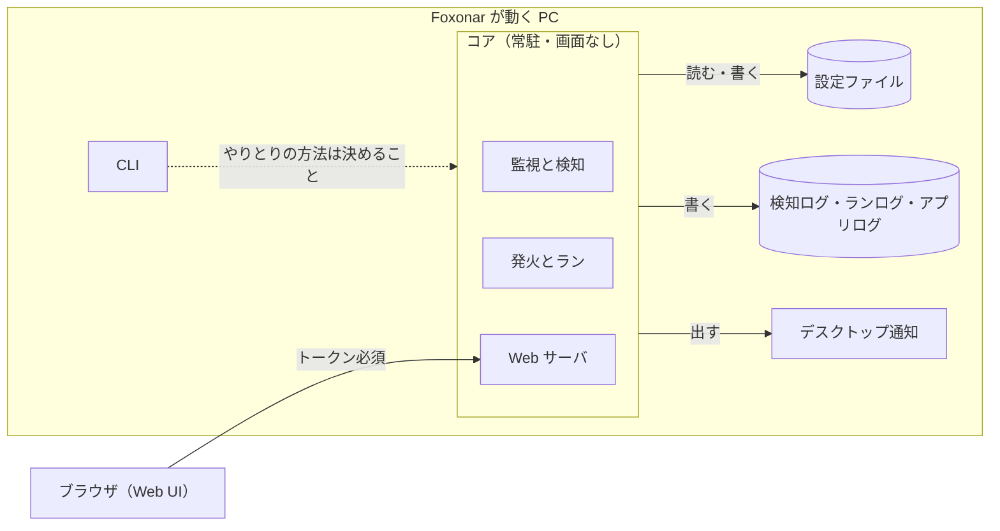
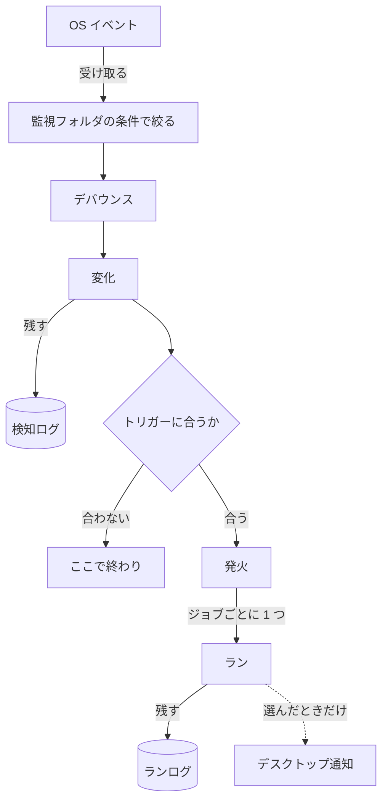

# 設計書

Foxonar の設計書です。決まった方針と、まだ決まっていない「どうやるか」をまとめています。

- 言葉は [用語集](glossary.ja.md) の意味で使う。用語集にまだ載っていない言葉（コア、Web UI、検知ログなど）は、[議論の記録](decisions.ja.md) の論点 O〜T で決めた意味で使う。
- 「論点 J」などは、議論の記録の見出しを指す。
- 章は外側から内側への順に並べる：目的と範囲 → 全体の構成 → Web UI → 設定ファイル → 監視と検知 → ランの実行 → ログ → デスクトップ通知。
- 各章は「決まったこと」と「決めること」に分ける。「決めること」に書いた案は、まだ決定ではない。
- 日本語のみ。英訳は、設計の方針が固まってから作る。

## 1. 目的と範囲

### 決まったこと

- Foxonar は、監視フォルダを見張り、変化を検知して、トリガーに合ったらジョブを走らせる常駐アプリ。利用者が設定したとおりに動く。
- ジョブが無くても、監視フォルダにどんなファイルが来たかを、検知ログで確かめられる（論点 Q、T）。
- 対応する OS は Windows と Linux。Linux は、画面のないサーバーも含む（論点 O）。
- 使い方は 2 つの形がある（論点 P）。

| 形 | 起動のしかた | Web UI の開き方 | デスクトップ通知 |
|---|---|---|---|
| デスクトップで使う | ログイン時に起動 | 同じ PC のブラウザ | 出せる |
| サーバーとして動かす | サービス | SSH のトンネルを使い、手元のブラウザ | 出せない |

### やらないこと

- シェルを通したコマンドの実行（論点 F）。外部のプログラムは、プロセス実行で動かす。
- ほかの PC やスマホからの接続は、最初は作らない。あとで足す（論点 O）。

### 決めること

| 項目 | 決めること |
|---|---|
| 対応する OS | Windows と Linux の、どの版から対応するか。macOS を対象にするか |

## 2. 全体の構成

### 2.1 部品

| 部品 | 役割 | 論点 |
|---|---|---|
| コア | 監視フォルダを見張り、変化を検知して、発火とランを行う常駐のプログラム。画面を持たない。Web UI を閉じていても動き続ける | O |
| Web UI | コアの中の Web サーバが出す画面。ブラウザで開き、設定とログを見たり変えたりする | O |
| CLI | ターミナルから操作するコマンド | O |
| 設定ファイル | 監視フォルダ、トリガー、ジョブなどを書いたファイル。Web UI から書くのが基本で、人が直接編集してもよい | S |
| 検知ログ | 検知した変化 1 件ごとの記録 | Q |
| ランログ | ラン 1 回分ごとの記録 | Q |
| アプリログ | Foxonar 自身の動き（起動、停止、設定の読み込み、エラーなど）の記録 | Q |
| デスクトップ通知 | OS の通知（Windows のトースト通知など）。何を知らせるかは利用者が選ぶ | R |

- 英語名：core、web ui、cli、detection log、run log、app log、desktop notification。
- `core` は Rust に最初からある `core` と名前がぶつかるので、コードではクレート名を `foxonar-core` にするなどして避ける（論点 O）。

### 2.2 動きの流れ

- ログやデスクトップ通知には、直接書き込むのではなく、用語集の「通知」として流し、それぞれが購読する。
- トリガーに合わなかった変化も、検知ログには残る。
- 「監視フォルダの条件で絞る」場所（デバウンスの前か後か）は、5 章で決める。

### 2.3 起動のしかた（論点 P）

#### 決まったこと

- ログイン時にユーザーとして起動する形（デスクトップ向け）と、OS のサービスとして起動する形（サーバー向け）を選べる。
- サービスでも、動かすユーザーを決められる。
- サービスの注意：
  - Windows のサービスは「セッション 0」で動くので、画面もデスクトップ通知も出せない。
  - Windows のサービスは、既定では強い権限（LocalSystem）で動く。プロセス実行のステップも、その権限で走る。
  - ドライブ文字（`Z:` など）はログインごとの割り当てなので、サービスからは見えない。共有フォルダは UNC パス（`\\server\share`）で書く。

#### 決めること

| 項目 | 決めること |
|---|---|
| ログイン時の起動の登録 | どう登録するか（Windows のスタートアップかタスク スケジューラか、Linux の `systemctl --user` か）。CLI で登録できるようにするか |
| サービスの登録 | どう登録するか（Windows のサービス、systemd）。CLI で登録できるようにするか |
| 二重起動 | 1 台の PC で、コアがいくつ同時に動いてよいか。サービスとログイン時の起動を両方登録すると、同じ監視フォルダを 2 つのコアが見張り、同じジョブが 2 回走るおそれがある |
| 止め方 | コアを止めるとき、走っているランをどうするか（終わるまで待つか、止めるか） |
| CLI とコアのやりとり | CLI がコアにどうつながるか（Web UI と同じ API を使う、など） |

## 3. Web UI（論点 O）

### 決まったこと

- コアの中の Web サーバが出す。
- 既定では、その PC からの接続（`127.0.0.1`）だけを受け付ける。
- 合言葉（トークン）は、同じ PC からの接続でも SSH のトンネルでも、いつでも必要。
- HTTPS：`127.0.0.1` で待ち受けるときは HTTP も許す。それ以外のアドレスで待ち受けるときは、HTTPS だけにする。
  - 同じ PC からの接続も SSH のトンネルも、コアから見るとどちらも `127.0.0.1` からの接続になる。
- 画面のないサーバーでは、SSH のトンネルを使って手元のブラウザから開く。例：`ssh -L 8400:localhost:8400 user@server`（ポート番号は仮）。
- ほかの PC やスマホからの接続は、あとで足す。そのときは HTTPS を強制する。
- Web UI でできること：設定を見る・変える。検知ログ・ランログ・アプリログを見る。検知ログとランログを ID でたどる。

### 決めること

| 項目 | 決めること |
|---|---|
| 作り方 | 候補：素の HTML＋JavaScript、htmx（HTML はコアが作り、JavaScript をほとんど書かない）、Leptos や Dioxus（Rust で書く）、egui の WASM |
| ポート | 番号。設定で変えられるか。使われていたらどうするか |
| トークン | 作り方、置き場所、利用者への渡し方（案：CLI で表示する、起動時にトークン付きの URL を表示する） |
| 攻撃への備え | CSRF と DNS リバインディングへの備えの具体（案：要求の `Host` と `Origin` を確かめる） |
| 証明書 | ほかの PC から接続するときの、証明書の用意のしかた（自分で作る、Tailscale を使う、など） |
| 画面の一覧 | どんな画面を持つか（設定、検知ログ、ランログ、アプリログ、今動いているラン、など） |
| 今の様子 | 今動いているランや、待っているランを、その場で見せるか |

## 4. 設定ファイル（論点 S）

### 決まったこと

- 設定は Web UI から書くのが基本。人が設定ファイルを直接編集してもよい。
- そのため、人が読める形にする。
- トリガーとジョブは、それぞれ ID を持つ。トリガーが走らせるジョブも、依存先のジョブも、ID で指す（論点 Q）。
- トリガーの無い監視フォルダを書いてよい（論点 T）。
- 注意：
  - Web UI で開いている間に人がファイルを直接書き換え、Web UI が古い内容のまま保存すると、人の書き換えが消える。
  - Web UI から保存すると、人が書いたコメントや並び順が消えることがある。

### 決めること

| 項目 | 決めること |
|---|---|
| 形式 | TOML、YAML、JSON など |
| 置き場所 | どこに置くか。ログイン時に起動する場合とサービスの場合で変わるか |
| 書き込み | 書きかけのファイルをコアに読ませない方法（案：一時ファイルに書いてから名前を変える） |
| 読み込みの失敗 | 中身が正しくないときの扱い（案：前の設定のまま動き続け、アプリログに残す） |
| 直接の編集 | 気づく方法（案：コアが設定ファイルの変化を検知して読み直す） |
| 書き換えの衝突 | 上の 2 つの注意への対策（案：保存の前に、ファイルが変わっていないか確かめる） |
| 読み直したとき | 走っているランや、待っているランをどうするか |
| ID | トリガー ID とジョブ ID を、利用者がつけるか、自動で振るか |

### 4.1 設定の中身で決めること

| 用語 | 決めること |
|---|---|
| 監視フォルダ | 検知するものの絞り方の書き方（5 章） |
| フィルタ | パターンの書き方 |
| プレースホルダ | 書き方、使えるプレースホルダの一覧、安全のための決まり（4.2 に案がある。論点 J） |
| プロセス実行 | プログラムを確かめるタイミング（4.3 に案がある。論点 I） |
| 依存 | 設定での書き方（GitHub Actions の `needs` のように依存先を並べる、など）。移動・削除の警告の出し方（論点 M） |

### 4.2 プレースホルダの案（論点 J から移した案）

- 書き方の案：`${path}` のように書く。環境変数は `${env:NAME}` と書き分ける。VS Code のタスク設定と同じ形で、OS に関係なく同じ書き方になる（`$HOME` と `%USERPROFILE%` のような違いが無い）。
- 一覧の案（監視フォルダが `C:\in`、対象パスが `C:\in\photos\cat.jpg` の場合）：

| プレースホルダ | 値 |
|---|---|
| `${path}` | `C:\in\photos\cat.jpg` |
| `${dir}` | `C:\in\photos` |
| `${name}` | `cat.jpg` |
| `${stem}` | `cat` |
| `${ext}` | `jpg`（点は含めない。拡張子が無ければ空） |
| `${rel}` | `photos\cat.jpg`（監視フォルダからの相対パス。サブフォルダの構成を保ったままコピーするときに使う） |
| `${old_path}` | 名前変更前のパス（名前変更のときだけ値がある） |

- 安全のための決まりの案：
  1. 置き換えは 1 回だけ行う。置き換えた値の中に `${env:HOME}` のような文字があっても、展開しない。
  2. プログラムの欄に `${path}` などランのプレースホルダを書いた場合（監視フォルダに置かれたファイルそのものを実行する場合）は、設定の読み込み時に警告する。監視フォルダに書き込める人なら誰でも、Foxonar の権限でプログラムを実行できるようになるため。禁止はしない。禁止しても `powershell -File ${path}` のように引数で渡せば同じことができ、防ぎきれないため。
  3. シェルにコードとして文字列を渡すオプション（`sh -c`、`cmd /C`、`powershell -Command` など）の引数にプレースホルダを書いた場合は、設定の読み込み時に警告する。`powershell -File` のようにスクリプトのファイルを渡す使い方は対象外。
  4. 文字としての `${` を書きたいときのエスケープの方法を決める（`$${` など）。

### 4.3 プロセス実行の案（論点 I から移した案）

- プログラムを確かめるタイミングの案：
  - プログラムの欄にランのプレースホルダが無い場合：起動時に探してフルパスに決める。見つからなければ起動しない。決めたフルパスは通知に出す。
  - プログラムの欄にランのプレースホルダがある場合（検知したファイルそのものを実行する場合など）：起動時にはまだ存在しないので確かめない。ランの実行時に確かめ、見つからなければそのステップの失敗にする。

## 5. 監視と検知

### 決まったこと

- 監視フォルダごとに、検知するものを絞れる（論点 T）。絞る条件の例：
  - 隠しファイルを含むか
  - ファイルとフォルダのどちらを検知するか
  - 名前やパターン
- 絞り込みは 2 か所ある。

| 絞る場所 | 外れたもの |
|---|---|
| 監視フォルダの条件 | 検知しない。検知ログにも残らない |
| トリガーのフィルタ | 検知はする（検知ログに残る）が、発火しない |

- 「隠しファイル」の意味は OS で違う。Windows ではファイルの属性（隠し属性）、Linux では名前が `.` で始まるもの。

### 決めること

| 項目 | 決めること |
|---|---|
| 絞る条件の書き方 | 書き方。用語集の「フィルタ」をここでも使うか、言葉を分けるか（論点 T の残り） |
| 絞る場所 | デバウンスの前に OS イベントで絞るか、デバウンスの後に変化で絞るか |
| 消えた隠しファイル | Windows の隠し属性は、ファイルが消えたあとでは確かめられない。削除の変化をどう扱うか |
| フォルダの変化 | フォルダごと名前を変えたり消したりすると、中のパスがすべて変わる。中のファイルの変化としても扱うか |
| デバウンス | 待ち方。デバウンス時間の既定の値 |
| 書き込み完了待ち | 判定の方法 |
| 溢れと再スキャン | 再スキャンの方法。再スキャンで見つけた違いを、変化として扱うか（発火させるか） |

## 6. ランの実行

### 決まったこと

- 発火、ラン、依存、同時実行数の決まりは、用語集のとおり（論点 D、H、L、M、N）。

### 決めること

| 項目 | 決めること |
|---|---|
| 同時実行数 | ジョブごとの上限を書かなかったときの扱い（すぐ走るか、読み込み時にエラーか）。全体の上限の値の決め方（必ず書かせるか、CPU の数などを既定にするか）（論点 N） |
| 無くなった対象パス | 前のジョブが対象パスのファイルを移動・削除したあと、後のジョブをどうするか（論点 D）。用語集の「無視」の例には「ランの直前にファイルが無くなっていた」がある |
| 成否の判定 | プロセス実行のステップの成否を、何で決めるか（案：終了コードが 0 なら成功） |
| 時間の上限 | ステップやランに時間の上限を付けるか。付けるなら、上限を超えたときの止め方 |
| やり直し | 失敗したランを、Web UI からやり直せるようにするか |

## 7. ログ（論点 Q）

### 決まったこと

- ログは 3 つに分ける。

| ログ | 何を残すか |
|---|---|
| 検知ログ | 検知した変化 1 件ごと。作成・変更・削除・名前変更のすべて。トリガーに合わなかった変化も残す |
| ランログ | ラン 1 回分ごと |
| アプリログ | Foxonar 自身の動き（起動、停止、設定の読み込み、エラーなど） |

- 検知ログには OS イベントではなく変化を残すので、ファイル 1 つのコピーで何行も出ることはない。
- 検知ログの列：検知 ID、日時、変化の種類、パス。発火やランのことは書かない。
- ランログの列：ラン ID、検知 ID、トリガー ID、ジョブ ID、そのときのジョブの名前、日時、結果。
- ID は 2 種類ある。

| ID | 誰が決める |
|---|---|
| 検知 ID、ラン ID | 実行時に、コアが振る |
| トリガー ID、ジョブ ID | 設定に書く |

- Web UI では、ランログの行から「もとの変化」を、検知ログの行から「この変化で走ったラン」を、たどって見せる。
- 例（ジョブ ID とトリガー ID は仮の名前）：

検知ログ

| 検知 ID | 日時 | 変化 | パス |
|---|---|---|---|
| 101 | 10:01:05 | 作成 | `C:\in\photos\cat.jpg` |
| 102 | 10:03:12 | 名前変更 | `C:\in\memo.txt` |
| 103 | 10:05:40 | 削除 | `C:\in\tmp.dat` |

ランログ

| ラン ID | 検知 ID | トリガー ID | ジョブ ID | ジョブの名前 | 結果 |
|---|---|---|---|---|---|
| 42 | 101 | photos | thumbnail | サムネイル | 成功 |
| 43 | 101 | photos | backup | バックアップ | 失敗 |

### 決めること

| 項目 | 決めること |
|---|---|
| 列 | 検知ログに、監視フォルダや変更前のパス（名前変更のとき）の列を足すか。ランログの「結果」に何を書くか（成功・失敗・無視、終了コード、かかった時間、エラーの内容など） |
| トリガーの名前 | ジョブの名前と同じように、そのときのトリガーの名前も残すか（論点 Q の残り） |
| 無視と溢れ | 変化の段階の無視と溢れを、どのログに残すか（論点 Q の残り。溢れは検知ログに残す案） |
| プロセス実行の出力 | 標準出力と標準エラーを、ランログに入れるか、別に残すか |
| 保存のしかた | ファイルの形式（案：SQLite、1 行 1 件の JSON（JSON Lines）） |
| 保存期間 | 何日分・何件分残すか。ログごとに期間がずれると、片方からもう片方をたどれなくなる |
| ID の振り方 | 検知 ID とラン ID を通し番号にするか、それ以外にするか。コアを起動し直しても重ならないようにする |
| アプリログの置き場所 | サービスのとき、OS のログ（Windows のイベントログ、Linux の journald）にも出すか |

## 8. デスクトップ通知（論点 R）

### 決まったこと

- OS の通知（Windows の右下に出るトースト通知など）を「デスクトップ通知」と呼ぶ。用語集の「通知」とは別物で、通知を購読するものの 1 つ。
- 何を知らせるかは、利用者が選ぶ。
- Windows のサービスと、画面のないサーバーでは出せない（論点 P）。

### 決めること

| 項目 | 決めること |
|---|---|
| 選べること | 何を選べるか（発火したとき、成功したとき、失敗したとき、溢れたとき、など） |
| 書く場所 | トリガーに書くか、ジョブに書くか、全体に書くか |
| まとめ方 | 一度にたくさん届いたとき、まとめて 1 つにする方法 |
| 押したとき | デスクトップ通知を押したら、Web UI のそのランを開くか |
| サービスのとき | サービスとして動いているときに、ログイン中のユーザーへ出す方法（案：ユーザー側の小さな常駐役） |
| サーバーでの代わり | Webhook（Discord、Slack など）、メール、ntfy など |
