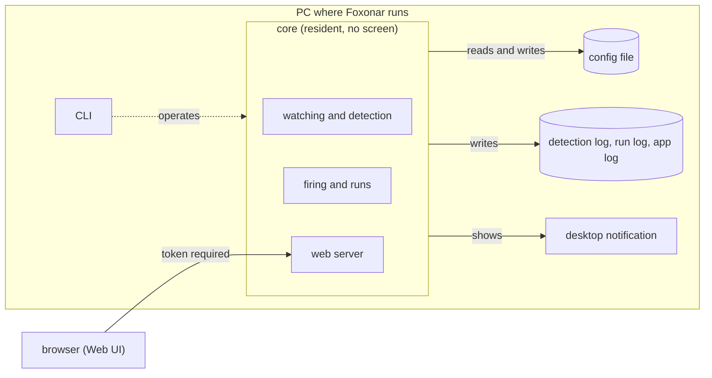
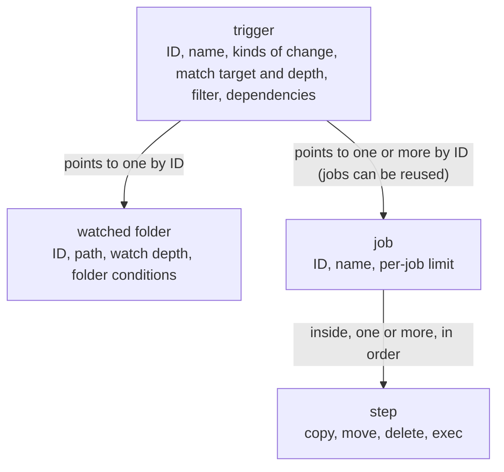

# Design document

> **Note:** This is an English translation of [design.ja.md](design.ja.md).
> The Japanese version is authoritative. If the two disagree, follow the Japanese version.
> Last synced: 2026-10-23 (up to 9.2).
> Terms follow the [glossary](glossary.md). See its translation notes ("watched folder", and when the verb "run" is avoided).

This is the design document for Foxonar. It records how things are done, as decided, and the reasons for those decisions.

- What is written here has been decided. Anything decided only provisionally is marked "provisional".
- A section that has reasons beyond its body text, options that were not chosen, or things that were verified ends with a "Reasons" box that holds them. When a similar topic comes up, look here.
- What is not decided yet, and the proposals for it, go in the [to-do list](todo.ja.md) (Japanese only). Once something is decided, its method and reasons are written in a section here, and it is removed from the to-do list.
- Words are used with the meanings in the [glossary](glossary.md).
- A page that lets you follow the flow step by step, picking an example: [flow.html](flow.html) (open it in a browser; Japanese only). It is only an overview, so when the two disagree, follow this design document.
- The history of the discussions up to 2026-10-21 is kept in the [old discussion record](archive/decisions-2026-10.ja.md) (Japanese only; you normally do not need to read it).
- The chapters go from the outside in: purpose and scope → overall structure → Web UI → config file → watching and detection → executing runs → logs → desktop notifications. The last chapter, 9, is about what it is built with (the physical design).

## Summary of decisions

| Chapter | What was decided |
|---|---|
| 1. Purpose and scope | A resident app that watches watched folders, detects changes, and starts jobs when a change matches a trigger. Windows and Linux (including servers without a screen). No shell is used. Licensed under MIT OR Apache-2.0 |
| 2. Overall structure | The resident "core" has no screen. The screen is the Web UI. It can start at login or as a service. Only one core can use the same config file. When stopping, it waits only for a grace period, and runs that do not finish become interrupted. What has not started yet continues from where it left off at the next start |
| 3. Web UI | Served by the web server inside the core. By default, only from the same PC. A token is always required. Only HTTPS on addresses other than `127.0.0.1` |
| 4. Config file | TOML. Normally written from the Web UI; people may also edit it directly. Reloaded automatically when it changes. If it cannot be read at startup, Foxonar does not start. Triggers point to watched folders and jobs by ID. Delete removes files immediately (no recycle bin) |
| 5. Watching and detection | os event → narrowed by the folder conditions → debounce → change. The kinds of change are create, modify, delete, rename, and move. Renames and moves are boundaries. A whole folder coming in or going out is extended to the paths inside it. When a change matches a trigger, it waits in the pending table for writing to finish and for any firing on the same path to finish. Foxonar keeps a known state, and each watched folder chooses what to do about what happened while Foxonar was stopped. When a watched folder is lost, Foxonar reports it and stops watching it; when it reappears, Foxonar only remembers its contents and watches it again. On Windows, a fork of notify changed to use ReadDirectoryChangesExW |
| 6. Executing runs | One trigger starts multiple jobs concurrently. The order is written as dependencies. The steps in a job are sequential and stop on failure. A job does not start if a dependency did not succeed. Success is decided by the exit code. To stop a step, Foxonar first asks, then forces it if needed |
| 7. Logs | The detection log and run log (SQLite) and the app log (text). They can be followed by detection ID and run ID. "Why did a job not execute?" can always be answered from the run log |
| 8. Desktop notifications | The user chooses which of detection, success, and failure to report. When many arrive at once, they are combined |
| 9. How it is built | Development is done mainly on Ubuntu-24.04 in WSL. The repository is cloned in two places, WSL and Windows, and kept in sync through GitHub. Windows checks are also done by building for Windows from WSL. The Rust version is pinned to 1.98.1 with `rust-toolchain.toml`. Every push is checked on both OSes with GitHub Actions |

## 1. Purpose and scope

### 1.1 What Foxonar does

- Foxonar is a resident app that watches watched folders, detects changes, and starts jobs when a change matches a trigger. It works exactly as the user configured it.
- Even without any jobs, you can check in the detection log what files came into a watched folder.
- Supported OSes are Windows and Linux. Linux includes servers without a screen.
- There are two ways to use it.

| Way | How it starts | How to open the Web UI | Desktop notifications |
|---|---|---|---|
| Use on a desktop | Starts at login | A browser on the same PC | Can be shown |
| Use as a server | As a service | A browser on your own machine, through an SSH tunnel | Cannot be shown |

### 1.2 What it does not do

- Executing commands through a shell. External programs are started with exec (4.4).
- Connections from other PCs or smartphones are not built at first. They will be added later.

> **Reasons**
> - No shell: when a string is passed to a shell,
>   - A file name gets executed as a command. Quoting it as `"{path}"` does not prevent this (with a file named `$(touch pwned).jpg`, sh executes `touch pwned`). Anyone who can write to a watched folder could execute commands with Foxonar's permissions.
>   - The quoting and escaping rules differ between shells (sh, cmd, PowerShell), so the same config cannot be used across OSes.
>   - Failures are hard to see (a failure in the middle of a pipe counts as success). It is hard to stop (child processes of the shell remain).
>   - Not chosen: also passing the target path in an environment variable (this was a way to pass it safely into a shell string; it became unnecessary once the shell was dropped).
> - Leave connections from other PCs and smartphones for later: they need protection and certificates, so it starts with the same PC and SSH tunnels.

### 1.3 License

- Foxonar is licensed under MIT OR Apache-2.0. Users can choose either one. The texts are in `LICENSE-MIT` and `LICENSE-APACHE` at the top of the repository.
- The copyright notice is `Copyright (c) 2026 capypara20`.
- Contributions (pull requests, etc.) are published under the same two licenses unless the contributor states otherwise.

## 2. Overall structure

### 2.1 Parts



| Part | Role |
|---|---|
| core | The resident program that watches the watched folders, detects changes, and handles firings and runs. It has no screen. It keeps running even when the Web UI is closed |
| Web UI | The screen served by the web server inside the core. Opened in a browser to view and change the config and the logs |
| CLI | The command for operating Foxonar from a terminal |
| config file | The file that describes watched folders, triggers, jobs, and so on. Normally written from the Web UI; people may also edit it directly |
| detection log | A record of each detected change |
| run log | A record of each run |
| app log | A record of what Foxonar itself does (starting, stopping, loading the config, errors, and so on) |
| desktop notification | An OS notification (such as a toast notification on Windows). A different thing from a "notice" in the glossary. The user chooses what it reports |

- `core` collides with Rust's built-in `core`, so in the code the crate name avoids it, for example `foxonar-core`.

> **Reasons**
> - No screen in the core; the screen is the Web UI: a native GUI (egui, etc.) and a web screen were compared. A native GUI opens no port, so it is the safer side, but it does not work on Linux without a screen and cannot be used from other PCs or smartphones. A web screen can be used from servers without a screen, and some day from other PCs too. In exchange, the web server needs protection (3.1).

### 2.2 Flow

```mermaid
flowchart TD
  os["os event"] -->|received| narrow["narrowed by the folder conditions"]
  narrow --> deb["debounce"]
  deb --> change["change"]
  scan["rescan<br>at startup, after an overflow, when a folder comes in"] -->|differences from the known state| narrow
  memo["known state"] -->|when a folder disappears, creates deletes for the paths inside| narrow
  change -->|recorded| dlog[("detection log")]
  change --> match{"matches a trigger?"}
  match -->|no| stop["ends here"]
  match -->|yes| pending["pending table<br>waits for writing to finish, and for any firing on the same path to finish"]
  pending --> firing["firing"]
  match -.->|even if not, when the pending table has a row for that path| pending
  pending -.->|when it did not fire (ignore)| rlog
  firing -->|one per job| run["run"]
  run -->|recorded| rlog[("run log")]
  run -.->|only when chosen| toast["desktop notification"]
  change -.->|when detected (only when chosen)| toast
  match -.->|even if it matches, a change made by Foxonar itself (the original trigger)| rlog
```

- Logs and desktop notifications are not written to directly. Foxonar emits "notices" (as in the glossary), and each of them subscribes.
- Changes that did not match any trigger are still recorded in the detection log.
- A change that matched a trigger waits in the pending table for writing to finish and for any firing on the same path to finish, and then fires (5.9).
- Narrowing by the folder conditions happens before debounce (5.5).
- Changes come from three sources: os events, differences found by a rescan (5.2), and items created from the known state (5.6). All of them are narrowed by the folder conditions and go through debounce to become changes.
- When an overflow happens, one row saying "something was missed here" is recorded in the detection log (7.1).
- When something matched a trigger but did not fire (a change made by Foxonar itself; created and then deleted; no longer matching after the pending table merged it again; no longer matching after the config was reloaded while waiting in the pending table; the watched folder was lost while waiting in the pending table — 5.7, 5.9, 4.2, 5.11), an "ignored" row is recorded in the run log (7.2).

> **Reasons**
> - All three sources go through debounce: when a folder is copied in, it would be wrong for the create made by reading inside the folder and the Created for the same path from the OS to become two separate rows (it was created only once). Everything goes through debounce so that the same path is merged into one.

### 2.3 How it starts

- You can choose between starting as the user at login (for desktops) and starting as an OS service (for servers).
- Even as a service, you can decide which user it runs as.
- Notes about services:
  - Windows services run in "session 0", so they cannot show a screen or desktop notifications.
  - By default, Windows services run with strong permissions (LocalSystem). Exec steps also execute with those permissions.
  - Drive letters (`Z:`, etc.) are assigned per login, so services cannot see them. Write shared folders as UNC paths (`\\server\share`).

### 2.4 Preventing double start

- Only one core can use the same config file. Cores with different config files may run at the same time.
  - Examples of running more than one core: executing with different users' permissions; keeping one going even if the other stops.
  - Workers execute concurrently even inside one core, so one core is enough if the only goal is spreading the load.
- This "preventing double start" is different from the glossary's "lock" (the mark meaning "a firing is in progress on this path"). To avoid confusion, it is not called a "lock".
- If cores with different config files watch the same watched folder (or overlapping places), Foxonar does not notice. Runs from both cores execute for the same path. A lock is a mark inside one core only, so it is not shared with other cores. This is the user's responsibility, and it will be written in the user documentation.
  - Example: core 1 moves a file in `C:\in` to `D:\done`, and core 2 uploads the same file. If the move finishes first, the upload fails with "file not found".

### 2.5 Stopping the core

- When it stops: stopping from the Web UI or the CLI, stopping as a service, restarting the PC, and so on.
- No new firing is started.
- Runs that were fired but have not started yet (runs waiting for the concurrency limit or for their dependencies) are also not started during the grace period. Even if a slot frees up or a dependency succeeds, they keep waiting, and continue from where they left off at the next start.
- Runs that are executing are waited for, only for the decided grace period. When the grace period has passed, the executing step is stopped, and that run is recorded as "interrupted".
  - How steps are stopped is in 6.5. For an exec step, the child process and the processes the child started without detaching are stopped. Detached processes are not stopped (6.3).
  - Even if a run is stopped in the middle of a step, the remaining steps do not execute (6.1). For example, in a job that "converts and then deletes the original file", stopping during the conversion does not delete the original.
- What has not started yet (pending table rows, and runs waiting for the concurrency limit or for dependencies) is not thrown away. It is kept in SQLite, and continues from where it left off at the next start.
  - A pending table row is written to the same SQLite as the detection log and the run log when it is put in the pending table.
  - A run that was fired but has not started is written to the run log as a row with the result "waiting" when it fires (7.2).
  - A run executes with the config as of when it fired (4.2), so when it fires, the config at that time is kept in SQLite for every run. It is used both when a run that has not started continues from where it left off, and when an interrupted run is retried at the next start (6.6).
- Whether an interrupted run is retried automatically at the next start can be chosen per job (6.6).

> **Reasons**
> - Do not start waiting runs during the grace period: they might be stopped at the end of the grace period.
> - Wait only for a decided grace period: waiting until everything finishes means it never stops if there is a long job (such as a 10-minute conversion). When the PC restarts, the OS only waits for a limited time (Windows services usually a few seconds to 20 seconds; systemd on Linux 90 seconds by default).
> - Do not throw away what has not started: the known state is updated every time something is detected (5.2), so if it were thrown away, even the rescan at the next start would not pick it up, and the job would never execute.
> - Write pending table rows to SQLite: so that they remain even if the core crashes.

## 3. Web UI

### 3.1 Connection and protection

- Served by the web server inside the core.
- By default, only connections from the same PC (`127.0.0.1`) are accepted.
- A token is always required, both for connections from the same PC and through an SSH tunnel.
- HTTPS: when listening on `127.0.0.1`, HTTP is also allowed. When listening on any other address, only HTTPS is allowed.
  - From the core's point of view, both connections from the same PC and connections through an SSH tunnel come from `127.0.0.1`.
- On a server without a screen, open it from a browser on your own machine through an SSH tunnel. Example: `ssh -L 8400:localhost:8400 user@server` (the port number is an example).
- Connections from other PCs and smartphones will be added later. HTTPS will be required then.

> **Reasons**
> - Protection is needed: being able to change the config from the Web UI means being able to make it execute programs.
> - Always require a token: if other users also use the same PC, they can connect to `127.0.0.1` too. There are also attacks where another site opened in the browser sends requests to localhost (CSRF, DNS rebinding), so "listening only on localhost" is not enough.
> - Allow HTTP on `127.0.0.1`: Forcing HTTPS was also considered, but connections inside the same PC never leave the PC, and SSH tunnels are already encrypted. Browsers warn about self-made certificates, and public certificate authorities do not issue certificates for `localhost`. HTTPS would add almost no protection, only the trouble of warnings. The risks of localhost are handled by the token and similar measures.

### 3.2 What it can do

- View and change the config.
- View the detection log, the run log, and the app log. Follow the detection log and the run log by ID (7.2).
- Logs are normally viewed in the Web UI. The log files are meant to be opened only when something goes wrong.

## 4. Config file

### 4.1 Format and who writes it

- The config is normally written from the Web UI. People may also edit the config file directly.
- So it must be readable by people. The format is TOML.
- Notes:
  - If a person edits the file directly while it is open in the Web UI, and the Web UI then saves its old contents, the person's edits are lost.
  - Saving from the Web UI may lose comments and ordering written by people.
- When saving from the Web UI, Foxonar first checks whether the config file has changed since it was opened. If it has, it does not save, and reports "The file has been changed since you opened it. Reload it, then make your changes again." The same applies when the Web UI is open in two tabs and both save.

> **Reasons**
> - TOML: comments can be written, and it is the same format as Rust's `Cargo.toml`.

### 4.2 Reloading

- When the core notices that the config file has changed, it reloads it automatically. It is reloaded the same way whether it was saved from the Web UI or edited directly by a person. There is no pause button.
- Each reload is written to the app log with the time (7.2).
- After reloading, the new config is used from the first firing onward. Runs that fired earlier are not stopped; they execute to the end with the config as of when they fired. Runs connected by dependencies also execute with that same config.
  - Inside the core, this is done by giving each firing the config as of when it fired.
  - A path waiting in the pending table has not fired yet. If the config is reloaded while it waits, whether it matches a trigger is checked again with the config at the time it fires (when it leaves the pending table). If the trigger is gone, it does not fire.
    - When the trigger is gone, or has changed and no longer matches, it is an ignore, and an "ignored" row is written to the run log (with a reason such as "after reloading the config, the trigger was gone". 7.2).
- Config load failures: a TOML syntax error, a missing required item (5.2), pointing to an ID that does not exist, and so on.
  - If reloading fails while running, the broken config is not used, and Foxonar keeps running with the previous config. The app log and the Web UI report that loading failed (which line, and what is wrong) and that the previous config is still in use.
  - If loading fails at startup, Foxonar does not start. It writes the reason to the app log and exits. The Web UI is also inside the core, so fix the config file directly.
  - Note: if reloading fails while running and Foxonar is stopped without fixing it (a PC restart, etc.), it will not start the next time.

> **Reasons**
> - Do not start if loading fails at startup.
>   - Not chosen: start with the last config that loaded correctly.
> - Do not write a config version: a version for the config file is not needed, but reloads should be in the log.

### 4.3 How the config parts connect



- The diagram shows only the main items. There are others, such as the debounce time per watched folder (5.4), the interval for checking whether writing has finished (5.9), how to handle what happened while stopped and what to do when there is no known state (5.2), overwriting per step (4.4), success exit codes (6.3), time limits per step and per job (6.4), and, per job, whether to retry interrupted runs automatically (6.6).
- Watched folders, triggers, and jobs each have an ID. The jobs a trigger starts, and the jobs it depends on, are also pointed to by ID.
- Triggers are written outside the watched folders, and point to a watched folder by ID.
- A trigger watches exactly one watched folder. A watched folder can be pointed to by zero or more triggers. A watched folder without triggers may be written.
- One trigger can list multiple kinds of change (create and modify, etc.).
- One trigger can list multiple jobs. Dependencies between jobs are also written in the trigger (6.1).
- A watched folder has a "watch depth" written as a number. The items directly inside count as level 1; if it is not written, there is no limit. Changes deeper than this are not detected.
- A trigger can have a match target (files, folders, or both) and a "match depth" (a number; if not written, everything down to the watch depth). The name pattern of a filter is applied only to the name.
- To use the same job in another watched folder, write a separate trigger that points to the same job.

> **Reasons**
> - Write triggers outside, pointing by ID: the config can be normalized. Jobs are also pointed to by ID, so the shape is consistent. The structure becomes a little complex, but if it is normalized, this shape is the best.
> - Only one watched folder: to use several kinds of change, listing them in one trigger is enough. Using the same job in several watched folders is rare, and when needed, separate triggers can point to the same job.
> - Allow watched folders without triggers: sometimes you want the detection log even without jobs (1.1).
> - Allow multiple jobs: if it were limited to one, starting another job under the same conditions would mean writing two triggers with the same conditions.
> - Write depth as a number: more intuitive than patterns like `**`.
> - Give triggers a match depth too: if it were only on the watched folder, you would have to create two watched folders with different depths at the same place, and each change would be recorded twice in the detection log.

### 4.4 Steps

- There are three built-in steps: copy, move, and delete. External programs are started with exec.
- Renaming within the same folder can be done with move.
- "Create a folder" is not a separate step. Copy and move can say whether to "create the destination folder if it does not exist".
- For copy and move, each step can choose whether to overwrite when the destination already has the same name. If it does not overwrite, that step fails (and the remaining steps stop. 6.1).
- Delete removes immediately. It does not use the recycle bin.
  - If you do not want things to disappear, use move instead of delete to move them to a holding folder.
- The program of an exec step can be written as a full path or as a name looked up in PATH. Environment variables can also be written in the path.
  - Note: the PATH of the resident core can differ from the PATH in a terminal (for example, when started from a Windows service or from systemd). "It works in the terminal but not when resident" is a common problem.
- `.bat` and `.cmd` can be started as they are. For `.ps1`, give `powershell` (or `pwsh`) as the program, with the arguments `-File script ${path}`.

> **Reasons**
> - No separate step for creating folders: separate steps are added once the situations that need them are clear.
> - Drop the recycle bin: the crate for moving to the recycle bin (`trash`) returned success on a Windows network location but deleted the file without putting it in the recycle bin (experiment on 2026-10-21). "Fail where the recycle bin cannot be used" cannot be built as it is. There were other concerns too: a service would put files in another user's recycle bin, and on a server without a screen they would keep piling up. It is hard by design, so it was dropped.
>   - Not chosen: allow the recycle bin only on local drives, checking the drive type before deleting.
> - Allow `.bat` and `.cmd`: Windows internally starts cmd and passes them to it, so by design it is the same as going through a shell. However, since Rust 1.77.2 the standard library escapes arguments for cmd and returns an error for arguments it cannot make safe (the fix for CVE-2024-24576). It may fail on files with unusual names, but no unintended command is executed. If they were forbidden, people who want them would write `cmd /C ...`, which is outside this protection, so it would actually be more dangerous.

## 5. Watching and detection

### 5.1 Folder conditions

- For each watched folder, you can narrow down what is detected. Examples of conditions:
  - Whether to include hidden files
  - Whether to detect changes to files, to folders, or both
  - Names and patterns
- Narrowing happens in two places.

| Where it is narrowed | What is left out |
|---|---|
| Folder conditions | Not detected. Not recorded in the detection log either |
| Trigger filter | Detected (recorded in the detection log), but does not fire |

- What "hidden file" means differs by OS. On Windows it is a file attribute (the hidden attribute); on Linux it is a name that starts with `.`.
- In a watched folder that does not include hidden files, deleting a hidden file is not detected either.
  - On Windows, whether it was a hidden file is told by the attributes that come with the Deleted os event (5.12). In a watched folder that fell back to the older API because the newer one could not be used, the attributes after deletion cannot be checked, so a path that got a Deleted is detected if it is in the known state (or currently being debounced), and dropped if not. Hidden files are left out from the start, so they are not in the known state.
  - Example: the hidden file `~$report.docx`, which exists only while Word has the document open, does not appear in the detection log even when it disappears after Word is closed.
  - A file that becomes hidden later is treated as deleted, and a file that stops being hidden is treated as created. This is the same as moving in or out of the folder conditions by a rename or move (5.8).
  - A Created whose path disappeared before its attributes could be checked is assumed not to be a hidden file, and is detected.
- When a folder is left out by the folder conditions, all paths inside it are also left out, down to the end of the watch depth (the same as `.gitignore`).
  - Example: if things named `.git` are left out, not only `.git\` but also `.git\index` and the contents of `.git\objects\` are not detected.
  - When a folder comes in, the conditions are applied first. The inside of a folder that was left out is not rescanned (5.6).

> **Reasons**
> - Narrow by watched folder: if every change were recorded in the detection log, Office temporary files (`~$…`) and files being downloaded such as `.crdownload` and `.part` would make it much larger.
> - Do not detect deleting hidden files either: when the condition is "do not include hidden files", not detecting their deletion is the natural reading.
> - A file that becomes hidden later is a delete: unless it is removed from the known state when it becomes hidden, a delete would appear later when it is deleted.
> - Detect when unsure: this matches the choice to record even something that came only for a moment in the detection log (5.4).

### 5.2 While stopped, and the known state

- What happened while the core was stopped can be handled differently for each watched folder. One of the following must be written (a config without it is a load failure).
  - Rescan: rescan at startup, and treat the differences from the known state as changes.
  - Remember only: handle only changes after startup. At startup, read the folder and update the known state to match its current state, but do not turn the differences into changes (this is not a rescan).
- The known state is updated each time a change is detected, and remains after the core stops. While running, it is kept up to date regardless of the choice above.
- For each path, the known state records whether it is a file or a folder, its size, and its modified time. A rescan compares these three and the path.
  - Folders are compared only by whether they exist (their size and modified time are not compared). A folder's modified time changes when something inside it changes, but folder modifies are not created (5.6).
  - A file that was overwritten while stopped is found as a modify, because its size or modified time changes.
  - A file whose contents changed while its size and modified time stayed the same is not found.
- Note: a rename or move while stopped cannot be traced from where to where just by comparing, so it looks like a delete and a create.
- When there is no known state (the first start, or when a new watched folder is added to the config), how to handle the files already there can also be chosen per watched folder. This must also be written.
  - Remember only: the existing files are only put into the known state, and nothing fires.
  - Treat all as created: every existing path is treated as a create change (runs execute if they match a trigger). Use this to clean up files that have piled up.
- When the path, the watch depth, or the folder conditions of a watched folder change, only the part whose visible range changed is handled again. This is the same at startup and when the config is reloaded while running.
  - The part that became visible: handled the same as when there is no known state (remember only, or treat all as created).
  - The part that is no longer visible: not turned into delete changes; it is removed from the known state (forgotten).
- Differences found by the rescan after an overflow are also treated as changes, the same as the rescan at startup (they fire if they match a trigger).
- After an overflow, the rescan is not done right away; it is done once, after things calm down.
  - In the same way as debounce, the timer restarts from the last overflow or os event, and when nothing has arrived for a set time, the whole watched folder (down to the watch depth) is rescanned. However many overflows happen in the meantime, they are combined into one rescan.
  - Even for a watched folder that never calms down (such as one where a log is constantly appended), the rescan is done once when a set time has passed since the first overflow, even if it has not calmed down.
  - Example: three overflows happened while copying 20,000 files (10:00:00–10:03:00). The detection log has three overflow rows, and the rescan happens only once, around 10:03:05, after the copy finished and things calmed down.
  - This is done regardless of how what happened while stopped is handled, because an overflow is something that happens after startup.
  - When the OS does not say which watched folder overflowed, all watched folders are rescanned (inotify on Linux does not say where the overflow happened).

> **Reasons**
> - One of them must be written: not writing it is not an option. Either choice greatly changes whether jobs execute, so the user chooses.
> - Update the known state even with "remember only": the known state is also used while running (telling hidden-file deletes apart 5.1, the rescan after an overflow, and the paths inside a folder that disappeared 5.6). If it stayed old, the rescan after an overflow would even turn what happened while stopped into changes. Even when it is updated, the differences are not turned into changes, so the intent of "do nothing" is kept (the answer to the question "If it does nothing, why does it need to remember again?").
> - Compare by size and modified time: files overwritten while stopped are found too (the same way rsync and Syncthing tell them apart). Remembering more would make it heavier, which should be avoided.
>   - Not chosen: file IDs (they could even tell renames while stopped apart, but they change every time on USB sticks and some network drives), content fingerprints (slow, because every file is read at each start).
> - Handle only the part whose range changed: if it were compared with the known state as it is, just changing the path from `C:\in` to `D:\in` would make every file in `C:\in` look deleted, and delete triggers (such as also deleting from the backup) would fire. Redoing everything could execute runs again for every path after only a small change in the conditions.
> - Differences after an overflow are also changes: to recover what was missed by the overflow.
> - Only once, after things calm down: overflows happen when the system is busy, such as during a large copy. Rescanning right away at every overflow would read the whole folder again and again in the middle of a heavy copy. The same idea as debounce.

### 5.3 Moves to and from outside the watched folder

- A move coming in from outside the watched folder is treated as a create, and a move going out is treated as a delete.
  - A move from watched folder A to watched folder B is a delete in A and a create in B.
  - A move to or from a place deeper than the watch depth is treated the same as a move to or from outside.
- When the folder that contains a path changes within the same watched folder, it is a move change (5.5, 5.6).

> **Reasons**
> - Treat moves to and from outside as create and delete: from the watched folder's point of view, the file really did "come" or "go away", so this is natural, and it matches how the OS reports it.

### 5.4 How debounce merges

- A path has two states: "absent" and "present". Create is "absent → present", delete is "present → absent", and modify stays "present". Renames and moves are not merged here (5.5).
- When several os events for the same path (other than those for renames and moves) arrive within the debounce time, they are merged into one. The result is decided by the first and last state.
  - absent → present is a create, present → absent is a delete, present → present is a modify.
  - However many times it switches in between, only the first and last state count. If the number of switches is odd, the last state is the opposite of the first; if it is even, the last state is the same as the first.
- However, when both the first and the last state are "absent", they are not merged into one: both a create and a delete are kept.
- The debounce time restarts from the last os event. While writing continues, it keeps waiting, so copying a large file becomes a single create. If the gap becomes longer than the debounce time, that is a boundary, and the parts are merged separately.
- The debounce time can be set per watched folder. Setting it to 0 means no debounce (one os event is one change).

| First | Switches | Last | Example | Merged result |
|---|---|---|---|---|
| present | 0 | present | Overwriting directly | One modify |
| present | 1 | absent | Delete | One delete |
| present | 2 | present | Deleting and creating again. Saving in Word and similar apps when the temporary file is left out by the folder conditions | One modify |
| present | 3 | absent | Created again, then deleted right away | One delete |
| absent | 1 | present | Copying a large file | One create |
| absent | 2 | absent | A temporary file (came and disappeared right away) | Two: a create and a delete (recorded in the detection log). Even if they match a trigger, they cancel each other out in the pending table, so no run executes (5.9) |
| absent | 3 | present | Came, and was created again right away | One create |

- To avoid confusion with the kinds of change, os events are written with the names FileSystemWatcher uses (Created, Changed, Deleted, Renamed).

> **Reasons**
> - Keep debounce: "no debounce at all" was also considered (simpler, reacts without waiting, and nothing the OS reported is lost). Dropping it causes problems:
>   - In a watched folder that leaves out temporary files, saving in Word gives a delete and a create, and delete triggers (such as also deleting from the backup) would fire.
>   - On Linux, copying a large file delivers an os event for every write (about 9,000 for 1 GB; experiment on 2026-10-20), so the detection log would get thousands of rows.
>   - Overwriting directly delivers Changed twice, so it would become two modifies.
>   - For cases where you want to detect each one separately, 0 can be chosen too.
> - Keep two when both the first and last state are "absent": so that the detection log shows that a file came, even for a moment.
> - Verified: with PowerShell's FileSystemWatcher (which uses ReadDirectoryChangesW on Windows), three ways of saving were reproduced (2026-10-19).
>   - Overwriting directly: the original path gets Changed twice (emptying the contents, then writing).
>   - Swapping with a temporary file (the same as Word): the original path never gets Changed. Only a Renamed from the original path to another name (present → absent) and a Renamed from the temporary file to the original path (absent → present) arrive. If the temporary file is left out by the folder conditions, this is one modify; if not, the renames and so on are seen as they are (5.5).
>   - Deleting and creating again: the original path gets Deleted, Created, and Changed. From the original path's point of view it is "present → absent → present", so it becomes one modify.

### 5.5 How renames and moves are merged

- The os events for renames and moves (Renamed, and on Windows, moves paired up by file ID; 5.12) are not merged with other os events. They are kept as one rename/move change, and act as a boundary. Created, Changed, and Deleted are merged by the "first and last state" of 5.4 separately before and after the boundary.
  - Example: if a write comes right after a rename (within the debounce time), the result is one rename and one modify.
- When both the name and the containing folder change, it is one change that is both a rename and a move. Both rename triggers and move triggers react to it.
- A rename or move where one side is outside the folder conditions is treated as Created or Deleted (5.8), and merged by the "first and last state" of 5.4.
- Narrowing by the folder conditions happens before debounce (at the os event stage), so that a Renamed with one side outside can be treated as Created or Deleted before merging.
- Because of this, the merged result depends on the folder conditions.

| What happened within the debounce time | A: temporary files not left out | B: temporary files (`*.tmp`, `~*`, etc.) left out by the folder conditions |
|---|---|---|
| Only renamed | One rename | One rename |
| Renamed, then written right away | One rename and one modify | One rename and one modify |
| Written under a temporary name `scan_01.tmp`, then renamed to `scan_01.pdf` | A create of `scan_01.tmp`, and one rename | One create of `scan_01.pdf` (a rename from outside to inside) |
| Saving in Word and similar apps (swapping with a temporary file) | A create of the temporary file, two renames, and a delete of the temporary file | One modify of the original file (disappeared → appeared) |
| Renamed twice in a row (a → b → c) | Two renames | Two renames |
| Moved to another subfolder (`a.txt` → `sub\a.txt`) | One move | One move |
| Renamed and moved to another subfolder (`a.txt` → `sub\b.txt`) | One rename/move (both a rename and a move) | One rename/move |
| Copying a large file | One create | One create |

- Guidelines for writing triggers:
  - To wait for downloads or scans: list both create and rename as kinds of change (A catches it as a rename, B as a create).
  - To catch saves: modify and rename for A; modify for B.
- A trigger filter does not affect detection. It only decides, after detection, whether that trigger fires, so the table above does not change with trigger filters.
- There is no per-watched-folder setting for whether to tell moves apart. You choose by whether a trigger lists "move".

> **Reasons**
> - Renames and moves are boundaries: a rename should be caught as a rename. A rename and a modify that happen together are better kept separate, so that the jobs after them can be configured precisely.
>   - Not chosen: treat it as a rename only when the original path is "present → absent" and the new path is "absent → present", and count everything else by "first and last state". A file written under a temporary name and renamed right away would be a create, and saving in Word would be a modify, splitting the rules by case. It is better to be fully consistent.
> - Keep moves separate from renames: moving to a subfolder does not change the name (Linux, which calls it a rename, is closer to a false detection. A rename does not fit into the three kinds of create, modify, and delete, so it is better to add a kind). If it were called delete + create, just moving a file would fire create and delete triggers (example: `inbox\report.pdf` → `inbox\done\report.pdf` would execute the thumbnail job and the cloud delete).
>   - Not chosen: call it delete + create (easy to build, but changing it to a move later would change how existing triggers behave); call it a rename (the name did not change).
> - When the name also changes, both apply: both rename triggers and move triggers should react.
>   - Not chosen: make it only a move; make it only a rename.
> - Verified (2026-10-21): when a file is moved to another subfolder inside a watched folder, Windows reports Deleted + Created (+ a Changed for the destination folder), and Linux reports Renamed. On Windows too, the newer API lets them be paired up by file ID (5.12).

### 5.6 Folder changes

- Not only files but also folders come into a watched folder. When a whole folder comes in or disappears, in addition to the change of the folder itself, the same change (create or delete) is treated as having happened to each path inside it (files and folders, down to the watch depth).
  - When it comes in: the inside of the folder is rescanned, and the paths found are treated as creates. Even if it is read in the middle of a copy, the create found by reading and the Created for the same path from the OS are merged into one by debounce (2.2).
  - When it disappears: its contents can no longer be seen, so deletes for the paths inside are created from the known state.
- When a folder is renamed, it is only one rename of the folder. No renames are created for the paths inside; only the paths in the known state are rewritten.
  - So the result is different from moving the files inside to another folder one by one (which gives a move for each file).
- When a folder moves to another folder within the same watched folder, it is also only one move of the folder. No moves are created for the paths inside; only the paths in the known state are rewritten.
- Folder modifies are not created. On Windows, when something happens inside a folder, a Changed for the folder itself arrives, but it is used only to see hidden attributes coming and going (5.1), and is not turned into a change.
- In detection, the folder and each path inside it are separate changes. Which ones to react to is chosen by the trigger's "match target" and "match depth" (4.3).
- Example: in the watched folder `C:\watch` (no limit on the watch depth), `hoge\` came in together with its contents.

```
C:\watch
  hoge\          folder at level 1
    test.txt     file at level 2
    sub\         folder at level 2
      a.txt      file at level 3
```

| Detected change | Trigger F: folders, create, match depth 1 | Trigger T: files, create, `*.txt` |
|---|---|---|
| Create of `hoge\` | Reacts | Does not react (folder) |
| Create of `hoge\test.txt` | Does not react (file) | Reacts |
| Create of `hoge\sub\` | Does not react (level 2) | Does not react (folder) |
| Create of `hoge\sub\a.txt` | Does not react (file) | Reacts |

- Notes:
  - With many files inside, the amount to remember and the time to read the inside grow. The changes of the paths inside may also become a large number of runs at once (kept down by the concurrency limit).
  - On Windows, the OS can only watch "that folder only" or "all depths". If the watch depth is cut off partway, os events from deeper places still arrive, and Foxonar drops them. On Linux, each folder is watched separately, so nothing deeper than the watch depth is watched.

> **Reasons**
> - Extend a folder coming in or going out to the paths inside: for moving a whole folder or deleting it to the recycle bin, the OS reports nothing about the paths inside. For copying or Shift+Delete, it reports them one by one. Left as is, the same action would execute jobs or not depending on how it was done. The result is made the same either way (the same idea of consistency as 5.5).
>   - Where it started: folders also come into watched folders. In cat-watcher too, with triggers that targeted folders, it was confusing whether to separate the create of a folder from the creates of the files inside it.
>   - The concern "isn't it difficult?": when it comes in, the inside is read with the same mechanism as a rescan, and when it disappears, the deletes are created from the known state, so little new machinery is needed. Facebook's Watchman also remembers contents and reports them one by one.
> - A folder rename is only one: only the name changed; the names of the files inside did not. Renaming `C:\Program` to `C:\Program2` and getting a rename for everything under it would be too much.
> - Do not create folder modifies: Windows delivers a Changed for the folder every time something happens inside it, and Linux does not (experiment on 2026-10-21). Using them as they are would make the behavior differ by OS. Even when folders are watched, there is almost no situation where detecting their modifies is useful. If "a change inside the folder" is wanted later, Foxonar can build it from the changes of the paths directly inside.

### 5.7 Changes made by Foxonar itself

- For a change made by a run, the trigger that the run came from does not fire. Other triggers may fire (example: a job of a trigger on the watched folder `inbox` moves a file to the watched folder `work`, and a job of a trigger on `work` does the rest).
  - This is an ignore. It is emitted as a notice with the reason "a change made by Foxonar itself". An "ignored" row is written to the run log for each job that would have executed (7.2).
- Loops that go around several triggers (trigger X → Y → X) come from how the config is set up, so they are the user's responsibility.
- Changes made by a run can be told apart only for the paths written by built-in steps (copy, move, delete). What a program started by an exec step writes cannot be told apart, because os events do not include "who wrote it". This is also the user's responsibility.
- Changes to Foxonar's own files (the app log, SQLite, and so on) are not detected, even if they are inside a watched folder.

> **Reasons**
> - Only the original trigger does not fire: this prevents a job from triggering itself forever. Hand-offs to other triggers (`inbox` → `work`) should still work.

### 5.8 Renames, moves, and filters

- A trigger's filter, match target, and match depth are applied to the new path (matching the glossary's definition of a run: "the new path is the target path").
  - Example: a trigger with match depth 1 does not react to moving `inbox\a.pdf` to `inbox\done\a.pdf` (level 2).
- To wait for things that are written under another name (such as `photo.jpg.crdownload`) and then renamed, like browser downloads, list both "create" and "rename" as the trigger's kinds of change. If the temporary name is left out by the folder conditions, it is caught as a create; if not, as a rename (5.5).
- A rename or move from outside the folder conditions to inside is treated as a create, and from inside to outside as a delete.
  - Example: in a watched folder that leaves out `*.crdownload`, when `photo.jpg.crdownload` becomes `photo.jpg`, it is a create of `photo.jpg`. In this case it is caught as a create even without "rename" in the trigger.

> **Reasons**
> - Apply to the new path: the target path of a run is the new path. For a delete the file no longer exists, and a rename or move spans two paths, so the target of a run is a "path", not a "file"; the new path is the target, and the old path is extra information. The way triggers are matched follows the same idea.
> - Treat renames and moves across the folder conditions as create and delete: the same idea as treating a move in from outside as a create (5.3).

### 5.9 What waits in the pending table

```mermaid
flowchart TD
  change["change (recorded in the detection log)"] --> row{"does the pending table have a row for this path?"}
  row -->|yes (even if it does not match a trigger)| pending
  row -->|no| match{"matches a trigger?"}
  match -->|no| stop["ends here (does not wait for writing to finish either)"]
  match -->|yes| pending["pending table (one row per path)"]
  match -->|yes, but a change made by Foxonar itself (the original trigger)| selfign["does not fire (ignore; without waiting, a row is written to the run log)"]
  pending -->|writing has finished, and no firing is active on the same path| check{"does the merged result still match the trigger?"}
  check -->|yes| firing["firing"]
  check -->|no longer matches| nofire["does not fire (ignore; a row is written to the run log)"]
  check -->|created and then deleted| ignore["does not fire (ignore; a row is written to the run log)"]
  firing --> run["run"]
  firing -.->|when finished, to the next row waiting on the same path| pending
```

- When a change matches a trigger, its path is placed in the pending table. It does not fire until both of the following are done.
  - Writing to that path has finished (settle).
    - Provisional: where settle happens (after matching a trigger, before firing). Only paths that matched a trigger are checked. This will be decided after checking the load in the implementation.
    - For a folder create, it waits until no new changes arrive inside the folder and all writing to the files inside has finished.
      - Example: trigger `zip-folder` (folders, create → zip it and upload). When the folder `photos_1020\` containing 500 photos is copied, it fires after the last photo has arrived, and the zip contains all 500.
      - When a whole folder is moved within the same drive, it arrives with its contents all at once, so it fires right away.
  - No firing is active on the same path (the lock).
- A path that does not match a trigger and has no row in the pending table does not wait for writing to finish.
- A change made by a run, for which the original trigger does not fire (5.7), becomes an ignore without waiting.
- If the next change for a path arrives while a firing on that path is active, it is not thrown away. It waits in the pending table, and fires again after the current firing finishes.
  - Example: while `report.xlsx` is being uploaded, a person saves it again. After the upload finishes, the new version is uploaded again.
  - However many changes for the same path arrive while it waits, they are merged into one row of the pending table. It executes once.
  - The merging is the same "first and last state" as debounce. When it fires, whether the merged result matches the trigger is checked again.
  - A change that arrives for a path that has a row in the pending table is merged into that row, even if it matches no trigger.
    - Example: there are two triggers, `upload` (modify → upload) and `cloud-delete` (delete → also delete from the cloud), and no create trigger. While `report.xlsx` is being uploaded, a delete (detection 302, matches cloud-delete) and a create from restoring it from the recycle bin (detection 303, matches nothing) arrive. The row is "present → absent → present", so it becomes one modify, and upload executes (the detection ID written for the run is 303). cloud-delete does not execute.
  - A trigger that no longer matches after merging becomes an ignore. It is emitted as a notice with the reason "after merging again, it no longer matched the trigger", and an "ignored" row is written to the run log for each job that would have executed (7.2). In the example above, an ignored row is written for the cloud-delete job.
  - Renames and moves are boundaries in the pending table too. If a change for the same path arrives after a row that contains a rename or move, it goes into a separate row, and fires in order after the rename/move firing finishes.
    - Example: right after a rename of `scan_01.pdf` (detection 201), a modify from appending (detection 202) arrives → run 60 (rename), then after it finishes, run 61 (modify).
    - Example: during the firing of an upload (create and modify triggers), a modify and then a delete arrive. The first state is "present" and the last is "absent", so it is one delete. The create and modify triggers no longer match, and the delete trigger fires.
  - When both the first and last state are "absent" (created and then deleted), the row is removed without executing anything.
    - Example: a copy was cancelled partway. The detection log has the create and the delete, but neither the upload nor "also delete from the cloud" executes.
    - This is an ignore. It is emitted as a notice with the reason "created and then deleted". An "ignored" row is written to the run log for each job that would have executed (7.2).
  - A rename or move goes into the row of the new path (the target path is the new path). Even if the original path disappears because of the rename or move, the row of the original path remains. A run fired from that row becomes an ignore, because the target path does not exist just before it starts (6.2).
  - A run from changes merged into one row records the detection ID of the last change (7.2).
- The interval for checking whether writing has finished can be set per watched folder.
- No worker is used while waiting.
- Pending table rows do not disappear when the core stops. At the next start, they continue waiting from where they left off (2.5).

> **Reasons**
> - Put settle after matching a trigger (provisional): a path that does not match has no job, so there is no point in waiting. There is a concern that the app's load might become high, so this is provisional.
>   - Not chosen: wait as a continuation of debounce (wait before checking whether it matches a trigger). It would wait even for files that have no job.
> - Wait for the contents of a folder create: firing as soon as the folder is created would execute the job before the contents have finished copying (`zip-folder` would make a zip with only about three photos).
>   - Not chosen: let each trigger choose whether to wait (one more setting; and even when it waits, a move within the same drive fires right away, so there are few situations where it causes trouble).
> - Do not throw away changes that arrive during a firing: if they were thrown away, a file saved again during its upload would stay as the old version. It should execute again after that job finishes.
> - Merge non-matching changes into the row too: if only matching changes were merged, the row's "first and last state" would drift from the real state. In the `report.xlsx` example above, without merging the create, the row would stay a delete, and a file you still have would be deleted from the cloud.
> - Do not execute anything when created and then deleted: the pending table is where it is decided what to execute, so a file that only came and went does not get an upload or "also delete from the cloud". Debounce keeps both the create and the delete to record in the detection log that something "came for a moment"; that is a different purpose.
> - Renames and moves are boundaries: consistent with 5.5.
> - Record only the last detection ID. The rows of earlier changes cannot be followed to the run, and that is accepted.
> - The check interval can be set per watched folder: on network drives, each check is slow, so it should be longer.
> - Verified (2026-10-20): Windows has no notification for "a file opened for writing was closed". A copy reaches its final size the moment it starts writing, and something that writes with pauses stops growing at every pause, so "the size has not changed for a while" is unreliable. "Can it be opened exclusively?" became possible right after the file was closed. On Linux, a notification arrived the moment it was closed. How to decide is in the to-do list, chapter 5.

### 5.10 When writing does not finish

- Foxonar waits until writing finishes. This is the same whether writing continues during debounce or during settle. When waiting for the contents of a folder (5.9), it also keeps waiting while changes keep arriving inside.
- No worker is used while waiting (during debounce it waits inside debounce; during settle it waits in the pending table). However many files are being appended to constantly, runs for other paths are not blocked.
- When it has not finished after a set time, the app log and the Web UI report that it is still waiting for writing to finish. It does not stop waiting.

> **Reasons**
> - Do not stop waiting: firing partway would execute jobs on a half-written file.

### 5.11 When a watched folder is lost

- At a set interval (a few seconds), Foxonar checks whether the watched folder still exists and whether it is the same folder as when watching started. If it does not exist, or is a different folder, it is lost. On Linux, a notification from the OS (a delete or rename of the watched folder itself) also counts as lost.
  - Only the path of the watched folder itself is checked. The inside is not read.
- When it is lost:
  - Watching of that watched folder stops.
  - The paths inside are not turned into delete changes. The known state is kept.
  - The pending table rows for that watched folder are removed, and an "ignored" row is written to the run log for each job that would have executed. Runs that were fired but have not started yet (result "waiting") are rewritten to "ignored". In both cases the reason is "the watched folder was lost" (7.2). Executing runs are not stopped.
  - One "lost" row is recorded in the detection log (7.1). It is also reported in the app log and the Web UI. It is not reported as a desktop notification (chapter 8).
  - When a person really deletes the watched folder, the OS returns Deleted for the paths inside, and those become delete changes.
- When a watched folder appears at the same path again, it is watched again automatically. If a different folder is at the same path, it is treated as lost and then immediately reappearing.
  - The inside is read and the known state is only updated to match the current state; the differences are not turned into changes (the same behavior as "remember only" in 5.2). The per-watched-folder choice of 5.2 is not followed.
  - One "reappeared" row is recorded in the detection log (7.1). It is also reported in the app log and the Web UI.
  - Example: USB stick A (`photo1.jpg`, `photo2.jpg`) is watched as the watched folder `E:\in`. Unplugging A makes it lost. Plugging in another USB stick B (`scan.pdf`) makes it watched again, but neither a create of `scan.pdf` nor deletes of `photo1.jpg` and `photo2.jpg` appear. A `new.jpg` put on B after that is detected normally.
  - Note: files that were put, changed, or deleted while it was lost do not appear as changes.
- Note: when a watched folder is renamed, until it is known to be lost, the OS returns os events under the new name with the original path (on both Windows and Linux). Nothing is at the original path anymore, so most runs fired from there become ignores at the pre-start check (6.2).

> **Reasons**
> - Make rules for this: there were no rules for when the watched folder itself disappears or is renamed (an oversight). It happens when a USB stick is unplugged, a network drive is disconnected, or a person deletes, renames, or moves it to the recycle bin.
> - Check every few seconds: on Windows, renaming the watched folder makes the OS report nothing (the watch follows the folder), so the only way is to go and check. The same mechanism also notices USB or network disconnections. Only one path is checked, so it is light (for example, 10 watched folders every 3 seconds is 3 checks per second).
>   - Not chosen: also watch the folder one level up (it would not notice if the folder above disappears too).
> - Do not turn it into delete changes: if they were deletes, just unplugging a USB stick would execute delete triggers (such as also deleting from the cloud) for every file inside.
>   - Not chosen: turn every path inside into a delete (the same handling as a folder disappearing in 5.6).
> - Remove pending table rows and waiting runs, and write ignores: also remove the data from the pending table and so on. "Why did a job not execute?" can always be answered from the run log (7.2).
> - Record a row in the detection log: to clearly show that the watched folder disappeared. Even looking only at the detection log, you can notice the gap in that period.
> - When it reappears, only remember and watch again: all the files that were there at first are ignored. This prevents, for example when another USB stick is plugged in, all the earlier files from looking deleted or all the files inside from looking created.
>   - Not chosen: follow the choice of 5.2 (decided once, then changed); also turn what disappeared into deletes; treat it as having no known state when the folder's file ID shows it is a different folder (even the same USB stick can get a different ID when plugged in again); do not restore automatically, and let the user restore it.
> - Verified (2026-10-21): when a watched folder was deleted, Windows (notify) reported only deletes of the files inside, and Linux also reported the delete of the watched folder itself. When it was renamed, Windows reported nothing and Linux reported it. On both, os events under the new name were returned with the original path, and creating it again did not bring the watch back.

### 5.12 How os events are received

- os events are received with notify. notify is forked, and its Windows part is changed to use ReadDirectoryChangesExW.
  - What the fork changes: switch to ReadDirectoryChangesExW; pass the file ID (FileId) and attributes of each os event to Foxonar; treat 0 bytes received as the sign of an overflow; do not silently stop watching when the watched folder disappears.
  - An overflow is known when the number of bytes received is 0 (5.2, 7.1).
  - When a Deleted and a Created with the same file ID arrive one after another, they are paired up as one move (5.5).
  - Whether it was a hidden file is told by the attributes that come with the Deleted os event (5.1).
- Where the newer API cannot be used (network locations, etc.), Foxonar falls back to the older version (ReadDirectoryChangesW).
  - There is no file ID, so in that watched folder a move becomes a delete + create. The attributes after deletion are not known either (5.1).
  - When watching starts, the app log and the Web UI report "moves cannot be told apart in this watched folder".
- On Linux, the inotify part of notify is used as it is. A Renamed across folders becomes a move (5.5).

> **Reasons**
> - Use the newer API on Windows: notify uses the older version (ReadDirectoryChangesW) and throws away overflows (0 bytes received). It does not get file IDs either, so the Deleted and Created of a move cannot be paired up (it is a problem that the Windows API notify uses is old).
> - Fork notify instead of dropping it: keep using notify, and fix only the Windows part.
>   - Not chosen: do not use notify, and have Foxonar use ReadDirectoryChangesExW directly (decided once, then changed).
> - Fall back where it cannot be used, and report it.
>   - Not chosen: only turn moves into delete + create, without reporting.
> - Verified (2026-10-20 to 21):
>   - With notify as it is, on Windows, overflows silently dropped os events by the hundreds (only about 5,000 of 20,000 arrived, with no overflow sign and no error). On Linux, the overflow sign arrived.
>   - With ReadDirectoryChangesExW (local NTFS), moves to another subfolder (files, folders, and moves that also rename) gave the Deleted and the Created the same file ID, arriving one after the other. The Deleted for a deleted hidden file also carried the hidden attribute.
>   - On `\\wsl.localhost\...`, the newer API failed with error 1 (not supported), and the older one delivered nothing. Real SMB shares, USB sticks (FAT32), and whether the newer API reports 0 bytes on overflow have not been checked yet.

## 6. Executing runs

### 6.1 Failures and dependencies

- The rules for firings, runs, dependencies, and concurrency are as in the glossary.
  - When a change matches one trigger, one run is created for each job of that trigger. Unless dependencies are written, the runs execute concurrently.
  - Only one firing can be active for the same path at a time. When multiple triggers match the same path, their firings are started one at a time, in the order the triggers are defined. When a change for the same path arrives during a firing, it waits in the pending table (5.9).
  - The steps in a job always execute sequentially.
  - Only when a concurrency limit (the global limit or the per-job limit) is reached does a run wait to start; it starts as soon as there is room. Waiting does not make it an ignore.
- If a step in a job fails, the remaining steps do not execute. That run fails (the same as the GitHub Actions default).
- If a run fails, the jobs that depend on that job are not started.
- When a dependency's run becomes an ignore, the later job is not started either. Everything that did not succeed is treated the same. The later job's run becomes an ignore, and the reason "a dependency did not succeed" is recorded in the run log.
  - Example: job A (make a thumbnail) → job B (upload that thumbnail). If, after firing, the file is deleted while A's run is waiting for the concurrency limit, A's run becomes an ignore because the target path does not exist just before it starts. B's run does not start, because there is no result from A. (If the file is put and deleted right away, the two cancel each other out in the pending table, so A's run is never created at all. 5.9)
  - When dependencies continue as A → B → C, if A does not succeed, neither B nor C starts.
- A job can depend on multiple jobs (a join). It starts when all of its dependencies have succeeded.
- If a job that has a built-in move or delete step is concurrent with other jobs without a dependency, Foxonar warns when it loads the config.

> **Reasons**
> - Concurrent per job, sequential steps: the definition of a job (an ordered list of steps) does not have to change. The unit of failure stays the job. Only one process is active at a time in one run, so the concurrency limit also limits the number of processes.
>   - History: at first, the idea was not to execute anything at the same time for the same path. Next, making the steps inside a job concurrent was considered, but every way of writing it (switching per job, step groups, per-step dependencies) made the job definition complicated, so it was not adopted.
>   - How to choose: things that depend on the previous result (upload and then delete, etc.) go in the steps of one job. Things that do not depend on each other (thumbnail, backup) go in separate jobs.
> - Write dependencies in the trigger: when the same job is reused by another trigger, the jobs that execute with it change. GitHub Actions writes `needs` in the job, but it does not reuse jobs, so that is enough there.
> - Do not execute the rest after a failure: this prevents things like deleting the original file after the copy failed.
> - Do not start if a dependency did not succeed: the rule of a dependency is "start after the dependency has succeeded", so a failure and an ignore are treated the same.
> - A join only means "all succeeded": "any one of them" and "when all have finished" will be added once the situations that need them are clear.
> - Warn about concurrent moves and deletes: on the same path, if one side moves or deletes, the other side gets into trouble. Foxonar cannot know what an exec step does, so only built-in steps are covered.
> - Concurrency has only limits: even for the same job, there is usually no need to wait for a different path. However, some jobs break when two of them execute at once (appending to the same `list.csv`, a program that can only be started once at a time, numbering things in the order they arrived), and only the user, who knows what they do, can tell. So a per-job limit can be written. The global limit is there to protect the PC when a large number of files arrive at once (a bulk copy, extracting a zip, etc.).

### 6.2 Pre-start check

- A run fired by a change other than a delete checks, just before it starts, whether the target path exists. If not, that run becomes an ignore (the reason "the target path does not exist" is recorded in the run log).
  - Example: within the same firing, another job not connected by a dependency had already moved or deleted the file at the target path.
  - A run fired by a delete does not check, because the target path not existing is expected.
  - A run that has dependencies does not check either. When all of its dependencies have succeeded, it simply starts.
    - Example: job A moves the file at the target path to `done\`, and job B, which depends on A, notifies Slack. B executes.
    - The `${path}` and other values passed to B are still the paths from before the move. If B has a step that tries to open the file, it fails there.
- If the target path disappears in the middle of a run, that step fails.

> **Reasons**
> - An ignore if it does not exist: executing after a previous job moved or deleted the file is not a failure; the reason to execute has simply gone away.
> - Runs with dependencies do not check: if they did, B in the example above would become an ignore (if A succeeded, B should start).

### 6.3 Step success and failure

- A built-in step (copy, move, delete) fails if the OS returns an error (no permission, not enough space, the destination already has the same name and the step is set not to overwrite, etc.).
- An exec step is decided by its exit code. By default, only 0 is success. Each step can list "success exit codes".
  - Example: for robocopy, 1 (files were copied) also means success, so write 0–7 as success. 8 and above are failures.
- If the program could not be started, was stopped from outside Foxonar partway (Task Manager, a signal on Linux, etc.), or exceeded its time limit (6.4), it is a failure regardless of the exit code. When the core is stopped or crashes, it is interrupted (2.5).
- Output to standard error is not used for success or failure.
- Note: in a PowerShell script, just writing `Write-Error` leaves the exit code at 0 (it looks like success). The user documentation will say to write `exit 1` to make it fail.
- An exec step ends when the program it started (a child process of Foxonar) ends. While waiting for it to end, the worker sleeps, and the OS reports the end and the exit code. The OS writes the output directly to a file for each run (7.1).
- Foxonar does not watch processes that the child started detached (example: notepad in `cmd /c start "" notepad.exe`). The step ends when the child ends. What a detached process does after that is the user's responsibility.

> **Reasons**
> - Separate interrupted from failed: a run that did not finish because of Foxonar's own circumstances (stopped, crashed) is interrupted. Being stopped from outside is on the user's side, so it is a failure.
> - Do not use standard error for success or failure: some programs, like ffmpeg, write progress to standard error even when everything is going well.
> - Do not watch detached processes: if Foxonar kept watching them, the step would never end. Foxonar cannot know what they do (the same idea as 5.7).

### 6.4 Time limits

- Time limits can be written per step and per job. If not written, there is no limit.
  - A per-step time limit is counted from when that step starts. A per-job time limit is counted from when the run starts (time spent waiting for the concurrency limit or for dependencies is not counted).
- When the limit is exceeded, the executing step is stopped, and that run fails (reason "exceeded the time limit"). The remaining steps do not execute, and the jobs that depend on that job are not started (6.1).
- If a run without a time limit takes long or hangs and occupies a worker or a concurrency slot, that is the user's responsibility.
  - Example: a script that waits for input (PowerShell's `Read-Host`, `pause` in a bat file) never ends when started from Foxonar, because nobody can type anything. This will be written in the user documentation.
- How steps are stopped is in 6.5.

> **Reasons**
> - A failure when the limit is exceeded: the reason it stopped is a limit the user wrote, so it is not an interruption (Foxonar's own circumstances).
> - No limit if not written: sometimes you cannot know how long something will take.

### 6.5 How steps are stopped

- When the time limit is exceeded (6.4), and when the grace period for stopping the core has passed (2.5), the executing step is stopped as follows.
- Exec steps: first ask it to end (a signal on Linux, Ctrl+Break on Windows). If it has not ended after waiting a set time, stop it forcibly. What is stopped is the child process and the processes the child started without detaching (6.3).
  - Example: if ffmpeg is converting, ffmpeg cleans up by itself when asked, and can close the file it was writing in a readable state.
- Built-in steps (copy, move): Foxonar stops them itself. It deletes the half-written destination file before stopping. For a move to another drive (copy, then delete the original), the original file remains.

> **Reasons**
> - Ask first: stopping suddenly can leave a half-written file broken.
> - Verified (2026-10-21): on Windows, when the child was started in a new process group and sent Ctrl+Break, the child cleaned up and ended. Even when imitating a service without a console, it could be sent by attaching to the child's console. On Linux, SIGTERM and SIGKILL could be sent to the process group. However, on Windows, forcibly stopping the child and grandchildren together (a Windows job object) also stopped the detached processes (to-do list, chapter 6).

### 6.6 Retrying

- Failed or interrupted runs cannot be retried by hand from the Web UI or the CLI. To execute it again, cause the change again (move the file out of the watched folder and back, etc.). For a run fired by a delete, there is no way to cause the change again.
- Whether an interrupted run is retried automatically at the next start can be chosen per job.
  - A run of a job that retries executes as a run with a new run ID, from the first step, with the config as of when it fired (2.5). The original run ID is written in the run log's "reason / error details", such as "retry of run 45". The original run's row stays interrupted.
  - A run of a job that does not retry stays interrupted. The jobs that depend on that run are not started (6.1).

> **Reasons**
> - Choose per job whether to retry automatically: some jobs give the same result however many times they execute (conversion, thumbnails), and some cause trouble if executed again (appending to a CSV, sending).

## 7. Logs

### 7.1 The three logs and how they are stored

| Log | What it records |
|---|---|
| detection log | Each detected change. All of create, modify, delete, rename, and move. Changes that did not match any trigger are recorded too. Overflows, and the watched folder being lost or reappearing, are also recorded, one row each |
| run log | Each run. Runs that were ignored and not executed are recorded too |
| app log | What Foxonar itself does (starting, stopping, loading the config, errors, and so on) |

- The detection log and the run log are stored in SQLite (a small database in a single file).
- The app log is stored in a text file.
- For a run that has exec steps, one output file is created per run, and it can be followed from the run log. It contains the start and end times and exit code of each step, and, when the run did not succeed (failed or interrupted), the output of the exec steps.
  - The run log stays one row per run; the per-step records are written to this file.
  - For a run that succeeded, the output of exec steps (neither standard output nor standard error) is not kept.
  - When it did not succeed, standard error is kept, and only the last few lines of standard output are kept.
- When an overflow happens, one row saying "something was missed here" is recorded in the detection log (in the kind-of-change column, only this row says "overflow". An overflow is not a change, but it is told apart in the same column. The path is the watched folder); it is also written to the app log and reported in the Web UI. Changes found by the rescan after that follow as ordinary rows.
- When a watched folder is lost and when it reappears, one row each is also recorded in the detection log (5.11. The kind-of-change column says "lost" or "reappeared". The path is the watched folder). They are also written to the app log.
- The detection log records changes, not os events, so copying a single file produces few rows. However, a copy that takes longer than the debounce time can become several changes (a create followed by a modify, etc.).

> **Reasons**
> - Split into three logs: you want to check what files came even without jobs (detection log). You want to see the results of runs (run log). You want to read Foxonar's own problems separately (app log).
> - The detection log and the run log in SQLite: easy to filter in the Web UI, to follow by ID, and to delete old entries.
> - The app log as text: when something goes wrong, people read it from the top.
> - Do not keep output on success: when it succeeded, knowing that it succeeded is enough.
> - Also keep the end of standard output on failure: robocopy writes its errors to standard output too. So do scripts that write errors with `echo` in a bat file or `print` in Python. With standard error alone, the reason for the failure would not be kept.
> - Keep overflow and lost rows: so that when you check what came using the detection log, you can also notice that something was missed.

### 7.2 Columns and IDs

- Columns of the detection log: detection ID, date and time, watched folder ID, file or folder, kind of change, path, old path (only for renames and moves), how found. Nothing about firings or runs is written.
  - How found: only for changes found by a rescan, it says "rescan (at startup)", "rescan (after overflow)", or "rescan (folder came in)". It is empty for changes that came from os events (including those merged with os events by debounce) and for changes created from the known state (5.6).
  - Watched folder ID: lets you tell them apart even when two watched folders look at the same place, and lets the Web UI filter by watched folder.
  - File or folder: after something disappears, you cannot tell from the path alone which it was.
  - Kind of change: a change that is both a rename and a move is written as "rename/move".
- Columns of the run log: run ID, detection ID, trigger ID, the trigger's name at that time, job ID, the job's name at that time, start time, end time, result, step where it stopped, exit code, reason / error details.
  - Which version of the config it executed with is not written. Reloads of the config are written to the app log with the time (no version number. 4.2).
  - Detection ID: the detection ID of the change it came from. When several changes were merged into one row of the pending table, the detection ID of the last change is written (5.9).
  - The results are: waiting (for the concurrency limit or for dependencies), executing, succeeded, failed, ignored (with the reason for ignoring) (6.1, 6.2), and interrupted (2.5).
  - An ignored row never starts, so the time it was ignored is written as the "start time", and the "end time" is left empty.
  - Step where it stopped: when it failed or was interrupted, which step (by number and name) it stopped at.
  - Exit code: the value returned by an exec step. It is kept even on success. When it stopped, it is the value of the step where it stopped; when it succeeded, the value of the last exec step that executed. The value of each step is written in the output file (7.1).
  - Reason / error details: the text giving the reason when it failed, was interrupted, or was ignored, and, for a retry run, the original run ID (example: retry of run 45. 6.6). For an ignore, the reason (examples: a change made by Foxonar itself (run 42), created and then deleted (detections 109–110)). For built-in steps, the OS error (example: access is denied); for exec steps, the last few lines of standard error, or the last few lines of standard output if standard error is empty (both are kept in the per-run file. 7.1); for an interruption, its reason (example: because the core was stopped).
- A run log row is written when it fires, and its result is rewritten as it goes. If it cannot start right away (the concurrency limit, or waiting for dependencies), it is "waiting"; when it starts, "executing"; when it ends, succeeded, failed, and so on. When a dependency did not succeed, when the target path did not exist just before starting (6.2), and when the watched folder is lost (5.11), it is rewritten from "waiting" to "ignored". An ignored run is written when it is ignored. When something matched a trigger but did not fire, an "ignored" row is also written for each job that would have executed.
  - It matched a trigger but did not fire when: it was a change made by Foxonar itself (5.7), it was created and then deleted (5.9), it no longer matched after the pending table merged it again (5.9), it no longer matched after the config was reloaded while waiting in the pending table (4.2), or the watched folder was lost while waiting in the pending table (5.11).
  - Examples of reason / error details: "after merging again, it no longer matched the trigger (detections 302–303)", "after reloading the config, the trigger was gone".
  - The Web UI shows the runs that are executing now and the runs that are waiting.
  - A row left as "executing" because the core crashed is changed to "interrupted" at the next start. A "waiting" row continues from where it left off at the next start.
  - Note: "waiting" in the run log is different from the pending table (where a path waits before firing). It means the run has fired and is waiting to start.
- There are two kinds of ID.

| ID | Who decides it |
|---|---|
| detection ID, run ID | Assigned by the core at runtime |
| watched folder ID, trigger ID, job ID | Written in the config |

- In the Web UI, from a run log row you can follow to "the change it came from", and from a detection log row to "the runs this change started".
- Example (job IDs and trigger IDs are example names):

Detection log

| Detection ID | Date and time | Watched folder ID | File or folder | Kind of change | Path | Old path | How found |
|---|---|---|---|---|---|---|---|
| 100 | 09:00:03 | inbox | file | create | `C:\in\dog.jpg` | | rescan (at startup) |
| 101 | 10:01:05 | inbox | file | create | `C:\in\photos\cat.jpg` | | |
| 102 | 10:03:12 | inbox | file | rename | `C:\in\memo.txt` | `C:\in\memo_old.txt` | |
| 103 | 10:05:40 | inbox | folder | delete | `C:\in\tmp\` | | |
| 104 | 10:10:00 | inbox | | overflow | `C:\in\` | | |

Run log

| Run ID | Detection ID | Trigger ID | Trigger name | Job ID | Job name | Start time | End time | Result | Step where it stopped | Exit code | Reason / error details |
|---|---|---|---|---|---|---|---|---|---|---|---|
| 42 | 101 | photos | When a photo arrives | thumbnail | Thumbnail | 10:01:06 | 10:01:08 | succeeded | | 0 | |
| 43 | 101 | photos | When a photo arrives | backup | Backup | 10:01:06 | 10:01:09 | failed | 2nd (exec robocopy) | 16 | ERROR 5 (0x00000005) D:\backup\ Access is denied. |
| 44 | 101 | photos | When a photo arrives | upload | Upload | 10:01:09 | | ignored | | | a dependency did not succeed (run 43) |
| 45 | 101 | photos | When a photo arrives | convert | Convert | 10:01:06 | 10:01:40 | interrupted | 1st (exec ffmpeg) | | because the core was stopped |

> **Reasons**
> - Connect with detection IDs and run IDs: you want to follow from a detection log row to "the runs this change started", and from a run log row to "the change it came from". Nothing about firings or runs is written in the detection log; the only connection is the detection ID in the run log.
> - A run ID is needed: a job ID alone cannot tell the rows apart, because the same job executes many times for different paths.
> - A trigger ID is needed: when a job is reused by several triggers, runs for the same change and the same job can come from different triggers.
> - Also write the names at that time: so that old run logs stay readable even after names are changed or triggers and jobs are deleted.
> - The how-found column: the date and time is when it was found, so with a rescan at startup, even files put there during the night get a morning time. This makes that clear.
> - Keep the exit code even on success: some values mean success, such as robocopy's 1 (6.3).
> - Reason / error details: a failed built-in step has no exit code, so without this the reason would be unknown.
> - Write it when it fires: so that runs that were fired but have not started remain even if the core crashes (2.5). Writing them in the run log also lets the Web UI show waiting runs.
>   - Not chosen: write it when it starts (the original idea); write it somewhere other than the run log.
> - Write an ignored row even when it did not fire: without it, "why did a job not execute?" could not be answered from the run log alone. It rarely happens, so it hardly increases the amount of logs.

## 8. Desktop notifications

- OS notifications (such as the toast notifications that appear at the bottom right on Windows) are called "desktop notifications". They are a different thing from a "notice" in the glossary; they are one of the subscribers of notices.
- The user chooses what to report. The following three can be chosen.

| What can be chosen | Example | Where it is written |
|---|---|---|
| When a change is detected | "report.pdf arrived in inbox" | The watched folder. Works even for a watched folder without jobs |
| When a run succeeds | "Thumbnail: cat.jpg succeeded" | Not decided (the trigger or the job; to-do list 8) |
| When a run does not succeed (failed or interrupted) | "Backup: cat.jpg failed (access is denied)" | Not decided (the trigger or the job; to-do list 8) |

- When many arrive at once, the first one is shown right away, and the ones that follow are combined into one and shown after things calm down. Only notifications of the same kind (detection, success, failure) for the same watched folder (for detection) or the same job (for runs) are combined.
  - Example: 500 photos arrived at once → "cat.jpg arrived in inbox", and a few seconds later "499 more arrived in inbox".
- Foxonar's own problems (an overflow, a config load failure, writing that does not finish, a lost watched folder) are not reported as desktop notifications. They are reported in the app log and the Web UI (7.1, 4.2, 5.10, 5.11).
- They cannot be shown from a Windows service or on a server without a screen (2.3).

> **Reasons**
> - Make desktop notifications: with only one watched folder where files arrive only occasionally, you want to be told when something arrives.
> - The user chooses: the idea of making "failures only" the default does not fit the request above (being told when something arrives), so it was not chosen.
> - Show the first one right away: when files arrive only occasionally, you want to be told without waiting. When many arrive, they must be combined, or the desktop notifications would fill the screen.

## 9. How it is built

This chapter covers what it is built with (the physical design): which tools are used to build the behavior of chapters 1–8, and how they are put together.

### 9.1 Development setup

- Development is done mainly on Ubuntu-24.04 in WSL. It is also executed and checked on Windows alongside.
- The repository is cloned in two places.

| Place | Path | Use |
|---|---|---|
| WSL (Ubuntu-24.04) | `~/developer/foxonar` | The Rust code is written and executed on Linux here. Opened with the VS Code WSL extension |
| Windows | `C:\Users\capypara20\Developer\02_App\foxonar` (the existing place) | Design documents, work notes, Claude Code. cargo can also be used with the Windows Rust (gnu toolchain) |

- The two are kept in sync through GitHub. Push from one, and pull in the other.
- Claude can also read the files on the WSL side with the `wsl` command, so code reviews can be done without pushing.
- Checks on Windows are also done from WSL.
  - Build for Windows in WSL (the target is `x86_64-pc-windows-gnu`; mingw-w64 is used for linking).
  - When the resulting .exe is started from WSL, it executes as a Windows program. So with `cargo test --target x86_64-pc-windows-gnu`, the tests execute on Windows.

```bash
cargo test                                   # on Linux
cargo test --target x86_64-pc-windows-gnu    # on Windows
```

- Note: rust-analyzer in VS Code (WSL) reads the code as Linux code by default, so Windows-only code (`#[cfg(windows)]`) is shown greyed out. When writing the Windows parts, change rust-analyzer's target setting to Windows.
- The Rust version is pinned in `rust-toolchain.toml` at the top of the repository. In both clones, rustup uses this version. To upgrade, edit this file.

```toml
[toolchain]
channel = "1.98.1"
components = ["rustfmt", "clippy"]
targets = ["x86_64-pc-windows-gnu"]
```

- The default host of rustup on Windows is set to gnu (`rustup set default-host x86_64-pc-windows-gnu`). In the Windows clone too, the 1.98.1 in `rust-toolchain.toml` becomes the gnu toolchain (`1.98.1-x86_64-pc-windows-gnu`). rustup downloads it the first time cargo is executed.
- Line endings are left to each git's settings (the Windows clone checks out with CRLF, the WSL clone with LF). The contents of the repository are LF, whichever side commits.
- Of the trial code written before the design, only the icons (`assets/`) and the `build.rs` that embeds the icon in the exe are kept. `Cargo.toml`, `Cargo.lock`, and `src/` are rewritten from `cargo new` in the WSL clone.
- The git name and email in WSL are the same as on Windows. To log in to GitHub, the Windows git credential manager (Git Credential Manager) is called from WSL.

```bash
git config --global user.name capypara20
git config --global user.email (the same as on Windows)
git config --global credential.helper "/mnt/c/ProgramData/scoop/apps/git/current/mingw64/bin/git-credential-manager.exe"
```

- On every push and PR, GitHub Actions executes `cargo fmt --check`, `cargo clippy`, and `cargo test` on both Linux (`ubuntu-latest`) and Windows (`windows-latest`). This is set up once the first code is pushed.
- Setup (once, at the start): on Ubuntu, `sudo apt install mingw-w64`, apply the git settings above, and create the WSL clone. The Windows target is installed by rustup when it reads `rust-toolchain.toml`.

> **Reasons**
> - Develop in WSL: Linux is lighter and better suited for development. The target is Windows, so it is also checked on Windows.
> - Ubuntu-24.04: it already has Rust (1.98.1, the same as Windows), git, and python3, and the experiments during the design (2026-10-20 to 21) worked here too.
>   - Not chosen: archlinux (the current WSL default; it only has the root user, and has neither git nor python3).
> - Clone in two places: files inside WSL are fast, and Linux watching (inotify) can be tried. Claude Code and the AI tooling (hooks, etc.) can stay in the existing Windows place.
>   - Not chosen: only one clone in WSL (the way Claude Code is used would change, and the `python` the hooks call does not exist on Ubuntu); keep only the Windows clone and work on it from WSL through `/mnt/c` (slow, and WSL tools do not notice files changed on the Windows side, because os events (inotify notifications) do not arrive on `/mnt/c`; experiment on 2026-10-21).
> - Checks on Windows also from WSL: even with half-written code, it can be checked on Windows without pushing and pulling.
>   - Not chosen: do the Windows checks with cargo in the Windows clone (every check would need a push in WSL and a pull on Windows); check both ways.
> - Make cargo usable in the Windows clone too: it is fine to have a Rust development environment on Windows as well. With the default host set to gnu, it is the same kind as the usual gnu toolchain, and Visual Studio Build Tools are not needed.
>   - Not chosen: use the MSVC toolchain (install Visual Studio Build Tools; several GB); do not execute cargo in the Windows clone (this was written once, but changed).
> - Pin the version: prevents the two places from drifting apart when only one side executes `rustup update`.
>   - Not chosen: write `channel = "stable"` (it becomes the latest stable of each place, which can drift); do not put the file.
> - Do not unify line endings: Rust code works with either CRLF or LF, and the contents of the repository are LF whichever side commits.
>   - Not chosen: use `.gitattributes` to check out with LF in both clones (in the experiments during the design, a `.sh` on the Windows side became CRLF and did not work in WSL).
> - Keep only the icons and `build.rs` from the trial code: the `Cargo.toml` used eframe (a native screen), which does not fit the design where the core has no screen (2.1).
>   - Not chosen: commit everything and continue in WSL; do nothing (nothing would reach the WSL side).
> - Use the Windows login: once logged in on Windows, pushing works from WSL too. GitHub login information does not have to be kept separately in two places.
>   - Not chosen: GitHub CLI (`gh auth login`; it needs a separate login from Windows), SSH keys.
> - Check automatically on both OSes: even if you forget to check on Windows from WSL, you will notice. It also shows whether it works on a real Windows machine, not through this PC's WSL. The repository is public, so it is free.
>   - Not chosen: Linux only; do not set it up.
> - Verified (2026-10-22):
>   - The Windows git was installed with scoop, and the credential manager (2.8.0) is inside it. Calling it from WSL works, and `git push --dry-run` got through the login (a check that sends nothing).
>   - When `rust-toolchain.toml` was put in the Windows clone and rustup was executed, it installed `1.98.1-x86_64-pc-windows-msvc` (because the default host of rustup on Windows was MSVC). This PC has no Visual Studio Build Tools (neither vswhere nor link.exe), and the MSVC toolchain cannot link, so it was removed.
>   - After setting the default host to gnu and checking with automatic installation turned off (`RUSTUP_AUTO_INSTALL=0`), the Windows clone tried to use `1.98.1-x86_64-pc-windows-gnu`.
>   - Windows has Rust 1.98.1 (`stable-x86_64-pc-windows-gnu`), and VS Code has the WSL extension and rust-analyzer. Ubuntu-24.04 has Rust 1.98.1 (rustup), git 2.43, and python3 3.12.
>   - When a Windows test .exe was started from WSL, it executed as a Windows program (`std::env::consts::OS` is `windows`, and the temporary folder is `C:\Users\…\AppData\Local\Temp`).
>   - Building from WSL with mingw-w64, and embedding the icon with `build.rs`, have not been checked yet (installing mingw-w64 needs the sudo password).

### 9.2 How the program is put together

- There is one package, `foxonar`. The parts are modules under `src/lib.rs`, and `src/main.rs` only starts things (reads the config and runs the core).

```
foxonar/
  Cargo.toml
  rust-toolchain.toml
  build.rs
  src/
    main.rs   ← only starts things
    lib.rs    ← brings the parts together
    …         ← the parts (modules)
  tests/      ← tests that use lib from outside
```

- Concurrency is built with async (tokio).
  - Parts that are not async (notify, writing to SQLite) execute on their own threads, and are connected with tokio channels (paths for sending messages from one part to another).
- The state (what is being debounced, the known state, the pending table, the locks) is held only by a single "core loop". It exchanges messages with the other parts through channels.

```
[receiver] ─os events→    ┐
[clock]    ─time→         ├→ [core loop] (the state lives only here)
[workers]  ─run results→  ┘     │
                                ├─requests runs→ [workers × N]
                                └─emits notices→ [log writer] → SQLite
```

  - The core loop handles the messages it receives one at a time.
  - Nothing heavy is done inside the loop. Rescans (reading folders), exec, and writing to SQLite are done by parts outside the loop, which send the results back as messages.
  - Notices are emitted by the core loop, and the log writer and others subscribe to them (2.2).
- The rule parts (how debounce merges, how renames and moves are merged, the pending table, whether something matches a trigger, and so on) are written without touching the OS, with the time passed in from outside. The parts that touch the OS (receiving os events, reading folders, executing processes, SQLite) are kept thin and separate from the rule parts.
  - The tables in this design document (5.4, 5.5, 5.6, 5.9, etc.) become automated tests as they are.

> **Reasons**
> - One package: with one Cargo.toml, there is nothing to get lost in. As a lib, the parts can be called from the tests in `tests/`. cat-watcher, built earlier, was also one package with modules side by side.
>   - Not chosen: split into a workspace from the start (`foxonar-core`, `foxonar`, `foxonar-web`; the compiler would guarantee that the core does not depend on the screen or the CLI, but there would be more Cargo.toml files and more to learn); only `main.rs` (the parts could not be called from `tests/`).
> - tokio: the core waits for many things at the same time (os events, the debounce time per path, the write checks per pending table row, calming down after an overflow, checking whether a watched folder was lost, the end of executing processes, time limits, the stop signal and the grace period, changes to the config file, and connections to the Web UI in stage 4). It has the clock, time limits, and stop signals (`timeout`, `select!`) ready to use, and the tools for the Web UI (axum, etc.) also need tokio. cat-watcher also used tokio. It also fits the end of the learning order (the ROADMAP of thread-async-learn: synchronous → threads → epoll → hand-written Future → tokio → reading cat-watcher).
>   - Not chosen: threads (std; managing deadlines by hand for each thing being waited for, and tokio would be needed when the Web UI is added); start with threads and move to tokio in stage 4 (moving would mean rewriting).
> - One loop holds the state: the state is changed in only one place, so there are no bugs from fighting over locks (Mutex). Messages are handled one at a time in the order they arrive, so tests can reproduce the same order as many times as needed.
>   - Not chosen: share the state with `Arc<Mutex<…>>` and let each part lock and touch it (getting the lock order wrong makes it hang, and the order of changes differs on every execution).
> - Separate the rule parts from the OS and the clock: the tables in this design document can be tested instantly, with the same result every time, without real folders or real waiting. How os events arrive differs slightly every time, even for the same action (the experiments during the design).
>   - Not chosen: test the rule parts with real folders and a real clock as well.
> - Verified (2026-10-22): cat-watcher (about 11,000 lines) was one package with modules side by side (`watcher.rs`, `router.rs`, `logger/`, `platform/`, etc.), used tokio, and pointed to a fork of notify with `path`.
