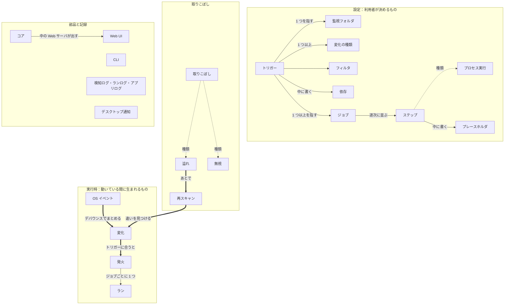

# 用語集

Foxonar で使う言葉の定義です。設計の議論と実装（型名・設定キー）は、ここで決めた言葉で行います。

> 英語版：[glossary.md](glossary.md)。この日本語版が正本で、食い違うときは日本語版に従う。
> 関連：[設計書](design.ja.md)（どうやるか、なぜそう決めたか）、[宿題一覧](todo.ja.md)（まだ決めていないこと）

## 使い方

- 定義した言葉は、定義した意味でだけ使う。
- 英語名は、コードの型名と設定ファイルのキーに使う。
- 「処理」は用語にしない。日常語として、一般的な意味で自由に使ってよい。
- 章は、言葉の種類で分ける（基本の言葉、設定、実行時、部品と記録）。
- 表は、上から小さい概念、下に行くほど大きい概念の順に並べる。
- 言葉の定義には、それより上で定義した言葉だけを使う。
- 表には、確定した言葉だけを載せる。新しい言葉を足したいときや、表の言葉を変えたいときは、[宿題一覧](todo.ja.md) に書いて話し、決まってから表に書く。
- 用語集には言葉の意味だけを書く。「どうやるか」と「なぜそう決めたか」は設計書に書く。

## 全体の地図

言葉どうしの関係を示す図です。定義ではないので、下の章で定義する言葉を先に使っています。図は上ほど大きい概念で、表とは向きが逆です。

- 実線（→）は「中に含む」か「指す」。ラベルで区別する（「指す」は ID で指す。「中に書く」は、その中に書くもの。「中の Web サーバが出す」は、コアの中の Web サーバが Web UI を出すこと）。
- 点線（⇢）は「その一種」。
- 太線（⇒）は「動いている間に、次のものが生まれる」。
- ワーカー、ロック、待ち表、書き込み完了待ち、通知などの「しくみ」の言葉は、図にならないので表だけに載せる。
- 部品と記録のつながり（コアが書くログ、CLI とコアのやりとりなど）は、[設計書](design.ja.md) の 2 章の図にある。
- この図は Mermaid で書いている。GitHub では図として表示される。

## 1. 基本の言葉

設定にも実行時にも使う言葉。

| 用語 | 英語名 | 定義 |
|---|---|---|
| 逐次 | sequential | 前のものが終わってから、次を始めること |
| 並行 | concurrent | 前のものの終わりを待たずに、同時に走らせること |

## 2. 設定

利用者が決めるもの（設定ファイルなどで）。

| 用語 | 英語名 | 定義 |
|---|---|---|
| 監視フォルダ | folder | Foxonar が見張るフォルダ。どの深さまで見るか（見る深さ。すぐ下のものを 1 段目と数える）と、見るものを絞る条件（監視フォルダの条件）も含む |
| フィルタ | filter | パスを、名前のパターンで絞り込む条件。パスのうち、名前だけに当てる |
| プレースホルダ | placeholder | 設定の中に書き、実行時に値に置き換わる名前（例：`${path}`）。Foxonar の設定の中でだけ意味を持つ。「変数」とは呼ばない |
| ステップ | step | コピー、移動、プログラムの起動など、やることを表す最小の単位 |
| プロセス実行 | exec | プログラムと引数の配列を指定して、プロセスを起動するステップ。シェルは通さない。プログラムは、フルパスでも、PATH から探す名前でも書け、パスの中に環境変数も書ける。`.bat` と `.cmd` はそのまま起動でき、`.ps1` は、プログラムに `powershell` か `pwsh` を指定して起動する |
| ジョブ | job | ステップを順番に並べたもの。中のステップは常に逐次に走る |
| 依存 | dependency | あるジョブを、ほかのジョブ（依存先）が成功してから始める、という順番の約束。依存先は複数書ける。依存先が 1 つでも成功しなかったら、そのジョブは始めない。組み込みの移動や削除のステップを持つジョブが、ほかのジョブと依存なしで並行になっていると、設定の読み込み時に警告する |
| トリガー | trigger | 「どの監視フォルダ（1 つ）の、どの深さまで（反応する深さ）の、ファイルとフォルダのどちら（反応する対象。両方も可）に、作成・変更・削除・名前変更・移動のどれ（複数選べる）が起き、どのフィルタに合ったら、どのジョブ（1 つ以上）を走らせるか」の組。1 つのジョブを、複数のトリガーから使い回せる。ジョブ同士の依存もトリガーに書く |

## 3. 実行時

動いている間に、Foxonar の中で生まれるもの。

| 用語 | 英語名 | 定義 |
|---|---|---|
| OS イベント | os event | 監視フォルダの中のファイルやフォルダが作られた、書き換えられた、などを知らせるために OS が返してくるもの 1 件（Linux の inotify、Windows の ReadDirectoryChangesExW が返すもの）。手を加える前のもの |
| 覚えている中身 | known state | 監視フォルダに何があるかについて、Foxonar が覚えている記録（パス、ファイルかフォルダか、など）。検知するたびに更新し、Foxonar を止めても残る |
| 見失う | lost | 監視フォルダそのものが、消えたり、名前が変わったり、つながらなくなったりして、見張れなくなること。中のファイルが消えたこととは区別する |
| デバウンス | debounce | 同じパスの OS イベント、フォルダを読み直して見つけた違い、覚えている中身から作ったものを、一定時間（デバウンス時間）待ってまとめること。名前変更と移動はまとめず、区切りにする。デバウンス時間を 0 にすると、まとめない |
| 変化 | change | Foxonar が検知した、1 つのパスの作成・変更・削除・名前変更・移動 1 件。移動は、同じ監視フォルダの中で、パスの入っているフォルダが変わること。名前と入っているフォルダの両方が変わったときは、名前変更でもあり移動でもある 1 件とする。OS イベント、フォルダを読み直して見つけた違い、覚えている中身から作ったもの（フォルダが消えたときの中のパスなど）を、デバウンスでまとめて生まれる |
| ラン | run | 1 つのジョブを、1 つの対象パスについて実行する 1 回分。プレースホルダは、ランごとに対象パスなどの値に置き換わる。名前変更・移動の変化では、変更後のパスを対象パスとし、変更前のパスは付随する情報として渡す。あるランが失敗しても、それに依存していないほかのランは止まらない |
| 中断 | interrupted | Foxonar の側の事情（Foxonar を止めた、Foxonar が落ちた）で、ランが最後まで走らなかったこと。Foxonar の外から止められたときは、中断ではなく失敗とする |
| ワーカー | worker | ランを実行する担い手。1 つのワーカーは一度に 1 つのランを実行する |
| 同時実行数 | concurrency | 同時に走っているランの数。利用者は、全部のジョブを合わせた「全体の上限」と、ジョブを定義するときに書く「ジョブごとの上限」を決められる。上限に達しているときだけ、ランは始まるのを待ち、空いたら走る。ジョブごとの上限は、同時に 2 つ動くと壊れるジョブのために使う |
| 発火 | firing | トリガーに合った変化から、そのトリガーのジョブを走らせること。ジョブごとのランをまとめたもの。発火の中のランは、依存を書かなければ並行に走る。同じパスで同時に動ける発火は 1 つだけ。同じパスに複数のトリガーが合ったときは、トリガーの定義順に、発火を 1 つずつ動かす |
| 書き込み完了待ち | settle | トリガーに合ったパスについて、発火する前に、そのパスのファイルへの書き込みが終わるのを待つこと。フォルダでは、中に新しい変化が来なくなり、中のファイルへの書き込みがすべて終わるのを待つ |
| 待ち表 | pending table | パスごとに 1 行を持つ表。トリガーに合ったパスを置き、書き込み完了待ちと、同じパスの発火が終わるのを待つ。待っている間に届いた同じパスの変化は、1 行にまとめる |
| ロック | lock | 「このパスは発火中」という、Foxonar の中だけの印。同じパスで発火を同時に動かさないために使う。OS のファイルロックとは別物 |
| 通知 | notice | Foxonar の中で起きたこと（ランの開始と終了など）の記録 1 件。Foxonar が流し、ログなどが購読する |

### 取りこぼし

処理されるべき変化が、処理されなかったときの言葉。

| 用語 | 英語名 | 定義 |
|---|---|---|
| 溢れ | overflow | OS か Foxonar のバッファがいっぱいになり、OS イベントを受け取れなかったこと。意図せず起きる。通知として流す |
| 無視 | ignore | 決まりに従って、変化から発火やランを作らない、または始めないこと（例：ランが起こした変化で、そのランのもとになったトリガーを発火させない。ランの直前に、対象パスにファイルが無かった。依存先が成功しなかった。待ち表で待っている間に、作成のあと削除された）。意図して行う。理由を添えて通知として流す |
| 取りこぼし | — | 処理されるべき変化が処理されないこと。原因によって、意図せず起きる溢れと、意図して行う無視に分ける |
| 再スキャン | rescan | フォルダを読み直して、覚えている中身と比べること。起動したとき、溢れのあと、フォルダが入ってきたときに行う。見つけた違いは変化として扱う |

## 4. 部品と記録

Foxonar を形づくる部品と、Foxonar が残す記録。

| 用語 | 英語名 | 定義 |
|---|---|---|
| 検知ログ | detection log | 検知した変化 1 件ごとの記録。トリガーに合わなかった変化も残す。溢れたこと、監視フォルダを見失ったこと・また現れたことも、1 行ずつ残す。1 件ごとに、重ならない番号（検知 ID）を付ける |
| ランログ | run log | ラン 1 回分ごとの記録。無視して走らなかったランも残す。1 回ごとに、重ならない番号（ラン ID）を付け、もとになった変化の検知 ID も書く |
| アプリログ | app log | Foxonar 自身の動き（起動、停止、設定の読み込み、エラーなど）の記録 |
| デスクトップ通知 | desktop notification | OS の通知（Windows のトースト通知など）。通知を購読するものの 1 つで、用語集の「通知」とは別物。何を知らせるかは利用者が選ぶ |
| CLI | cli | ターミナルから Foxonar を操作するコマンド |
| Web UI | web ui | ブラウザで開き、設定とログを見たり変えたりする画面 |
| コア | core | 監視フォルダを見張り、変化を検知して、発火とランを行う常駐のプログラム。画面を持たず、Web UI を閉じていても動き続ける。Web UI は、コアの中の Web サーバが出す |

## 5. 言い方の決まり

### 層ごとの名詞と動詞

同じ「イベント」でも、どの層の話かで名詞と動詞を変える。「検知する」は変化にだけ使い、OS イベントには「受け取る」を使う。

| 層 | 名詞 | 動詞 | 例 |
|---|---|---|---|
| OS | OS イベント | 受け取る | 「OS イベントを受け取る」 |
| Foxonar の中 | 変化 | 検知する | 「作成の変化を検知した」 |
| 外への発信 | 通知 | 流す | 「無視したことを通知として流す」 |
| OS の通知 | デスクトップ通知 | 出す | 「失敗したらデスクトップ通知を出す」 |

### 使わない言葉

| 使わない言葉 | 理由 | 代わりに使う言葉 |
|---|---|---|
| イベント（単独で） | OS イベント、変化、通知のどれを指すか分からない | OS イベント／変化／通知 |
| ルール | トリガーとジョブのどちらを指すか分からない | トリガー／ジョブ |
| 非同期（実行のしかたの意味で） | Rust の async の話でも使うので、ぶつかる | 並行 |
| ファイル（ランの対象として） | 削除や名前変更・移動では、対象のファイルが存在しない | パス |
| 履歴、処理履歴 | 「処理」は用語にしない。記録はすべて「ログ」と呼び、何の記録かで分ける | 検知ログ／ランログ／アプリログ |
| システムログ | OS のログ（Windows のイベントログ、Linux の journald）と紛れる | アプリログ |
| 変化 ID | ログの名前と揃える | 検知 ID |
