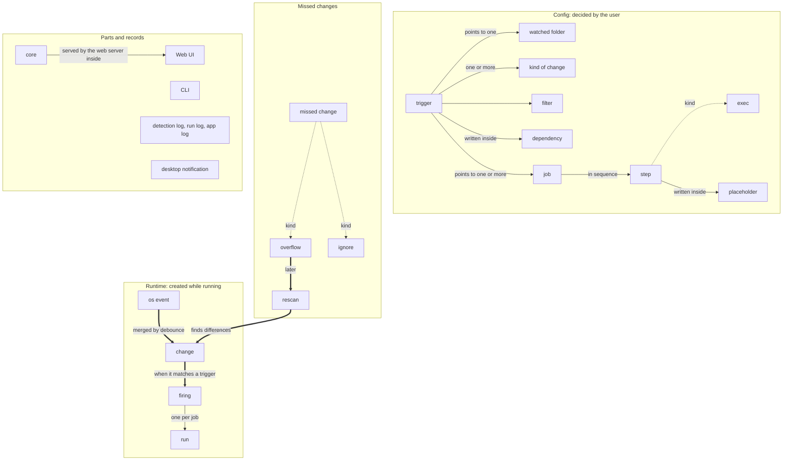

# Glossary

> **Note:** This is an English translation of [glossary.ja.md](glossary.ja.md).
> The Japanese version is authoritative. If the two disagree, follow the Japanese version.
> Last synced: 2026-10-22.
> Related: [design document](design.md) (how things are done, and why they were decided that way), [to-do list](todo.ja.md) (what is not decided yet; Japanese only)
>
> **Translation notes:** In English prose, 監視フォルダ is written "watched folder" (its English name in code and config is `folder`). For jobs, steps, and programs, the verb "run" is avoided so that it is not confused with the term "run"; "execute" or "start" is used instead. It is still used for Foxonar itself, as in "while the core is running".

Terms used in Foxonar. Design discussions and the implementation (type names and config keys) use the words defined here.

## How to use this glossary

- Use a defined term only in its defined meaning.
- The English names are used for type names in the code and for keys in the config file.
- "Processing" is not a term. Use it freely in its everyday sense.
- Sections are split by the type of term (basic words, config, runtime, parts and records).
- Each table is ordered from smaller concepts at the top to larger concepts at the bottom.
- A definition uses only terms defined above it.
- The tables list only decided terms. To add a new term or change a term in the tables, write it in the [to-do list](todo.ja.md) and discuss it first, then write it here once it is decided.
- This glossary holds only the meaning of terms. How things are done, and why they were decided that way, go in the design document.

## Overview map

This diagram shows how the terms relate. It is not a definition, so it uses terms that are defined in the sections below. In the diagram, larger concepts are at the top, which is the opposite of the tables.

- A solid arrow (→) means "contains" or "points to". The label tells which ("points to" means pointing by ID; "written inside" means something written inside it; "served by the web server inside" means that the web server inside the core serves the Web UI).
- A dotted arrow (⇢) means "a kind of it".
- A thick arrow (⇒) means "while running, this produces the next one".
- Mechanism terms such as worker, lock, pending table, settle, and notice do not fit in the diagram, so they appear only in the tables.
- How the parts and records connect (the logs the core writes, how the CLI talks to the core, and so on) is shown in the diagram in chapter 2 of the [design document](design.md).
- The diagram is written in Mermaid. GitHub renders it as a diagram.

## 1. Basic words

Words used for both config and runtime.

| English name | Japanese | Definition |
|---|---|---|
| sequential | 逐次 | Starting the next one only after the previous one has finished. |
| concurrent | 並行 | Executing at the same time, without waiting for the previous one to finish. |

## 2. Config

Decided by the user (in the config file, etc.).

| English name | Japanese | Definition |
|---|---|---|
| folder | 監視フォルダ | A folder that Foxonar watches (a watched folder). It also includes how deep to watch (the watch depth; the items directly inside count as level 1) and the conditions that narrow down what is watched (the folder conditions). |
| filter | フィルタ | A condition that narrows down paths by a name pattern. It is applied only to the name part of a path. |
| placeholder | プレースホルダ | A name written in the config that is replaced with a value at execution time (e.g. `${path}`). It has meaning only inside the Foxonar config. Do not call it a "variable". |
| step | ステップ | The smallest unit of what to do, such as copy, move, or starting a program. |
| exec | プロセス実行 | A step that starts a process from a program and an array of arguments. It does not go through a shell. The program can be written as a full path or as a name looked up in PATH, and the path can contain environment variables. `.bat` and `.cmd` files can be started directly; `.ps1` files are started by giving `powershell` or `pwsh` as the program. |
| job | ジョブ | An ordered list of steps. The steps in a job always execute sequentially. |
| dependency | 依存 | An ordering promise: start a job only after other jobs (its dependencies) have succeeded. A job can have more than one dependency. If even one dependency did not succeed, the job is not started. If a job that has a built-in move or delete step is concurrent with other jobs without a dependency, Foxonar warns when it loads the config. |
| trigger | トリガー | A set that says: "In which watched folder (one), down to which depth (the match depth), for files or folders (the match target; both is allowed), when which of create, modify, delete, rename, or move happens (more than one can be chosen), matching which filter, start which jobs (one or more)." One job can be reused by multiple triggers. Dependencies between jobs are also written in the trigger. |

## 3. Runtime

Created inside Foxonar while it runs.

| English name | Japanese | Definition |
|---|---|---|
| os event | OS イベント | One item that the OS returns to report that a file or folder in a watched folder was created, modified, and so on (what inotify on Linux or ReadDirectoryChangesExW on Windows returns). It is the raw form, before Foxonar touches it. |
| known state | 覚えている中身 | The record Foxonar keeps of what is in a watched folder (paths, whether each one is a file or a folder, and so on). It is updated each time something is detected, and remains after Foxonar stops. |
| lost | 見失う | The watched folder itself can no longer be watched because it was deleted, renamed, or disconnected. This is distinguished from files inside it disappearing. |
| debounce | デバウンス | Waiting a fixed time (the debounce time) and merging, for the same path, the os events, the differences found by reading the folder again, and the items created from the known state. Renames and moves are not merged; they act as boundaries. A debounce time of 0 means no merging. |
| change | 変化 | One create, modify, delete, rename, or move of one path, detected by Foxonar. A move means that the folder containing the path changes, within the same watched folder. When both the name and the containing folder change, it is one change that is both a rename and a move. It is produced by debounce from os events, differences found by reading the folder again, and items created from the known state (such as the paths inside a folder that disappeared). |
| run | ラン | One execution of one job for one target path. Placeholders are replaced with values, such as the target path, for each run. For a rename or move change, the new path is the target path, and the old path is passed along as extra information. If a run fails, other runs that do not depend on it keep going. |
| interrupted | 中断 | A run did not finish because of Foxonar's own circumstances (Foxonar was stopped, or Foxonar crashed). When the run is stopped from outside Foxonar, it is a failure, not an interruption. |
| worker | ワーカー | What executes runs. One worker executes one run at a time. |
| concurrency | 同時実行数 | The number of runs executing at the same time. The user can set a "global limit" for all jobs together, and a "per-job limit" written when defining a job. Only when a limit is reached does a run wait to start; it starts as soon as there is room. The per-job limit is for jobs that break when two of them execute at once. |
| firing | 発火 | Starting a trigger's jobs from a change that matched that trigger. It groups the runs, one per job. The runs in a firing execute concurrently unless dependencies are written. Only one firing can be active for the same path at a time. When multiple triggers match the same path, their firings are started one at a time, in the order the triggers are defined. |
| settle | 書き込み完了待ち | For a path that matched a trigger, waiting, before firing, until writing to the file at that path has finished. For a folder, waiting until no new changes arrive inside it and all writing to the files inside it has finished. |
| pending table | 待ち表 | A table with one row per path. Paths that matched a trigger are placed in it, and wait there for settle and for any firing on the same path to finish. Changes for the same path that arrive while waiting are merged into one row. |
| lock | ロック | A mark that exists only inside Foxonar, meaning "a firing is in progress on this path." It is used so that firings on the same path are not active at the same time. Not the same as an OS file lock. |
| notice | 通知 | One record of something that happened inside Foxonar (such as a run starting or finishing). Foxonar emits notices, and the logs and others subscribe to them. |

### Missed changes

Words for when a change that should have been handled was not.

| English name | Japanese | Definition |
|---|---|---|
| overflow | 溢れ | A buffer in the OS or in Foxonar filled up, and os events could not be received. Happens unintentionally. Emitted as a notice. |
| ignore | 無視 | Not creating, or not starting, a firing or a run from a change, as the design specifies (e.g. for a change that a run made, not firing the trigger that run came from; the target path had no file just before the run; a dependency did not succeed; while waiting in the pending table, the path was created and then deleted). Done intentionally. Emitted as a notice with the reason. |
| — | 取りこぼし | A change that should have been handled but was not. By cause, it is either an overflow (unintended) or an ignore (intended). Not used in code; in English prose, call it a "missed change". |
| rescan | 再スキャン | Reading a folder again and comparing it with the known state. Done at startup, after an overflow, and when a folder comes in. Differences found are treated as changes. |

## 4. Parts and records

The parts that make up Foxonar, and the records Foxonar keeps.

| English name | Japanese | Definition |
|---|---|---|
| detection log | 検知ログ | A record of each detected change. Changes that did not match any trigger are recorded too. Overflows, and the watched folder being lost or appearing again, are also recorded, one row each. Each row gets a unique number (the detection ID). |
| run log | ランログ | A record of each run. Runs that were ignored and not executed are recorded too. Each run gets a unique number (the run ID), and the detection ID of the change it came from is also written. |
| app log | アプリログ | A record of what Foxonar itself does (starting, stopping, loading the config, errors, and so on). |
| desktop notification | デスクトップ通知 | An OS notification (such as a toast notification on Windows). It is one of the subscribers of notices, and is a different thing from a "notice" in this glossary. The user chooses what it reports. |
| cli | CLI | The command for operating Foxonar from a terminal. |
| web ui | Web UI | The screen opened in a browser to view and change the config and the logs. |
| core | コア | The resident program that watches the watched folders, detects changes, and handles firings and runs. It has no screen, and keeps running even when the Web UI is closed. The Web UI is served by the web server inside the core. |

## 5. Wording rules

### Nouns and verbs by layer

Even for the same "event", use a different noun and verb depending on the layer. Use "detect" only for changes, and "receive" for os events.

| Layer | Noun | Verb | Example |
|---|---|---|---|
| OS | os event | receive | "receive an os event" |
| Inside Foxonar | change | detect | "detected a create change" |
| Outward | notice | emit | "emit the ignore as a notice" |
| OS notification | desktop notification | show | "show a desktop notification when a run fails" |

### Words to avoid

| Word to avoid | Why | Use instead |
|---|---|---|
| event (alone) | Unclear whether it means an os event, a change, or a notice | os event / change / notice |
| rule | Unclear whether it means a trigger or a job | trigger / job |
| async (meaning a way of executing) | Collides with Rust's `async` | concurrent |
| file (as the target of a run) | For a delete, rename, or move, the target file does not exist | path |
| history, processing history | "Processing" is not a term. Every record is called a "log", and logs are told apart by what they record | detection log / run log / app log |
| system log | Easily confused with the OS's logs (the Windows Event Log, journald on Linux) | app log |
| change ID | Match the name of the log | detection ID |
| process (meaning a step) | In Foxonar, "process" always means an OS process (see exec). English-only rule | step |
