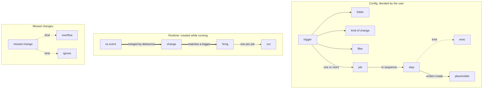

# Glossary

> **Note:** This is an English translation of [glossary.ja.md](glossary.ja.md).
> The Japanese version is authoritative. If the two disagree, follow the Japanese version.
> The design document ([design.ja.md](design.ja.md)), which also records the reasons for each decision, is in Japanese only for now.
> Last synced: 2026-10-18.

Terms used in Foxonar. Design discussions and the implementation (type names and config keys) use the words defined here.

## How to use this glossary

- Use a defined term only in its defined meaning.
- The English names are used for type names in the code and for keys in the config file.
- "Processing" is not a term. Use it freely in its everyday sense.
- Sections are split by the type of term (basic words, config, runtime).
- Each table is ordered from smaller concepts at the top to larger concepts at the bottom.
- A definition uses only terms defined above it.
- The tables list only decided terms. To add a new term or change a term in the tables, discuss it in the decision log first, and write it here once it is decided.
- This glossary holds only the meaning of terms. Why something was decided goes in the decision log, and how to do it goes in the design document.

## Overview map

This diagram shows how the terms relate. It is not a definition, so it uses terms that are defined in the sections below. In the diagram, larger concepts are at the top, which is the opposite of the tables.

- A solid arrow means "contains". Its label adds detail ("written inside" means something written inside it).
- A dotted arrow means "a kind of it".
- A thick arrow means "while running, this produces the next one".
- Mechanism terms such as worker, lock, pending table, and notice do not fit in the diagram, so they appear only in the tables.
- The diagram is written in Mermaid. GitHub renders it as a diagram.

## 1. Basic words

Words used for both config and runtime.

| English name | Japanese | Definition |
|---|---|---|
| sequential | 逐次 | Starting the next one only after the previous one has finished. |
| concurrent | 並行 | Running at the same time, without waiting for the previous one to finish. |

## 2. Config

Decided by the user (in the config file, etc.).

| English name | Japanese | Definition |
|---|---|---|
| folder | 監視フォルダ | A folder that Foxonar watches, including whether to watch its subfolders. |
| filter | フィルタ | A condition that narrows down paths by name or pattern. |
| placeholder | プレースホルダ | A name written in the config that is replaced with a value at execution time (e.g. `${path}`). It has meaning only inside the Foxonar config. Do not call it a "variable". |
| step | ステップ | The smallest unit of work, such as copy, move, or starting a program. |
| exec | プロセス実行 | A step that starts a process from a program and an array of arguments. It does not go through a shell. The program can be given as a full path or as a name looked up in PATH, and the path can contain environment variables. `.bat` and `.cmd` files can be started directly, and `.ps1` files by passing them to `powershell`. |
| job | ジョブ | An ordered list of steps. The steps in a job always execute sequentially. |
| dependency | 依存 | An ordering promise: start a job only after other jobs (its dependencies) have succeeded. A job can have more than one dependency. If any dependency fails, the job is not started. If a job with a move or delete step executes concurrently with other jobs without a dependency, Foxonar warns when it loads the config. |
| trigger | トリガー | A set that says: "In which watched folder, on which of file create, modify, delete, or rename, matching which filter, start which jobs (one or more)." One job can be reused by multiple triggers. Dependencies between jobs are also written in the trigger. |

## 3. Runtime

Created inside Foxonar while it runs.

| English name | Japanese | Definition |
|---|---|---|
| os event | OS イベント | One message from the OS saying that a file in a watched folder was created, modified, and so on (what inotify on Linux or ReadDirectoryChangesW on Windows returns). Foxonar receives it through the notify crate. It is the raw form, before Foxonar touches it. |
| debounce | デバウンス | Waiting a fixed time (the debounce time) and merging the OS events for the same path. |
| change | 変化 | One result of merging the OS events for the same path by debounce. Its kind is create, modify, delete, or rename. |
| run | ラン | One execution of one job for one target path. Placeholders are replaced with values, such as the target path, for each run. For a rename change, the target path is the new path, and the old path is passed along as extra information. If a run fails, other runs that do not depend on it keep going. |
| worker | ワーカー | What executes runs. One worker executes one run at a time. |
| concurrency | 同時実行数 | The number of runs executing at the same time. The user can set a global limit for all jobs together, and a per-job limit written when defining a job. Only when a limit is reached does a run wait to start; it runs as soon as there is room. The per-job limit is for jobs that break when two copies run at once. |
| settle | 書き込み完了待ち | Waiting, before a run starts, until writing to the file has finished. |
| firing | 発火 | One unit of execution that starts when one trigger matches one change. It groups the runs of that trigger's jobs (one run per job). The runs in a firing run concurrently unless dependencies are written. Only one firing can be active for the same path at a time. When multiple triggers match the same path, their firings run one at a time, in the order the triggers are defined. |
| pending table | 待ち表 | A table with one row per path. It holds paths being debounced and paths waiting for a firing. |
| lock | ロック | A mark inside Foxonar meaning "a firing is in progress on this path." Used to prevent two firings on the same path from being active at the same time. Not the same as an OS file lock. |
| notice | 通知 | One record of something that happened inside Foxonar (such as a run starting or finishing). Foxonar emits notices, and logging and other consumers subscribe to them. |

### Missed changes

Words for when a change that should have been handled was not.

| English name | Japanese | Definition |
|---|---|---|
| overflow | 溢れ | A buffer in the OS or in Foxonar filled up, and OS events could not be received. Happens unintentionally. Emitted as a notice. |
| ignore | 無視 | Deliberately not creating, or not starting, a firing or a run from a change, according to conditions Foxonar defines (e.g. a change arrived for a path that already has a firing in progress, the file was gone just before the run, or a dependency failed). Done intentionally. Emitted as a notice with the reason. |
| — | 取りこぼし | A change that should have been handled but was not. By cause, it is either an overflow (unintended) or an ignore (intended). Not used in code; in English prose, call it a "missed change". |
| rescan | 再スキャン | After an overflow, reading the folder again to check its actual state. |

## 4. Wording rules

### Nouns and verbs by layer

Even for the same "event", use a different noun and verb depending on the layer. Use "detect" only for changes, and "receive" for os events.

| Layer | Noun | Verb | Example |
|---|---|---|---|
| OS | os event | receive | "receive an os event" |
| Inside Foxonar | change | detect | "detected a create change" |
| Outward | notice | emit | "emit the ignore as a notice" |

### Words to avoid

| Word to avoid | Why | Use instead |
|---|---|---|
| event (alone) | Unclear whether it means an os event, a change, or a notice | os event / change / notice |
| rule | Unclear whether it means a trigger or a job | trigger / job |
| async (meaning a way of running) | Collides with Rust's `async` | concurrent |
| file (as the target of a run) | For delete and rename, the target file does not exist | path |
| process (meaning a step) | In Foxonar, "process" always means an OS process (see exec). English-only rule | step |
